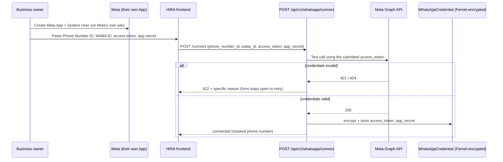
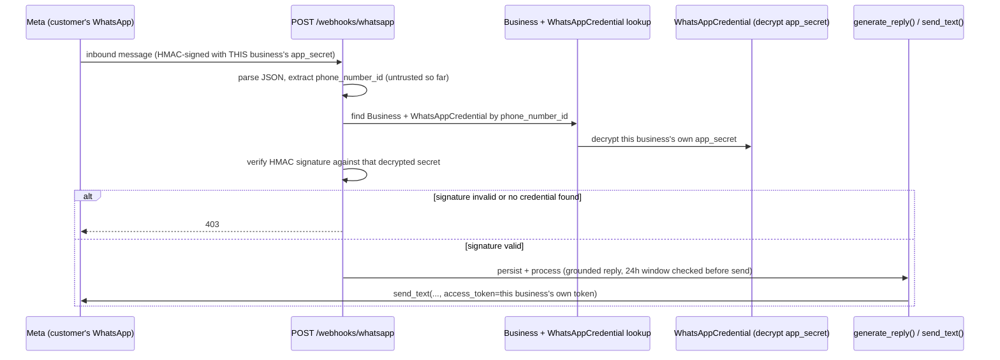

# DECISIONS.md

Permanent decision log for HIRA — architectural, product, and business decisions with lasting consequence. This is an append-only history.

**Rules:**
- Never delete a decision. History is never rewritten.
- If a decision changes, mark the old one **Superseded** (leave it intact, note which decision replaces it) and add a new decision that references the one it supersedes.
- Record only decisions with lasting consequence — not implementation trivia.
- Update this file whenever an important decision is made.
- Never invent reasoning or alternatives; if something wasn't actually considered, say so.

Each entry uses: Decision ID · Date · Category · Decision · Context · Alternatives Considered · Reasoning · Trade-offs · Status · Review Date.

---

## DEC-001 — Long-term vision is an AI Business Operating System

- **Date**: 2026-06-29
- **Category**: Business
- **Decision**: HIRA's long-term vision is to become an AI Business Operating System where businesses can "hire" AI employees across multiple business functions.
- **Context**: Setting the north star that gives all near-term work a direction, while keeping near-term scope narrow.
- **Alternatives Considered**: None formally recorded. The vision was stated as a founding premise.
- **Reasoning**: A large, expandable vision provides strategic direction and framing for fundraising/positioning, while still allowing a deliberately narrow first product.
- **Trade-offs**: A broad vision risks scope creep if not disciplined; mitigated by DEC-002 and DEC-003 which keep the first product narrow.
- **Status**: Accepted
- **Review Date**: Pending Validation

---

## DEC-002 — First product is an AI Receptionist

- **Date**: 2026-06-29
- **Category**: Product
- **Decision**: The first product is an AI Receptionist for WhatsApp-first businesses (responds to inquiries, answers FAQs from a knowledge base, books/reschedules appointments, escalates to humans, stores conversation history).
- **Context**: The AI Business Operating System (DEC-001) is too large to build at once. A focused first product is needed to enter the market.
- **Alternatives Considered**: Building broader "AI employee" functionality up front. Rejected in favor of focus.
- **Reasoning**: Receptionist is a concrete, high-frequency pain point with clear value (never miss a lead) and a measurable outcome (booked appointments). It is a wedge into the larger vision.
- **Trade-offs**: Narrow scope may undersell the larger vision to some stakeholders; accepted in exchange for a shippable, validatable product.
- **Status**: Accepted
- **Review Date**: Pending Validation

---

## DEC-003 — MVP-first philosophy

- **Date**: 2026-06-29
- **Category**: Product
- **Decision**: Build the smallest possible MVP. No feature ships ahead of demonstrated need.
- **Context**: Early-stage product with unvalidated assumptions; building too much too early wastes time and money.
- **Alternatives Considered**: Building a feature-rich product before launch. Rejected.
- **Reasoning**: A minimal product reaches real customers faster and exposes wrong assumptions cheaply. Aligns with CLAUDE.md development and startup philosophy.
- **Trade-offs**: A minimal product may feel incomplete to some early prospects; accepted in exchange for speed and learning.
- **Status**: Accepted
- **Review Date**: Pending Validation

---

## DEC-004 — Customer validation before scaling

- **Date**: 2026-06-29
- **Category**: Business
- **Decision**: Validate product-market fit with real customers before scaling features, verticals, or infrastructure.
- **Context**: Six candidate verticals and many possible features exist; resources are limited.
- **Alternatives Considered**: Scaling/expanding on assumption before validation. Rejected.
- **Reasoning**: Scaling an unvalidated product multiplies wasted effort. Validation de-risks the larger investments.
- **Trade-offs**: Slower apparent growth in the short term; accepted to avoid building the wrong thing at scale.
- **Status**: Accepted
- **Review Date**: Pending Validation

---

## DEC-005 — WhatsApp-first approach

- **Date**: 2026-06-29
- **Category**: Product
- **Decision**: HIRA is WhatsApp-first — the primary channel where the AI Receptionist meets customers is WhatsApp.
- **Context**: Target businesses' customers already communicate via WhatsApp; meeting them there lowers adoption friction.
- **Alternatives Considered**: Web chat widget, SMS, or multi-channel from the start. Not chosen for the first product (multi-channel remains a possible future direction, not a decision).
- **Reasoning**: Focusing on one high-adoption channel keeps the MVP small and matches where the target customers' demand already exists.
- **Trade-offs**: Dependency on WhatsApp Business API rules and pricing; single-channel coverage. The specific integration path (official WhatsApp Business API vs. a BSP/provider) is **not yet decided** — Pending Validation.
- **Status**: Accepted
- **Review Date**: Pending Validation

---

## DEC-006 — Research six candidate verticals; select one primary

- **Date**: 2026-06-29
- **Category**: Business
- **Decision**: Research six industries and select **one** primary vertical for the first production version. The six are: Dental Clinics, Beauty Salons, Immigration & Study Abroad Consultants, Gyms & Fitness Centers, Real Estate Agencies & Property Consultants, Cafés & Restaurants.
- **Context**: A focused go-to-market requires a single beachhead vertical rather than spreading thin.
- **Alternatives Considered**: Launching horizontally across all six at once. Rejected per DEC-003/DEC-004.
- **Reasoning**: Selection criteria are market demand, willingness to pay, ease of sales, and product-market fit. One vertical allows tailored prompts, messaging, and sales.
- **Trade-offs**: Narrowing may exclude a vertical that later proves strong; mitigated by keeping the core product vertical-agnostic so expansion is cheap.
- **Status**: Accepted — chosen vertical is **Pending Validation**.
- **Review Date**: When customer research concludes.

---

## DEC-007 — Git + GitHub from day one

- **Date**: 2026-06-29
- **Category**: Operations
- **Decision**: Use Git for version control and GitHub as the remote from the start of the project.
- **Context**: Establishing professional engineering practices early, before significant code exists.
- **Alternatives Considered**: Deferring version control until later, or using a different host (GitLab, Bitbucket). Not chosen.
- **Reasoning**: Version control from day one preserves history, enables review, and supports the documentation-first workflow.
- **Trade-offs**: Minor upfront setup overhead. **Note**: as of this entry the working directory is not yet a Git repository — initialization is pending and tracked in `TODOS.md`.
- **Status**: Accepted (implementation pending)
- **Review Date**: N/A

---

## DEC-008 — Claude project memory via the `.claude/` directory

- **Date**: 2026-06-29
- **Category**: Operations
- **Decision**: Maintain a persistent, file-based project memory system in `.claude/` (CLAUDE.md, PROJECT_CONTEXT.md, MEMORY.md, PROGRESS.md, TODOS.md, DECISIONS.md) that Claude reads and updates across sessions.
- **Context**: Cross-session continuity is needed so context and decisions aren't re-explained each session.
- **Alternatives Considered**: Relying on conversation context alone (lost between sessions) or external doc tools. Not chosen.
- **Reasoning**: A version-controlled, in-repo memory keeps the source of truth next to the code and survives session boundaries.
- **Trade-offs**: Requires discipline to keep files current; mitigated by explicit update rules in CLAUDE.md Section 12.
- **Status**: Accepted
- **Review Date**: N/A

---

## DEC-009 — Documentation-first development

- **Date**: 2026-06-29
- **Category**: Operations
- **Decision**: Establish structure and documentation before writing application code; keep documentation updated in the same session as the change that affects it.
- **Context**: The project began by building repository structure and documentation scaffolding ahead of any code.
- **Alternatives Considered**: Code-first, documenting later. Rejected — deferred docs tend to drift or never get written.
- **Reasoning**: Clear structure and intent reduce rework and make the codebase navigable as it grows. Aligns with CLAUDE.md documentation standards.
- **Trade-offs**: Slower start before the first line of code; accepted for long-term clarity and maintainability.
- **Status**: Accepted
- **Review Date**: N/A

---

> The decisions below (DEC-010 to DEC-015) are the MVP engineering plan. **Accepted 2026-06-29** by the founder after confirming beginner background, the two-language (Python + TypeScript) reality, backend-first development, and managed auth via Clerk. Full detail lives in `documentation/`.

## DEC-010 — WhatsApp integration: Meta Cloud API (direct)

- **Date**: 2026-06-29
- **Category**: Technical
- **Decision**: Use the Meta WhatsApp Cloud API directly for the MVP; optionally spike on the Twilio sandbox first. Revisit 360dialog at multi-tenant scale.
- **Context**: AI receptionist traffic is mostly inbound service replies inside the free 24h window (1,000 free service conversations/month); per-message markup matters little for MVP, more at scale.
- **Alternatives Considered**: Twilio (fastest setup, +$0.005/msg markup, lock-in); 360dialog (€49/mo flat, no markup, strong for multi-number provisioning later); other BSPs (more lock-in/less control).
- **Reasoning**: Best long-term cost and control, cheapest Indian rates, highest learning value (the real platform, not an abstraction). Loses only on setup speed — mitigated by an optional Twilio-sandbox spike.
- **Trade-offs**: Harder initial setup (Meta Business verification, embedded signup); HMAC/webhook plumbing is on us.
- **Status**: Accepted (2026-06-29)
- **Review Date**: At multi-tenant scaling (reconsider 360dialog). Full detail: `documentation/WHATSAPP_INTEGRATION.md`.

## DEC-011 — MVP technology stack

- **Date**: 2026-06-29
- **Category**: Technical
- **Decision**: Python + FastAPI backend; Anthropic Claude (Sonnet 4.6 reasoning, Haiku 4.5 classification); PostgreSQL + pgvector; Next.js + TypeScript + Tailwind frontend; Clerk auth; Railway (backend+DB) + Vercel (frontend); Google Calendar API.
- **Context**: Solo founder optimizing for learning, fast development, low cost, production readiness.
- **Alternatives Considered**: Node/NestJS backend (unifies language — recommended fallback if founder prefers all-TS); Supabase all-in-one (fewer vendors, more lock-in); dedicated vector DB (rejected, pgvector suffices).
- **Reasoning**: Python is AI-native; pgvector avoids a separate vector service; managed auth/hosting keeps a solo founder productive and secure.
- **Trade-offs**: Two languages (Python + TS). **Assumes founder is willing to learn Python/TS — founder background is Unknown; confirm before accepting.**
- **Status**: Accepted (2026-06-29)
- **Review Date**: Before Sprint 1 start. Full detail: `documentation/TECH_STACK.md`.

## DEC-012 — MVP system architecture

- **Date**: 2026-06-29
- **Category**: Architecture
- **Decision**: Webhook handler → async conversation orchestrator (intent → KB/tool/escalate) → Assisted-Mode approval gate → outbound send; Postgres system of record; dashboard via REST + Clerk JWT. Vertical-agnostic core.
- **Context**: Implements the Assisted-Mode MVP scope.
- **Alternatives Considered**: Synchronous webhook processing (rejected — must return 200 fast); monolith vs. services (monolith chosen — fewer moving parts for solo founder).
- **Reasoning**: Async processing protects against Meta retries; escalation-on-uncertainty and AI audit logging address AI failure modes; multi-tenant scoping enforced at the data layer.
- **Trade-offs**: Background processing adds some complexity vs. a pure request/response app; justified by webhook reliability needs.
- **Status**: Accepted (2026-06-29)
- **Review Date**: N/A. Full detail: `documentation/ARCHITECTURE.md`.

## DEC-013 — Database design

- **Date**: 2026-06-29
- **Category**: Architecture
- **Decision**: PostgreSQL schema: businesses, users, customers, conversations, messages, kb_entries (pgvector), appointments, escalations, calendar_credentials; tenant-scoped by business_id; Assisted/Autonomous modeled via flags, not schema changes.
- **Context**: Multi-tenant system of record for the MVP.
- **Alternatives Considered**: Separate vector store (rejected); per-tenant databases (rejected — overkill at MVP scale).
- **Reasoning**: Relational fit; additive expansion path to AI-OS (agents/roles) and multi-number without breaking changes.
- **Trade-offs**: Shared-schema multi-tenancy requires disciplined scoping (mitigated in DEC-012).
- **Status**: Accepted (2026-06-29)
- **Review Date**: N/A. Full detail: `documentation/DATABASE.md`.

## DEC-014 — REST API design

- **Date**: 2026-06-29
- **Category**: Architecture
- **Decision**: Versioned `/api/v1` REST API; Clerk JWT for dashboard, Meta signature for webhook; consistent data/error envelope; endpoints for conversations/inbox, approvals, escalations, appointments, KB, settings, users.
- **Context**: Contract between the Next.js dashboard and the backend.
- **Alternatives Considered**: GraphQL (rejected — unnecessary complexity for MVP); unversioned API (rejected — future breakage risk).
- **Reasoning**: REST is simple, well-understood, auto-documented by FastAPI; versioning protects clients.
- **Trade-offs**: Some over-fetching vs. GraphQL; acceptable at MVP scale.
- **Status**: Accepted (2026-06-29)
- **Review Date**: N/A. Full detail: `documentation/API.md`.

## DEC-015 — Frontend design

- **Date**: 2026-06-29
- **Category**: UX
- **Decision**: Next.js dashboard for business owner/staff: Dashboard, Inbox (core Assisted-Mode surface), Calendar, Knowledge Base, Settings; desktop-first; data via `/api/v1`.
- **Context**: Customers stay in WhatsApp; the business needs a control/approval surface.
- **Alternatives Considered**: No dashboard / config-by-message (rejected — no approval or review surface); native app (rejected — premature).
- **Reasoning**: The Inbox approval flow is essential to Assisted Mode; a web dashboard is the fastest learnable, production-ready option.
- **Trade-offs**: Building a UI adds scope vs. backend-only; required by Assisted Mode.
- **Status**: Accepted (2026-06-29)
- **Review Date**: N/A. Full detail: `documentation/FRONTEND.md`.

---

## DEC-016 — Three-stage feature workflow (Explain → Build → Review)

- **Date**: 2026-06-29
- **Category**: Operations
- **Decision**: Every feature is built in three mandatory stages — Stage 1 Explain (why, architecture fit, concepts, alternatives, beginner mistakes) before any code; Stage 2 Build (small focused commits, no unnecessary abstractions); Stage 3 Review (explain files/logic/decisions/extensions, update all docs + memory + progress, capture learnings, suggest commit message). Codified in `CLAUDE.md` §18.
- **Context**: The founder is a beginner learning professional software engineering while building HIRA; every session must optimize for both shipping and teaching.
- **Alternatives Considered**: Build-only (faster but no learning) and explain-only (learning without shipping). Both rejected — the founder's stated goal requires both simultaneously.
- **Reasoning**: Structured teaching around real implementation builds durable understanding ("understand every technology, not copy code") while still producing a shipped product and a portfolio.
- **Trade-offs**: Slower per-feature throughput due to explanation overhead; explicitly accepted as the point of the project.
- **Status**: **Superseded by DEC-017 (2026-06-29).** Founder moved to Execution Mode to ship faster; can switch back to Teacher Mode on request.
- **Review Date**: N/A

---

## DEC-017 — Switch to Execution Mode (supersedes DEC-016)

- **Date**: 2026-06-29
- **Category**: Operations
- **Decision**: Default working mode is **Execution Mode**: brief 2–5 min overview → implement immediately → explain only important architectural decisions while coding → end-of-task summary (what was built, why it matters, files changed, key concepts, bugs fixed). Skip quizzes/knowledge-checks/long lessons unless requested. Stop and warn before any important architectural mistake. Codified in CLAUDE.md §18.
- **Context**: Foundation tasks (S1-01–03) are done; founder now prioritizes building HIRA quickly while keeping high engineering quality. The teaching-heavy three-stage workflow (DEC-016) was too slow for that priority.
- **Alternatives Considered**: Keep DEC-016 teacher mode (too slow for shipping); drop explanations entirely (loses the learning goal). Execution Mode is the middle path.
- **Reasoning**: Founder can always ask "Why?" for depth; defaulting to lean delivery maximizes shipping speed without abandoning understanding of important parts.
- **Trade-offs**: Less proactive teaching; relies on the founder to pull deeper explanations when wanted.
- **Status**: Accepted
- **Review Date**: N/A

---

## DEC-018 — Autonomous Execution Mode

- **Date**: 2026-06-29
- **Category**: Operations
- **Decision**: Claude operates autonomously for routine engineering — no approval needed to create/edit/delete files, install dev deps, run tests/linters, create+apply migrations, commit, refactor, fix bugs, improve non-behavioral architecture, or update docs/memory/progress. Stop and ask only for: (1) business decision changes, (2) product feature changes, (3) a required paid service, (4) destructive operations risking data loss, (5) credentials/API-keys/billing, (6) legal/security/privacy decisions, (7) multiple valid architectures with significant trade-offs. Codified in CLAUDE.md §18.
- **Context**: Founder prioritizes momentum/shipping; per-task approval prompts were slowing routine work after the foundation is in place.
- **Alternatives Considered**: Keep per-task approval (slower); full autonomy with no stop-list (too risky for business/legal/cost). The seven-case stop-list is the balance.
- **Reasoning**: Reversible, low-risk work should just happen; irreversible or business/cost/legal/security-significant decisions still require the founder.
- **Trade-offs**: Less oversight on routine changes; mitigated by small commits + CI + the stop-list, all reversible via Git.
- **Status**: Accepted
- **Review Date**: N/A

---

## DEC-019 — Prioritize end-to-end AI receptionist over auth/dashboard

- **Date**: 2026-06-29
- **Category**: Product
- **Decision**: Build the core AI loop first — receive WhatsApp message → retrieve from knowledge base → generate response → send back to WhatsApp. Pause Clerk auth (S1-05) and dashboard work until that loop works end to end. Reorder Sprint 1 accordingly (S1-07, S1-08, S1-09 next).
- **Context**: Founder is obtaining an Anthropic API key and wants the product's differentiating capability proven before supporting infrastructure.
- **Alternatives Considered**: Continue strict S1 numeric order (auth before AI) — rejected; auth is supporting infrastructure, not the value proposition.
- **Reasoning**: The AI receptionist is the MVP's core value; proving it end to end de-risks the product fastest. Auth/dashboard can follow.
- **Trade-offs**: The AI loop will run without the dashboard approval UI initially; Assisted-Mode approval surfaces later. Acceptable for proving the loop.
- **Status**: Accepted
- **Review Date**: When the E2E AI loop works.

---

## DEC-020 — Local open-source embeddings (BAAI/bge-small-en-v1.5) behind an EmbeddingProvider abstraction

- **Date**: 2026-06-29
- **Category**: Architecture
- **Decision**: Knowledge-base embeddings are generated locally by `BAAI/bge-small-en-v1.5` (384 dims) via `fastembed` (ONNX, no PyTorch). All KB indexing/retrieval depend only on an `EmbeddingProvider` interface; provider is selected by config (`EMBEDDING_PROVIDER`, default `local_bge`). Anthropic/Claude handles reasoning only, not embeddings.
- **Context**: Founder priorities — low cost, learning, simplicity, privacy, flexibility; no second paid API during MVP.
- **Alternatives Considered**: Voyage AI / OpenAI embeddings (higher quality, but paid + another key/vendor — rejected for MVP); sentence-transformers (pulls heavy PyTorch — rejected; fastembed is lighter). bge-small chosen over larger bge variants for speed/footprint at acceptable quality.
- **Reasoning**: Local embeddings are free, private, no extra credential, and good enough for KB semantic search. The abstraction keeps a hosted provider a config + small class away.
- **Trade-offs**: Lower retrieval quality than top hosted models; CPU inference latency; model download on first use; schema dimension (384) is coupled to the model — changing to a different-dimension provider needs a migration.
- **Status**: Accepted
- **Review Date**: If retrieval quality proves insufficient in pilot.

---

## DEC-021 — Provider-agnostic LLM layer (LLMProvider; Claude + Mock)

- **Date**: 2026-06-29
- **Category**: Architecture
- **Decision**: All reasoning/response generation goes through an `LLMProvider` interface. `MockProvider` (default, no key) and `ClaudeProvider` (Anthropic) are implemented; provider selected by `LLM_PROVIDER` config. Business logic (orchestrator, prompts, processing) never imports a vendor SDK. Going live = add `ANTHROPIC_API_KEY` + set `LLM_PROVIDER=claude`.
- **Context**: Build the full AI loop before the API key arrives; keep vendor lock-in out; enable offline tests.
- **Alternatives Considered**: Call the Anthropic SDK directly from the orchestrator (vendor lock-in, untestable without a key — rejected).
- **Reasoning**: The abstraction lets the whole loop run/test with a mock today and swap to Claude (or OpenAI/Gemini/OpenRouter/local later) by config alone. Matches the EmbeddingProvider pattern (DEC-020).
- **Trade-offs**: A thin abstraction layer over the SDK; worth it for testability and flexibility. Provider-specific features (e.g. tool use) will need interface extension when needed.
- **Status**: Accepted
- **Review Date**: N/A. Detail: `documentation/LLM_ORCHESTRATION.md`.

---

## DEC-022 — Gemini is the default LLM provider (replacing Claude as default)

- **Date**: 2026-06-29
- **Category**: Technical
- **Decision**: Use Google **Gemini** (`gemini-2.0-flash` default) as the primary LLM provider, via the official **`google-genai`** SDK, implemented as `GeminiProvider` behind the existing `LLMProvider` interface. `LLM_PROVIDER=gemini`. ClaudeProvider and MockProvider remain available; switching is config-only.
- **Context**: Founder chose to replace Anthropic with Gemini for response generation.
- **Alternatives Considered**: Keep Claude default (DEC-021) — superseded by founder choice. Deprecated `google-generativeai` SDK — rejected for the current official `google-genai`.
- **Reasoning**: The provider-agnostic layer (DEC-021) made this a drop-in: one new class + factory entry + config, no orchestrator/business-logic change.
- **Trade-offs**: Gemini's API key project must have quota/billing enabled (observed `429 limit:0` on a project without quota). Embeddings remain local (DEC-020) — unaffected.
- **Status**: **Superseded by DEC-023 (2026-06-29)** — switched from Gemini to OpenRouter. GeminiProvider removed.
- **Review Date**: N/A.

---

## DEC-023 — OpenRouter is the default LLM provider (replaces Gemini)

- **Date**: 2026-06-29
- **Category**: Technical
- **Decision**: Use **OpenRouter** (OpenAI-compatible API) as the primary LLM provider via the official **`openai`** SDK with `base_url=https://openrouter.ai/api/v1`, implemented as `OpenRouterProvider` behind the existing `LLMProvider` interface. `LLM_PROVIDER=openrouter`, `OPENROUTER_MODEL` selects the model (any OpenRouter model id). GeminiProvider removed; ClaudeProvider + MockProvider intact.
- **Context**: Founder switched from Gemini to OpenRouter (one key, many models; avoids per-vendor billing setup).
- **Alternatives Considered**: Keep Gemini (DEC-022) — superseded by founder choice; Gemini key also had a quota-0 project.
- **Reasoning**: OpenRouter's OpenAI-compatible API + the provider abstraction made this a drop-in: one class + factory entry + config, no orchestrator/business-logic/prompt/retrieval change. One account fronts many models (incl. free tiers).
- **Trade-offs**: Adds OpenRouter as an intermediary (extra hop, their uptime/pricing). Embeddings remain local (DEC-020), unaffected.
- **Status**: **Superseded by DEC-024 (2026-06-29)** — switched to Groq after OpenRouter free-tier models proved unavailable/rate-limited. OpenRouterProvider removed.
- **Review Date**: N/A. Detail: `documentation/LLM_ORCHESTRATION.md`.

---

## DEC-024 — Groq is the default LLM provider (replaces OpenRouter)

- **Date**: 2026-06-29
- **Category**: Technical
- **Decision**: Use **Groq** (official `groq` SDK) as the primary LLM provider via `GroqProvider` behind the existing `LLMProvider` interface. `LLM_PROVIDER=groq`, `GROQ_MODEL` (default `llama-3.3-70b-versatile`). OpenRouterProvider + `openai` dep removed; Claude + Mock intact.
- **Context**: OpenRouter free-tier models were retired/unavailable or rate-limited (404/429) on the founder's account; Groq offers a fast free tier that worked on the first live call.
- **Alternatives Considered**: OpenRouter (DEC-023, superseded — free tier unreliable); Gemini (DEC-022, quota 0); Claude (available, needs Anthropic key/billing).
- **Reasoning**: The provider abstraction made this a drop-in (one class + factory + config); **live smoke test succeeded** (`llama-3.3-70b-versatile` answered correctly). No orchestrator/business-logic/prompt/retrieval change.
- **Trade-offs**: Groq model catalog is smaller (Llama/Mixtral/Gemma family); fine for the receptionist. Embeddings remain local (DEC-020).
- **Status**: Accepted — **live and verified.**
- **Review Date**: N/A. Detail: `documentation/LLM_ORCHESTRATION.md`.

---

## DEC-025 — Clerk JWT auth with JWKS verification; user→business_id resolution

- **Date**: 2026-06-29
- **Category**: Architecture
- **Decision**: Protect dashboard/API routes with Clerk. Verify RS256 session JWTs against Clerk's public **JWKS** (`CLERK_JWKS_URL`, optional issuer check) using PyJWT — no Clerk secret needed server-side. A `get_current_principal` dependency resolves the JWT `sub` (Clerk user id) to the local `User` row and returns a `Principal` carrying `business_id`; every protected route scopes by it. Cross-tenant access → `404`. First protected endpoints: `GET /api/v1/pending`, `POST /api/v1/messages/{id}/approve` (on top of `approve_and_send`).
- **Context**: Milestone 2. Existing multi-tenant architecture (DEC-013) and tenant helpers (DEC — tenant scoping) unchanged.
- **Alternatives Considered**: Verify via Clerk's API/secret key per request (network round-trip, slower — rejected; JWKS is the standard, stateless approach); hand-rolled auth (rejected — security risk for a beginner solo founder, per DEC-011).
- **Reasoning**: JWKS verification is stateless, fast, and the Clerk-recommended backend pattern. Token verification is injected as a dependency, so routes are testable without a live Clerk account (deterministic self-signed-JWT tests).
- **Trade-offs**: Requires `CLERK_JWKS_URL` configured to run live; a `User` row must exist per Clerk user (user provisioning/webhook is a later step).
- **Status**: Accepted (built & tested). Live use pending Clerk app credentials in `.env`.
- **Review Date**: N/A. Detail: `documentation/API.md`.

---

## DEC-026 — Next.js dashboard with mock-auth dev fallback (production-guarded)

- **Date**: 2026-07-01
- **Category**: UX
- **Decision**: Build the dashboard as specified (Next.js 15 App Router, TS, Tailwind v4, shadcn-style UI on Radix, TanStack Query, RHF/Zod, Lucide, Clerk). Auth uses real Clerk when `NEXT_PUBLIC_CLERK_PUBLISHABLE_KEY` is set, and a **dev-only mock** otherwise; in production without Clerk the app renders an "auth not configured" screen rather than bypassing auth. A shared `AuthContext` abstracts Clerk vs mock so pages/API never call Clerk hooks directly. Typed API client centralizes auth token, retries, and errors; TanStack Query handles caching/optimistic updates/background refresh. Dashboard layers on the existing backend — no backend changes.
- **Context**: Milestone 3. Backend exposes only `/api/v1/pending` and approve; other pages render polished placeholders until endpoints exist.
- **Alternatives Considered**: Next.js 16 (installed by create-next-app) — **rejected**, pinned to 15 per spec (16 had breaking changes vs known conventions); shadcn CLI — skipped in favor of hand-authored primitives (Tailwind v4 + Radix) to avoid the interactive/config churn; hard build-time throw when Clerk missing — rejected (broke CI builds); replaced with a runtime auth-misconfigured screen.
- **Reasoning**: Mock fallback keeps dev unblocked without Clerk keys while the production guard preserves "never bypass auth in production." The `AuthContext` seam keeps Clerk swappable and pages testable without a live account.
- **Trade-offs**: Placeholder pages for missing endpoints; Node 26 local vs Node 22 CI (Next 15 supports both). Pinning Next 15 over the newer 16 to stay on known-stable ground.
- **Status**: Accepted — builds, typechecks, lints, tests pass; frontend CI job added.
- **Review Date**: N/A. Detail: `frontend/README.md`, `documentation/FRONTEND.md`.

---

## DEC-027 — Autonomous-mode auto-send completes the WhatsApp loop

- **Date**: 2026-07-03
- **Category**: Product
- **Decision**: In the background reply processor (`app/ai/processing.py`), when `business.mode == "autonomous"` the generated reply is sent immediately via the WhatsApp Cloud API (`send_text`) and marked `sent`/`failed` — no human approval. Assisted Mode (default) is unchanged (stores `pending_approval` for dashboard approval). No global `PHONE_NUMBER_ID` env: the sender number id is per-business (`businesses.whatsapp_phone_number_id`, from webhook metadata).
- **Context**: The webhook (verify/receive/signature/dedupe) and `send_text` already existed, but the loop required a human approval click. The requested end-to-end flow has no human node.
- **Alternatives Considered**: A global auto-send flag (rejected — `businesses.mode` already models this per-tenant); a global PHONE_NUMBER_ID (rejected — breaks multi-tenancy).
- **Reasoning**: Acts on the already-modelled `businesses.mode`; additive, preserves assisted behavior; no AI/retrieval/schema change.
- **Trade-offs**: Autonomous businesses send unreviewed replies — acceptable and opt-in per business; escalation/guardrails remain future work.
- **Status**: Accepted — code complete & tested (50 backend tests). Live round-trip pending Meta credentials/number (see WHATSAPP_INTEGRATION.md).
- **Review Date**: N/A.

---

## DEC-028 — Provider-agnostic AppointmentService with a CalendarProvider interface

- **Date**: 2026-07-08
- **Category**: Architecture
- **Decision**: New `app/calendar/` package, structured like `app/ai/llm/` (an interface + registry layer consumed by a sibling orchestration class): `providers/base.py` defines the `CalendarProvider` ABC (`get_availability`, `create_event`, `update_event`, `cancel_event`), provider-agnostic domain dataclasses (`TimeSlot`, `CalendarEventDraft`, `CalendarEventUpdate`, `CalendarEvent`), and a `CalendarError` hierarchy (`CalendarAuthError`, `CalendarConflictError`, `CalendarNotFoundError`, `CalendarProviderUnavailableError`). `providers/mock.py` (`MockCalendarProvider`) is the only registered implementation so far. `providers/__init__.py` exposes `get_calendar_provider(name)` — deliberately **not** `@lru_cache`d (unlike `get_llm_provider`/`get_embedding_provider`), because a real provider will be constructed per-business with that business's own credentials; caching by name alone would leak one business's calendar client to another. `service.py` (`AppointmentService`) is a class (not a function module, unlike `replies.py`/`provisioning.py`) holding `db`/`business_id`/`provider`/`calendar_id` as constructor state, with `list_availability`/`book_appointment`/`reschedule_appointment`/`cancel_appointment` methods — all tenant-scoped via `get_scoped` (`app/db/tenant.py`), all reachable only through the `CalendarProvider` interface (it never imports a vendor module). The provider is **injected**, not resolved from stored credentials inside the service — credential resolution (decrypting a business's OAuth token, picking which vendor class to build) is deliberately deferred to a not-yet-built `app/calendar/credentials.py`, so `AppointmentService` stays fully testable against `MockCalendarProvider` with no database-backed credential lookup.
- **Context**: A calendar-integration audit (this session) found `Appointment`/`CalendarCredential` exist in the schema with **zero** application code referencing them, and confirmed no OAuth, no service layer, no tool-calling capability in the LLM providers, and no frontend. The founder asked for the internal architecture to be designed and built *before* any Google OAuth work, specifically to avoid baking Google-specific assumptions into the booking logic.
- **Alternatives Considered**: A `GoogleCalendarService` built directly against the Google Calendar API (rejected — the explicit ask was "no Google-specific logic inside AppointmentService," and the audit found `app/ai/llm/`'s provider-swap pattern already solves exactly this problem elsewhere in the codebase); function-module style for `AppointmentService` matching `replies.py`/`provisioning.py` (rejected — every method needs both a `Session` and a resolved `CalendarProvider`; a class avoids threading both through every call site, a legitimate exception to the module convention).
- **Reasoning**: Mirrors an already-proven pattern (`app/ai/llm/`) rather than inventing a new one; keeps `AppointmentService` provider-agnostic by construction (it structurally cannot import a vendor module, since none exists in its import graph); defers OAuth/encryption/routes/frontend — none of which were requested yet — without leaving the interface or service in a half-built state.
- **Trade-offs**: `CalendarCredential` has no `provider` column, so once a second real vendor is added, one small additive migration is needed for `credentials.py` to know which provider a stored credential belongs to (flagged, not yet done — doesn't block the current single-provider-per-business shape, since `business_id` is already unique on that table). No idempotency key on `Appointment` yet either — a retried `book_appointment` call could theoretically double-book; flagged as a future additive column, not fixed now (out of scope: schema changes weren't authorized for this task).
- **Status**: Accepted — code complete & tested (17 new tests, 142 backend tests total). No OAuth, routes, or frontend built — deliberately out of scope for this phase.
- **Review Date**: Revisit when Google OAuth (Phase 2) is scheduled — decide the `CalendarCredential.provider` migration then.

---

## DEC-029 — Conversations API: limit/offset pagination envelope; "pending" is a derived filter

- **Date**: 2026-07-08
- **Category**: Architecture
- **Decision**: `GET /api/v1/conversations` and `GET /api/v1/conversations/{id}/messages` introduce the app's first pagination convention: `limit`/`offset` query params, response shape `{"data": [...], "meta": {"total", "limit", "offset"}}` — additive to the existing `{"data": ...}` envelope every other endpoint uses (a new top-level `meta` key, not a breaking change to the shape). The `status` filter chip set is `open | pending | closed`; `open`/`closed` map directly to `Conversation.status` (`active`/`closed`), but **`pending` is a derived, cross-cutting filter** — "has at least one outbound message with `status == "pending_approval"`" — not a `Conversation.status` value. Omitting `status` returns everything, including `escalated` conversations, which have no dedicated filter chip. Message-thread pagination returns the most recent `limit` messages (respecting `offset` to page further back) but reverses them to oldest-first before responding, matching `app/ai/orchestrator.py`'s existing `_load_history` convention.
- **Context**: Building the Inbox (`GET /conversations`, `/{id}`, `/{id}/messages`) required a pagination shape and filter semantics that didn't exist anywhere in the codebase yet — every prior list endpoint (`/kb`, `/pending`) returns everything unpaginated. The frontend's three requested filter chips (Open/Pending/Closed) don't map 1:1 onto the three real `Conversation.status` values (`active/escalated/closed`) — "pending" doesn't exist as a conversation-level state at all; it's inherently a `Message`-level fact.
- **Alternatives Considered**: Cursor-based pagination (rejected — `limit`/`offset` is simpler, sufficient at this scale, and boring/well-understood per CLAUDE.md's technology philosophy; revisit only if conversation volume ever makes offset pagination's performance a real problem); adding a fourth "Escalated" filter chip to cover all three `Conversation.status` values (rejected — not requested, and escalated conversations remain visible under "All"); a `Conversation.status` value of `"pending"` (rejected — would require a schema/migration change and conflates a per-message fact with per-conversation state; the derived-filter approach needed no migration).
- **Reasoning**: Keeps this additive — no schema change, no migration, reuses `tenant_query`/`get_scoped` and the existing envelope convention with one backward-compatible extension (`meta`). The oldest-first-after-fetching-newest-first pattern for messages reuses an established convention instead of inventing a second one.
- **Trade-offs**: `escalated` conversations are invisible under every filter chip except "All" — a business owner filtering to "Open" won't see a conversation a human needs to look at *because* it's escalated. Acceptable for v1 (matches exactly what was asked — three chips, not four) but worth revisiting if/when the escalation-handling roadmap item (`ARCHITECTURE.md` §15 item 3) is built, since escalated conversations arguably deserve their own visibility, not just inclusion in an unfiltered view.
- **Status**: Accepted — code complete & tested (20 new backend tests, 162 total; 12 new frontend tests, 55 total).
- **Review Date**: Revisit the `escalated` visibility trade-off when human-handoff/escalation (§15 item 3) is built.

---

## DEC-030 — Pending Approvals V2: editable drafts, reject, regenerate, and manual escalation, all sharing one tenant-scoped action module

- **Date**: 2026-07-09
- **Category**: Architecture
- **Decision**: `POST /messages/{id}/approve` (existing) gained four siblings — `PATCH /messages/{id}/draft`, `POST /messages/{id}/reject`, `POST /messages/{id}/regenerate`, `POST /messages/{id}/escalate` — all added to `backend/app/services/replies.py` (renamed in scope from "approve and send" to every pending-draft action) behind a single shared `_get_pending_reply()` lookup (tenant-scoped via `get_scoped`, raises `ValueError` unless the message is this business's `outbound`/`pending_approval` row — including `approve_and_send` itself, refactored onto the same helper). Every route in `dashboard.py` maps that `ValueError` to `404`, identical to the pre-existing approve endpoint's "don't reveal whether it exists for another tenant" convention. `Message.status` gained two new string values, `rejected` and `escalated` (no migration — the column has no CHECK constraint, per the original "status fields are plain strings for MVP flexibility" design). `regenerate_draft()` calls the unmodified `orchestrator.generate_reply()` — the same function the WhatsApp webhook and the AI Playground already call — against the customer message that originally triggered the draft (found via `_last_inbound_before`, using `<=` rather than `<` because Postgres's `now()` is fixed for a transaction's duration, so a message and the reply generated for it in the same transaction can share a timestamp), and replaces only that message's `body`/`ai_meta` in place. `escalate_reply()` creates an `Escalation` row (the table has existed since the initial migration with zero application code referencing it until now) with `reason="other"` and marks the parent `Conversation.status = "escalated"` — a value the schema has modeled since the same initial migration but nothing had ever assigned. `GET /pending` gained two additive fields, `customer` (joined via the conversation) and `conversation_preview` (the most recent inbound message in that conversation), reusing the same `DISTINCT ON` "latest message per conversation" pattern DEC-029's `conversations.py` already established, rather than inventing a second way to compute a preview.
- **Context**: Sprint 27 turns the Pending Replies queue from a bare approve button into the intended AI-copilot loop (customer → AI drafts → human edits/approves/rejects/regenerates/escalates → reply sent). The four new actions and the `/pending` payload enrichment needed a lookup/validation pattern; the approve endpoint's existing tenant-scoping and 404-on-invalid-state convention already solved that problem.
- **Alternatives Considered**: A `409 Conflict` for "message already approved" instead of `404` — rejected, to stay consistent with the existing approve endpoint's deliberate choice not to distinguish "not found" from "not yours" from "no longer pending" (all three are equally uninformative to a caller who shouldn't be probing another tenant's data). A dedicated `escalation_reason` request body for `POST /messages/{id}/escalate` — rejected as unrequested scope; no UI was asked to collect a reason, so the endpoint takes no body and defaults to `"other"`, one of the four reasons the schema already models. Filtering `_last_inbound_before` with strict `<` — reverted after it failed in tests: within one uncommitted transaction, `now()` is fixed, so an inbound message and the outbound draft it triggered can share a timestamp; `<=` is safe here specifically because the query already filters `direction == "inbound"`, so it can never match the (outbound) draft itself.
- **Reasoning**: Every new endpoint reuses an already-proven pattern (tenant scoping via `get_scoped`, the approve endpoint's error-hiding convention, the orchestrator's unmodified reply pipeline, DEC-029's latest-message-per-conversation query shape) rather than introducing a second way to do any of these things. Adding string values to an already-unconstrained status column, and writing to two long-modeled-but-unused schema elements (`escalations`, `Conversation.status = "escalated"`), kept the whole sprint migration-free.
- **Trade-offs**: There is still no `GET /escalations` list or `POST /escalations/{id}/resolve` endpoint — `Escalation` rows are now created but not yet visible or actionable anywhere in the dashboard; an operator who escalates a conversation today has no in-app way to see the resulting queue (flagged in `ARCHITECTURE.md` §15 item 3, not built — out of scope for this sprint, which was about the Pending queue, not a new Escalations page). `regenerate_draft()`'s history load (`orchestrator._load_history`) still includes the very draft being replaced as a prior "assistant" turn, since regenerating doesn't delete or exclude it first — reusing the pipeline unmodified was preferred over adding history-filtering logic for a single caller.
- **Status**: Accepted — code complete & tested (33 new backend tests, 195 total; backend endpoints also smoke-tested live against the real dev database and a real Groq LLM call, then fully reverted; 20 new/updated frontend tests, 68 total). `ruff check`/`ruff format` (scoped to touched files only — 13 pre-existing files already failed `ruff format --check` on `main` before this sprint and were left untouched), ESLint, `tsc --noEmit`, and `next build` all clean.
- **Review Date**: When Escalations gets its own list/resolve endpoint and dashboard surface — revisit whether `reason="other"` should become an operator-chosen value at that point.

---

## DEC-031 — CRM foundation: `Lead` (one per customer per business) + append-only `LeadEvent` timeline, new migration

- **Date**: 2026-07-09
- **Category**: Architecture
- **Decision**: New migration adds two tables. `leads`: `id`, `business_id` (FK → `businesses.id`, `ON DELETE CASCADE`, indexed — required for `tenant_query`/`get_scoped`, which reject any model without a direct `business_id` column), `customer_id` (FK → `customers.id`, `ON DELETE CASCADE`), `stage` (`String(32)`, default `"new"`, **no CHECK constraint** — same "plain string, no DB-level enum" convention as `Message.status`/`Conversation.status`; validated instead at the API boundary via a Pydantic `Literal["new","contacted","qualified","proposal_sent","negotiation","won","lost"]`), `source` (`String(64)`, nullable, free text — not validated against a fixed set, unlike `stage`), `estimated_value` (`Numeric(12, 2)`, nullable), `notes` (`Text`, nullable), `next_follow_up_at` (`DateTime`, nullable), `assigned_to` (FK → `users.id`, `ON DELETE SET NULL`, nullable — same shape as `Escalation.resolved_by`), `created_at`/`updated_at`. `UNIQUE(business_id, customer_id)` — **one lead per customer per business for the MVP**; a repeat inquiry updates the existing lead rather than creating a second one. Composite index `ix_leads_business_stage (business_id, stage)` for pipeline-board-style "list leads in stage X" queries, mirroring `ix_conversations_business_status_last`.
  `lead_events`: `id`, `lead_id` (FK → `leads.id`, `ON DELETE CASCADE`, indexed), `type` (`String(32)` — `lead_created | stage_change | notes_updated | follow_up_set | assigned`), `from_value`/`to_value` (`Text`, nullable — `Text` rather than `String` because `notes_updated` events store full note content, not just short codes), `note` (`Text`, nullable, currently unused by any event type the app writes — reserved for a future caller-supplied annotation), `created_at`. **No `business_id` column** — this is the first tenant-owned-adjacent table without one; every query reaches it by joining through `Lead.business_id`, never via `tenant_query`/`get_scoped` directly (documented in `app/services/leads.py`). **Append-only**: application code only ever inserts `LeadEvent` rows; nothing updates or deletes one once written (`ON DELETE CASCADE` from the parent `Lead` is the only way a row disappears, when the whole lead is deleted).
  Events are logged only for `stage`, `notes`, `next_follow_up_at`, and `assigned_to` changes (each only when the new value actually differs from the old one) — not for `source` or `estimated_value`, which are treated as descriptive lead attributes rather than pipeline-progression activity. `PATCH /leads/{id}` distinguishes "field omitted" from "field explicitly set to null" via Pydantic's `model_fields_set` (not plain `is not None`), so `assigned_to`/`next_follow_up_at`/`notes`/`source`/`estimated_value` can all be explicitly cleared — a real gap the simpler "all-optional-fields-default-None" pattern used by `PATCH /kb/{id}` doesn't have to solve, since none of that endpoint's fields are nullable-and-clearable.
  The customer timeline (`GET /customers/{id}/timeline`) merges `Message` rows (via the customer's conversations) and `LeadEvent` rows (via the customer's lead) in Python — fetch the most recent `offset + limit` rows from each source ordered newest-first, merge, slice to the requested page — rather than a SQL `UNION ALL` across two structurally different row shapes. `meta.total` is the sum of two independent `COUNT(*)` queries.
- **Context**: Sprint 28 (CRM Foundation) explicitly required a `Lead` model — the only schema the codebase had for "customer relationship" state before this was `Conversation.status`. This is the first sprint since the founding schema (`DECISIONS.md` DEC-013) to add new tables rather than reuse or extend existing ones, so per the standing execution policy this was **stopped and escalated** rather than the schema being invented unilaterally; the founder specified the exact shape above (one Lead per customer, `LeadEvent` for history, which fields are event-worthy) before any code was written.
- **Alternatives Considered**: Multiple leads per customer over time (rejected by the founder — MVP scope is one lead per customer, updated in place); a `Conversation.status`-style single mutable field with no history table (rejected — the sprint explicitly asked for a customer timeline aggregating "CRM events," which requires an append-only log, not just current state); a SQL `UNION ALL` for the timeline query (considered for single-round-trip efficiency, but `Message` and `LeadEvent` don't share a natural column signature — reconciling nullable placeholder columns and type-casting untyped `NULL`s across the two `SELECT`s added real complexity for a merge that, at MVP data volumes, a two-query-then-Python-merge handles correctly and far more simply, consistent with "boring solution over clever" per `CLAUDE.md` §2); giving `LeadEvent` its own `business_id` (rejected by the founder's explicit field list — enforced instead by always joining through `Lead`).
- **Reasoning**: The one-lead-per-customer constraint keeps the MVP model simple and matches how `Customer` itself is already unique per `(business_id, wa_phone)`. Keeping `stage` an unconstrained string (validated only at the API layer) matches every other status field in the schema and avoids a second migration if a stage is ever added/renamed. The append-only `LeadEvent` table is the smallest structure that satisfies "customer timeline aggregates CRM events" without mutating history in place — mirroring how `Message` rows are themselves never edited after creation (edits go through separate app-level actions, not row mutation of the historical record) once sent/rejected/escalated.
- **Trade-offs**: One lead per customer means there's no way to represent "this customer had two separate sales cycles" without deleting and recreating the lead (losing its `LeadEvent` history via cascade) — acceptable for MVP per the founder's explicit choice, revisit if repeat-business tracking becomes a real need. The Python-merge timeline re-fetches up to `offset + limit` rows from both sources on every page request rather than a single indexed query — fine at MVP data volumes (mirrors the existing `_load_history`/conversation-message-thread pattern's own "fetch more, process in memory" style), but would need revisiting (most likely the `UNION ALL` approach that was rejected above) if a single customer's timeline ever grows into the thousands of rows. `LeadEvent.note` is reserved but currently written by nothing — a small amount of speculative schema, kept because it's a free column on an already-being-created table, not a separate migration.
- **Status**: Accepted — schema, service layer, API, and frontend implemented and tested this session (see `.claude/PROGRESS.md` for test counts).
- **Review Date**: Revisit one-lead-per-customer and the Python-merge timeline if/when multi-cycle lead tracking or timeline scale becomes a real requirement.

---

## DEC-032 — Google Calendar integration: official OAuth libraries, Fernet-encrypted tokens, JSONB working hours, approval-gated booking tool calls

- **Date**: 2026-07-10
- **Category**: Architecture
- **Decision**: Four founder decisions unblock Sprint 29 (Google Calendar Integration), each escalated per the standing execution policy since DEC-028 explicitly left OAuth, encryption, and tool-calling unbuilt:
  1. **OAuth**: use the official Google-maintained libraries — `google-auth`, `google-auth-oauthlib`, `google-api-python-client` — rather than hand-rolling token exchange/refresh against `httpx`. New dependencies. `GOOGLE_CLIENT_ID`/`GOOGLE_CLIENT_SECRET`/`GOOGLE_OAUTH_REDIRECT_URI` are new, empty-by-default settings (same pattern as `anthropic_api_key`); connecting a real business's calendar additionally requires the founder to create a Google Cloud project and OAuth client (a credential/billing decision, independent of this architectural choice).
  2. **Encryption**: `cryptography`'s `Fernet` (symmetric, authenticated) encrypts `calendar_credentials.refresh_token_encrypted` at rest. New dependency, new `CALENDAR_ENCRYPTION_KEY` env var (empty-by-default setting; calendar-connect code raises a clear, actionable error if a real connection is attempted without it set — mirrors how an unset `CLERK_JWKS_URL` fails loudly rather than silently). The same key material also HMAC-signs the OAuth `state` parameter (CSRF/replay protection on the callback) — one key, two independent uses, rather than adding a second secret for a purpose this MVP doesn't need split out.
  3. **Working hours**: additive `working_hours` JSONB column on `businesses` (nullable; `NULL` means "no restriction configured yet" — availability filtering skips the working-hours step rather than blocking all bookings for a business that hasn't configured hours). Shape: `{"mon": {"open": "09:00", "close": "17:00"}, ..., "sun": null}` (a day's value is `null` for "closed"). Chosen over a normalized `business_hours` table — matches the existing "flexible JSONB for MVP" convention (`messages.ai_meta`), and one schedule per business needs no join-friendly structure.
  4. **Tool-call approval gate**: a booking/reschedule/cancel action proposed by the AI is held for human approval in Assisted Mode — nothing touches the real calendar until approved — reusing the existing Pending Approvals mechanism exactly (DEC-030) rather than inventing a parallel one. In Autonomous Mode it executes immediately, mirroring how autonomous text-sending already works (DEC-027).
- **Context**: Sprint 29 asked for OAuth, encrypted credential storage, working hours, and AI tool-calling — DEC-028 (the calendar architecture's prior decision) explicitly listed all four as deliberately deferred, undocumented gaps. Per this sprint's own stop condition, no code was written until the founder chose among presented options for each.
- **Concrete implementation shape decided alongside the above** (not separately escalated — these are ordinary engineering choices within the four decisions, not new architectural forks):
  - **Tool-call representation reuses `Message`, not a new table.** A proposed AI action is an outbound `Message` with `status="pending_approval"` (unchanged), `type="tool_call"` (a new value on the already-unconstrained `type` string column — no migration), and `ai_meta` (existing JSONB) carrying `{"tool_name", "tool_arguments", ...}` alongside the existing `model`/`prompt_version`/`retrieved_count` keys. `body` is a human-readable, **editable** preview/confirmation string (e.g. "Book Tue Aug 5, 2–3pm for a dental cleaning") — `update_draft`/`reject_reply`/`regenerate_draft` (DEC-030) work on it completely unchanged. Only `approve_and_send` (`app/services/replies.py`) branches on `message.type == "tool_call"`: it executes the tool via `AppointmentService` *before* sending the (possibly-edited) `body` over WhatsApp, and marks the message `failed` (not a new status) if the tool call itself fails (e.g. `CalendarConflictError` because the slot was taken in the meantime) — identical to how a `WhatsAppSendError` already produces `failed`.
  - **`CalendarProvider` gains a real implementation, no interface change.** `GoogleCalendarProvider` (`app/calendar/providers/google.py`) implements the existing `CalendarProvider` ABC from DEC-028 unchanged — `get_availability`/`create_event`/`update_event`/`cancel_event` map onto the Google Calendar API's `freebusy`/`events` endpoints, wrapping `googleapiclient.errors.HttpError` into the existing `CalendarAuthError`/`CalendarConflictError`/`CalendarNotFoundError`/`CalendarProviderUnavailableError` hierarchy. `create_event` explicitly checks `freebusy` before inserting (Google's API does not reject overlapping events on its own), so the "no `Appointment` row on `CalendarConflictError`" guarantee `AppointmentService`/its tests already rely on holds for the real provider too, not just `MockCalendarProvider`. No `calendar_credentials.provider` column is added — DEC-028 flagged that column as needed only "once a second **real** vendor is added"; `MockCalendarProvider` is a test double, so Google remains the first and only real vendor and that migration stays deferred, unchanged from DEC-028's own reasoning.
  - **Working-hours filtering lives in `AppointmentService`, not the provider.** `GoogleCalendarProvider.get_availability` returns raw calendar free/busy; a new pure function (`app/calendar/working_hours.py`) intersects that with the business's `working_hours` + `timezone` (already on `Business`, no migration needed — DEC-013's original schema already included it). This keeps `CalendarProvider` vendor-only and reuses one filtering implementation for both the dashboard's availability view and the AI's `check_availability` tool.
  - **LLM tool-calling extends `LLMProvider.generate()` additively** (`tools: list[ToolSchema] | None = None` parameter; `LLMResponse.tool_calls: list[ToolCall] | None` field) — implemented for `GroqProvider` (OpenAI-compatible `tools`/`tool_calls`) and `ClaudeProvider` (Anthropic's native tool use); `MockProvider` gains an injectable `fixed_tool_calls` for deterministic tests, mirroring its existing `fixed_reply`. Tool schemas (`check_availability`/`book_appointment`/`reschedule_appointment`/`cancel_appointment`) and the dispatcher that turns a `ToolCall` into an `AppointmentService` call live in a new `app/ai/tools.py` — the orchestrator/processing layer calls this dispatcher, never a vendor SDK directly, matching how `app/ai/llm/` already isolates vendor specifics.
- **Alternatives Considered**: Hand-rolled OAuth via `httpx` (rejected by the founder — more code and security surface for a well-solved problem); a non-`cryptography` encryption approach (founder confirmed Fernet); a normalized `business_hours` table (founder confirmed JSONB); always executing a booking tool call immediately regardless of mode (founder confirmed approval-gating in Assisted Mode — a wrong calendar write is harder to undo than a wrong queued text, so the existing, proven Pending Approvals path was reused rather than accepting that asymmetric risk). A `calendar_credentials.provider` column now, ahead of need (rejected — no second real vendor exists yet; adding it would be schema speculation DEC-028 already explicitly deferred).
- **Reasoning**: Every concrete implementation choice above reuses an already-accepted pattern (the `Message`/pending-approval mechanism, the `CalendarProvider` interface, `Business.timezone`, the `LLMProvider` abstraction) rather than introducing a parallel one, keeping this the second-largest schema/behavior change in the project (after DEC-031) additive and reversible.
- **Trade-offs**: Reusing `Message` for tool calls means a tool-call "reply" and a text reply share one status/type space — acceptable since `type` and `ai_meta` already existed for exactly this kind of extensibility, but a future third action-kind (e.g. an escalation-triggering tool) would need to extend the same convention, not invent a fourth. `GoogleCalendarProvider`'s pre-insert `freebusy` check adds one extra Google API round-trip per booking to close a race the mock provider didn't have to worry about — acceptable latency cost for correctness. Live verification against Google's real API requires a real Google Cloud OAuth Client ID/Secret from the founder (a credential the sprint's own stop-list already covers); everything else is verified against injected fakes.
- **Status**: Accepted — code complete & tested (104 new backend tests, 379 total; 18 new frontend tests, 98 total). Live-verified against the real Google API surface where possible (see `.claude/PROGRESS.md` Session 29 for three real bugs this caught and fixed: a `google.auth.exceptions.RefreshError` that wasn't wrapped into `CalendarAuthError`, a blank Playground reply when the model proposed a tool call, and a stray repeated `check_availability` call being treated as an approvable pending action). Live OAuth consent-screen verification is gated on the founder supplying a real Google Cloud OAuth Client ID/Secret.
- **Review Date**: Revisit the `calendar_credentials.provider` migration when a second real vendor (Outlook/CalDAV) is actually added.

---

## DEC-033 — CRM AI tool registration: reuse DEC-031's schema unchanged, approval-gated like calendar tools

- **Date**: 2026-07-10
- **Category**: Architecture
- **Decision**: Sprint 30 was requested as a full "CRM Foundation" (migration, `Lead`/`LeadEvent` models, CRUD API, stage transitions, timeline aggregation, tests, docs) — but that is Sprint 28 (DEC-031), already shipped and pushed (`4f0854b`), and already re-confirmed as "keep as-is" once this session when a near-identical restart request came in. Rebuilding it would be pure duplication against a live schema. This was flagged to the founder before any code was written; the founder confirmed scoping Sprint 30 down to the one deliverable from that list which is genuinely missing: **AI tool registration for CRM actions** — `app/ai/tools.py` (DEC-032) only registers calendar tools; nothing lets the AI touch a lead during a conversation.
  Two decisions were escalated and resolved before implementation:
  1. **Scope**: build only AI tool registration (`create_lead`, `update_lead_stage`, `set_lead_follow_up`) against the existing `Lead`/`LeadEvent` schema and `app/services/leads.py` service layer — no new migration, no new REST endpoints (the founder's own prior "keep DEC-031 as-is" call already covers CRUD/stage-transition/timeline; the generic `PATCH /leads/{id}` already logs a `stage_change` `LeadEvent` when `stage` differs, which is what a dedicated "stage transition API" would otherwise duplicate).
  2. **Approval gating**: AI-proposed CRM actions are gated behind the exact same Pending Approvals mechanism as calendar tools (DEC-032/DEC-030) — held for human review in Assisted Mode, executed immediately only in Autonomous Mode. Considered and rejected: auto-executing immediately regardless of mode (CRM writes are lower-stakes/more reversible than a calendar write, but a misjudged AI stage change can still quietly corrupt pipeline data the business owner relies on for reporting — consistency with the calendar precedent won out over the friction savings); a split gate (auto-execute `create_lead`, gate stage/follow-up changes) — rejected as unnecessary configurability for three tools that all write to the same table via the same service functions.
- **Concrete implementation shape** (ordinary engineering choices within the two decisions above, not separately escalated):
  - New `app/ai/lead_tools.py`, mirroring `app/ai/tools.py`'s shape for calendar tools but kept in its own module — CRM and calendar are different domains even though both plug into the same `Message`/`ToolCall`/pending-approval plumbing. Exposes `LEAD_TOOL_SCHEMAS`, `LEAD_TOOL_NAMES`, `preview_lead_tool_call`, `execute_lead_tool_call` — all built directly on `app/services/leads.py` (`create_lead`/`update_lead`), never a new data-access path.
  - `ToolExecutionResult` (previously calendar-only, defined in `app/ai/tools.py`) moves to a new `app/ai/tool_results.py` so both `tools.py` and `lead_tools.py` can depend on it without a circular import; gains an additive `lead_id` field alongside the existing `appointment_id`.
  - `app/ai/tools.py` becomes the single combined dispatcher: `TOOL_SCHEMAS` concatenates calendar + lead schemas, and `preview_tool_call`/`execute_tool_call` delegate to the lead-specific functions when `tool_call.name` is a lead tool. No change to `orchestrator.py`/`processing.py`/`services/replies.py` — they already call `execute_tool_call`/`response_to_message_fields` generically and don't know or care which domain a tool call belongs to, exactly like `CHECK_AVAILABILITY` already proved out for calendar.
  - `create_lead` fails gracefully (not an error surfaced to the customer) if a lead already exists for that customer (`LeadAlreadyExistsError`) — matches the one-lead-per-customer constraint from DEC-031. `update_lead_stage`/`set_lead_follow_up` fail gracefully if no lead exists yet for that customer, since there's nothing to update.
  - System prompt (`app/ai/prompts.py`) gains CRM tool-usage guidance alongside the existing booking guidance; `SYSTEM_PROMPT_VERSION` bumped to `v3`.
- **Context**: Sprint 30's own instructions included the same stop condition as Sprint 29 ("if a new undocumented architectural decision is required, stop immediately") — both the duplication-vs-DEC-031 conflict and the approval-gating question were surfaced and resolved with the founder before any code was written.
- **Alternatives Considered**: Rebuilding the full CRM Foundation from scratch as instructed literally (rejected — duplicates a live, tested, shipped schema for no product benefit and risks regressing DEC-031); a dedicated `POST /leads/{id}/stage` endpoint (rejected — the existing generic `PATCH` already does this exact thing via `_EVENT_FIELDS`, per the founder's own prior "keep DEC-031 as-is"); auto-execute / split-gate approval models (rejected, see Decision above); putting lead tools in `app/ai/tools.py` directly rather than a new module (rejected — would conflate two unrelated domains in one file, against `CLAUDE.md` §4's "if a file is doing two unrelated things, split it").
- **Reasoning**: Every piece reuses an already-accepted pattern (the `Lead`/`LeadEvent` schema and service layer from DEC-031, the `Message` pending-approval mechanism and `ToolSchema`/`ToolCall` plumbing from DEC-032) rather than introducing a parallel one. Flagging the duplication before writing any code, rather than silently either redoing or skipping the literal instructions, matches how the same conflict was already handled once this session for Sprint 28's near-identical restart request.
- **Trade-offs**: `ToolExecutionResult` now carries two mutually-exclusive optional id fields (`appointment_id`, `lead_id`) rather than a single polymorphic one — slightly redundant, but avoids a generic `entity_id: uuid.UUID | None` whose meaning would depend on `tool_name`, which is worse for readability at this scale (four calendar tools, three CRM tools). CRM actions proposed by the AI now sit in the same Pending queue as calendar actions with no visual distinction beyond the preview text — acceptable for MVP; revisit if the queue becomes busy enough that staff want to filter by action type.
- **Status**: Accepted — implementation in progress this session (see `.claude/PROGRESS.md`).
- **Review Date**: Revisit split approval-gating if staff feedback shows CRM-tool approvals are pure friction with no observed error-catching value.

---

## DEC-034 — AI Memory & Context Engine: persisted rolling conversation summary, unified Context Builder

- **Date**: 2026-07-10
- **Category**: Architecture
- **Decision**: Sprint 31 asks for a Context Builder that assembles all relevant information (business, customer, lead, appointments, knowledge base, conversation history/summary) before every LLM call. One piece has nowhere to live in the current schema: a conversation's "memory" once it grows past the 20-message raw history window (`HISTORY_LIMIT`) already fed to the LLM. This was escalated before any code was written, since it's a schema change with an ongoing LLM-cost trade-off, not just an implementation detail.
  Founder-confirmed approach: **persist a rolling summary on `Conversation`**. New additive migration: `conversations.summary` (`Text`, nullable), `conversations.summary_message_count` (`Integer`, nullable — a watermark: how many of the conversation's oldest messages are already covered by `summary`). Regenerated by a new Memory service (`app/ai/memory.py`) only when the raw window's boundary has advanced past what's already summarized (roughly every `HISTORY_LIMIT` new messages, not every turn) — bounded LLM cost, and the summary survives across turns/restarts unlike an on-the-fly recompute.
- **Context**: `ARCHITECTURE.md`'s own "Future improvements" note (added Sprint 29) already flagged this exact gap ("today 'memory' is a rolling window of the last 20 raw messages; there is no summarization... worth revisiting once conversations regularly exceed that window in practice") — Sprint 31 is that revisit, made explicit rather than left implicit.
- **Alternatives Considered**: Recompute a summary on-the-fly every turn with no persistence (rejected — cost/latency grows unbounded as a conversation lengthens, since the entire older prefix would be re-summarized on every single reply once a conversation passes the window, not just when the window boundary actually advances); skip LLM summarization for this sprint and just widen `HISTORY_LIMIT` (rejected — a stopgap that still hard-caps memory at whatever the new limit is and doesn't scale, whereas the sprint explicitly asks for real "memory" support); storing the summary as a special `Message` row (rejected — a conversation summary is meta-information about the thread, not a message in it; reusing `Message` would need filtering everywhere `Message` rows are listed/counted/displayed — e.g. the Inbox thread view, `HISTORY_LIMIT` counting itself — a dedicated `Conversation` column avoids that entirely); a separate cheaper/smaller model tier just for summarization (rejected — reuses the existing `get_llm_provider()` default; introducing model-tier selection is unrequested speculative config for an MVP with no evidence summarization cost is a real problem yet).
- **Concrete implementation shape** (ordinary engineering choices within the escalated decision above, not separately escalated):
  - **New `app/ai/context.py` (Context Builder)**: `ConversationContext` dataclass (`business`, `customer`, `lead`, `upcoming_appointments`, `retrieved_kb`, `summary`, `history`) + `build_context(db, conversation, user_text, *, llm=None, embedding=None, k=RETRIEVAL_K)`, the single place all of this is assembled. Moves `_load_history` here (made public as `load_history`) out of `orchestrator.py`.
  - **New `app/ai/memory.py` (Memory service)**: `get_conversation_summary(db, conversation, *, llm=None) -> str | None` — the one function owning the regenerate-or-reuse decision described above. On regeneration it summarizes the *entire* older prefix in one call (not incrementally on top of the prior summary) — simpler and avoids compounding summarization drift across many regenerations. A summarization failure (`LLMError`) is caught and logged; the previous stored summary (possibly `None`) is returned unchanged rather than blocking the main reply — matches the existing principle that AI-adjacent conveniences degrade gracefully rather than breaking the core reply path.
  - **Deduplication, per this sprint's "reuse existing services, avoid duplicated logic" requirement**: `app/ai/tools.py::_find_upcoming_appointment` (a private, single-result query) is replaced by a new public `get_upcoming_appointments(db, business_id, customer_id, *, limit=None)` in `app/calendar/service.py` — the natural home next to `AppointmentService`, even though this particular read doesn't need a live provider (it only reads already-booked local `Appointment` rows). Both `app/ai/tools.py` (reschedule/cancel dispatch, `limit=1`) and the new Context Builder (`limit=3`, for prompt grounding) call this one function. Similarly, a new public `get_lead_for_customer(db, business_id, customer_id) -> Lead | None` in `app/services/leads.py` replaces `app/ai/lead_tools.py`'s private duplicate of the same query (and `create_lead`'s own inline existence check now calls it too).
  - **`app/ai/prompts.py::build_system_prompt` signature changes** from `(retrieved, *, business=None, availability_note=None)` to `(context: ConversationContext, *, availability_note=None)` — the only caller is `orchestrator.py` (two call sites), so this is a contained refactor, not a breaking change to any other module. Gains a new `_format_customer_context()` formatter (lead stage/source/notes/follow-up, upcoming appointments) and a "Conversation summary so far" block when `context.summary` is set. `SYSTEM_PROMPT_VERSION` bumped to `v4`.
  - **`app/ai/orchestrator.py` becomes thin**: `generate_reply()` calls `build_context()` once, then `build_system_prompt(context)` / `build_messages(context.history, user_text)` — it no longer owns history-loading, retrieval-calling, or business-loading directly. The existing bounded one-round-trip `check_availability` handling (DEC-032) is unchanged in behavior, just rebuilds the prompt from the same `context` object plus `availability_note`.
- **Reasoning**: Every piece other than the new `summary`/`summary_message_count` columns reuses an already-accepted service (`retrieve_context`, `app/services/leads.py`, `Appointment` reads) rather than introducing a parallel data-access path, satisfying this sprint's explicit "reuse existing services" / "avoid duplicated logic" / "do not redesign existing CRM or Calendar architecture" requirements. The summary columns are the only new schema, and they're additive and nullable — no backfill, no behavior change for a business with no long conversations yet.
- **Trade-offs**: A business's older conversations won't have a summary until they naturally cross the `HISTORY_LIMIT` boundary again post-deploy (no backfill job) — acceptable, matches how every other additive nullable column in this schema has been introduced. Summarizing the entire older prefix in one call on each regeneration (rather than incrementally) means the summarization LLM call's input grows with conversation length — acceptable at MVP scale (still bounded by `HISTORY_LIMIT`-sized batches, and conversations this long aren't observed in practice yet); revisit if a single business's conversations regularly reach hundreds of messages.
- **Status**: Accepted — implementation in progress this session (see `.claude/PROGRESS.md`).
- **Review Date**: Revisit incremental (vs. full-prefix) summarization if conversation lengths in practice make a full-prefix resummarization call noticeably slow or expensive.

---

## DEC-035 — CRM Dashboard & Unified Inbox: reuse existing detail UI for a new Lead-first list, minimal channel seam for the Inbox

- **Date**: 2026-07-10
- **Category**: Architecture
- **Decision**: Sprint 32 asked for six deliverables (Unified Inbox, Conversation Detail, CRM Lead List, Lead Detail, Pending Approvals, Dashboard Home). An audit before writing any code found three already fully live and unchanged from prior sprints — `/inbox` (two-pane conversation list + message timeline, Sprint "Inbox" work + Sprint 27), `/pending` (the full Pending Approvals V2 copilot workflow, DEC-030), and `/customers` (already embeds a Lead-editing card and Timeline, DEC-031). This was flagged to the founder rather than silently rebuilding shipped work, consistent with how the same situation was handled for Sprint 28's and Sprint 30's near-identical restart requests. Two decisions remained genuinely open and were escalated:
  1. **CRM Lead List / Lead Detail**: build a new `/leads` page — a Lead-first list (filterable/grouped by pipeline stage, via the existing `GET /leads`, unlike `/customers`' customer-first list) — but have its detail pane **reuse the existing `CustomerDetailPane`** component unchanged (reached via the lead's `customer_id`) rather than build a second, parallel lead-editing UI. Founder confirmed reuse.
  2. **Multi-channel prep for the Inbox**: add a minimal typed `channel` seam (a lookup table keyed by channel string, defaulted client-side to `"whatsapp"` since the backend has no channel field and none is being added this sprint) plus a small `ChannelBadge` shown in the conversation list and detail header — establishing the one place a second channel would plug in later, without a channel *filter* control (which would be speculative UI for a choice that doesn't exist yet, since WhatsApp is still the only channel). Founder confirmed the minimal seam, no filter.
- **Context**: Sprint 32's own instructions included the same stop condition as Sprints 29–31 ("if a significant new architectural decision is required, stop and explain before proceeding") — both the duplication-vs-already-shipped-pages conflict and the two design questions above were surfaced before any code was written.
- **Alternatives Considered**: Rebuilding Inbox/Conversation-Detail/Pending-Approvals from scratch as literally instructed (rejected — duplicates live, tested pages for no product benefit); a second, Lead-specific detail component (rejected by the founder — two places to edit the same `Lead` fields is exactly the kind of duplicated logic this sprint's own requirements ask to avoid); a channel filter chip row (rejected by the founder — with only one real channel, it's a control with nothing to actually filter, i.e. speculative UI ahead of need, against `CLAUDE.md` §14).
- **Reasoning**: Reusing `CustomerDetailPane` keeps `Lead` editing behavior (create/edit/delete, event logging via `app/services/leads.py`) in exactly one place in the frontend, matching the backend's own single-service-layer discipline (DEC-034's dedup work). The channel seam is deliberately the smallest thing that makes a future second channel additive rather than a rewrite — a lookup table and a badge component, not a redesigned Inbox data model (nothing on the backend changes, per this sprint's "do not redesign backend architecture" constraint).
- **Trade-offs**: `/leads` and `/customers` are two different entry points into the same underlying `Lead`/`Customer` data (list-scoped differently: by lead attributes vs. by customer attributes) — acceptable, matches how `/inbox` and `/customers` already both surface conversation-adjacent data from different angles without being "the same page." The channel badge will show "WhatsApp" on every conversation with no way to turn it off/on — inert until a second channel exists, but cheap and harmless.
- **Status**: Accepted — implementation in progress this session (see `.claude/PROGRESS.md`).
- **Review Date**: Revisit whether `/leads` and `/customers` should be merged into one page with a view toggle if maintaining two list views for the same underlying data proves confusing in practice.

---

## DEC-036 — Brand Bible adopted: HIRA repositioned as "AI employee," not "AI receptionist"

- **Date**: 2026-07-12
- **Category**: Business / Brand
- **Decision**: Adopted `business/BRAND_BIBLE.md` as the canonical positioning, voice, and messaging reference for HIRA. Core positioning: **"HIRA is the AI employee businesses hire to answer customers, book appointments, and chase leads — not a chatbot they install and babysit."** "AI receptionist" is retired as the company-level category claim; it survives only as the name of the first role ("the Receptionist"), not the identity of the product. Every future landing page, deck, or feature announcement should be checked against this document before it ships, the same way code is checked against `.claude/CLAUDE.md`.
- **Context**: This formalizes a repositioning already in motion, not a new direction invented from nothing — `README.md` was rewritten in the prior session ("HIRA is an AI employee — not a chatbot... Software gets installed and configured. HIRA gets hired.") and the marketing site's own `components/marketing/ai-employees.tsx` (Sprint 41) already frames "Receptionist" as a role name under a multi-employee vision. The Brand Bible is the first document to make that positioning systematic: a full identity (mission, vision, values, personality, voice, vocabulary, taglines, headlines, naming architecture, competitor map) built from those existing decisions rather than sitting alongside them as an uncoordinated third source.
- **Alternatives Considered**: Keep "AI receptionist" as the primary category claim and treat "AI employee" as secondary framing (rejected — undersells the product against generic WhatsApp-bot point tools that also call themselves receptionists, and directly contradicts `README.md`'s own already-shipped positioning); give future AI roles human first names ("meet Aria") for approachability (rejected — explicitly the generic-AI-startup convention this brand is defined against; a job-title naming system, e.g. "the Sales Rep," keeps the employee metaphor literal instead of cute, and was chosen instead, documented in the Brand Bible §17–18).
- **Reasoning**: A repositioning that only lives in `README.md`'s prose has no enforcement mechanism — the next landing page, pitch deck, or ad copy has nothing concrete to check itself against beyond "read the README and infer the voice." A Brand Bible with an explicit vocabulary guide (approved/banned words), copywriting rules, and a naming hierarchy is checkable the way a lint rule is checkable, which is the standard this repo already holds its own code to.
- **Trade-offs**: The live marketing site (`frontend/src/components/marketing/*`, Sprint 41) and `.claude/PROJECT_CONTEXT.md`'s "What HIRA Is" section both still use the retired "AI receptionist" framing as of this decision — neither was rewritten in this session (out of scope for a brand-strategy deliverable; flagged explicitly in the Brand Bible's §20 as the immediate next work, not silently left inconsistent). Until that copy pass happens, the live product surface and the canonical brand document disagree with each other.
- **Status**: Accepted.
- **Review Date**: Revisit if a second AI employee role actually ships — confirm the naming convention (job title, no human name; Assisted Mode first) holds in practice, not just on paper.

---

## DEC-037 — Demo Chat extends the existing "Playground" transport rather than inventing a new one

- **Date**: 2026-07-16
- **Category**: Architecture
- **Decision**: Sprint 51 ("Demo Chat — Zero Friction Experience") asked for a second, WhatsApp-independent conversation transport reusing the exact same AI pipeline, with an explicit pre-coding mandate not to duplicate business logic or build a parallel implementation. Investigation found `app/ai/playground.py` already *is* that second transport: one synthetic `Customer` per business (`wa_phone="__playground__"`), one persistent `Conversation`, turns stored as ordinary `Message` rows, `generate_reply()` called unmodified. Rather than adding a new `channel` column or a parallel data model, this sprint renamed the feature end-to-end (UI: "Playground" → "Demo Chat", route `/playground` → `/demo`, synthetic customer's `display_name` "Playground" → "Demo Chat") and extended `playground_reply()` to actually execute proposed tool calls for real (via the existing `execute_tool_call`/`confirmation_message_for`, the same functions Autonomous Mode's `_auto_send` already uses) instead of only previewing them, plus added one new read endpoint (`GET .../playground/history`) so the frontend can load persisted history on mount instead of losing it on refresh.
- **Context**: The sprint's own hard rules ("reuse existing services," "do not duplicate business logic," "do not create a second chatbot," "do not bypass the existing AI pipeline") directly matched what `playground.py` already did. Building a new transport/channel abstraction as the brief's diagram implied would have violated those same rules by duplicating a mechanism that already existed under a different name.
- **Alternatives Considered**: Add a `channel` enum column to `Conversation`/`Message` to formally distinguish WhatsApp from Demo (rejected — the existing `wa_phone="__playground__"` sentinel on the synthetic `Customer` already serves as the transport discriminator; a redundant schema column would itself be inventing architecture the sprint said not to invent). Building a genuinely separate Demo Chat backend module (rejected outright — the whole point of the sprint was one pipeline, two transports).
- **Reasoning**: Every one of the sprint's required AI features (Business Knowledge/RAG, Memory, CRM tool calls, Calendar tool calls, the AI Planner) already worked in Playground because it calls the unmodified `generate_reply()`. The only real gaps were (1) tool calls were only ever previewed, never executed, since Playground's docstring judged "no human reviewer is waiting" as license to skip the approval gate but stopped short of real execution, and (2) the frontend never loaded history from the backend, so a refresh silently lost an already-durably-persisted conversation. Both were additive fixes, not architecture changes.
- **Trade-offs**: `execute_tool_call`'s `customer_id` is always the trusted, server-side synthetic Demo customer — so "create a lead for John" logs a real Lead against the *Demo Chat customer*, not a new customer literally named "John," exactly matching how a real WhatsApp customer asking the same thing behaves today (the message sender is the lead). This is correct, unmodified, confused-deputy-proof behavior, not a Demo Chat shortcoming, but it means the literal wording of acceptance-test phrasing ("lead for John") is satisfied in spirit (a real Lead row appears in the CRM as a direct result of the chat message) rather than literally (no customer is renamed "John"). The synthetic Demo customer still appears undistinguished from real customers in the Customers/Leads lists — a cosmetic gap already flagged in Sprint 51/RC1's audit (Session 53) and still not fixed here, since tagging/filtering is a separate, out-of-scope feature.
- **Status**: Accepted.
- **Review Date**: Revisit if a third transport (e.g. an embeddable web widget for a business's own site) is ever requested — confirm the same synthetic-customer-per-transport pattern still scales, or whether a real `channel` column finally earns its cost at that point.

---

## DEC-038 — Self-serve WhatsApp: per-business Meta credentials ("guided-manual v1"), Fernet-encrypted, reusing the calendar encryption key

- **Date**: 2026-07-16
- **Category**: Architecture
- **Decision**: Sprint 69 named self-serve WhatsApp connection as one of two disqualifying blockers to operational independence — every business previously shared one global `settings.whatsapp_access_token`/`whatsapp_app_secret`, and connecting a new business's number was a founder-run manual script. Two decisions were escalated and resolved with the founder before implementation:
  1. **Connection model**: "guided-manual v1" — each business creates its own Meta App/System User on Meta's own site and pastes its Phone Number ID, WABA ID, access token, and app secret into a HIRA form. Rejected: full Embedded Signup (a one-click OAuth-style flow Meta hosts) — that requires Meta Tech Provider approval, which HIRA does not yet have; building toward it now would mean shipping code that can't actually be used until an external approval lands.
  2. **PR scope**: split Sprint 69 into four independent PRs (Deployment/Reliability, Self-Serve WhatsApp + 24h window, Knowledge Safety, Escalation Queue) rather than the single PR the brief requested, given the size and blast radius of touching webhook auth and message sending.
  New `WhatsAppCredential` table (`business_id` FK unique, `access_token_encrypted`, `app_secret_encrypted`) mirrors `CalendarCredential` (DEC-032) exactly, and reuses `settings.calendar_encryption_key`/Fernet for encryption rather than introducing a new required env var — same "one key, another use" reasoning DEC-032 already used for its own second purpose (HMAC-signing the OAuth `state` param). The Meta webhook **verify token** (the one-time GET handshake proving endpoint ownership) stays global/shared across all businesses — it is not a per-message trust boundary, so every business is instructed to paste the same HIRA-provided value into their own Meta App's webhook config.
- **Architecture diagram** — connect flow and the inbound webhook flow it enables, both per-business from here on:

- **Context**: `app/onboarding/whatsapp.py::connect_phone_number()` was a manual script-run utility and the dashboard's "Connect WhatsApp" wizard had no backend endpoint at all — it only built a copy-pasteable message for the owner to send the founder. That workflow does not scale past the founder's personal attention and was called out explicitly in the Sprint 69 proposal as one of two blockers to "a business can use HIRA for an entire workday without the founder."
- **Concrete implementation shape** (ordinary engineering choices within the decisions above, not separately escalated):
  - **Webhook signature verification reordered.** `app/webhooks/whatsapp.py::receive()` previously verified the inbound HMAC signature against one global secret *before* parsing the payload. It now parses the untrusted JSON first (safe — nothing is trusted or persisted from it yet) to extract `phone_number_id`, looks up the `Business` and its `WhatsAppCredential`, decrypts that business's own `app_secret`, and only then verifies the signature against it — a real security-sensitive reordering, not cosmetic. Any failure at any step (unparseable body, unknown `phone_number_id`, no stored credential, signature mismatch) rejects with 403, collapsing what used to be one failure mode into several without changing the response the caller sees.
  - **`send_text` requires `access_token` as a keyword-only parameter, no default.** This forces every caller through the per-business credential lookup rather than allowing a silent fallback to a shared token that no longer conceptually exists.
  - **24-hour service window enforcement.** `Conversation.window_expires_at` was already written on every inbound message but never read before sending. Both `approve_and_send` (Assisted Mode) and `_auto_send` (Autonomous Mode) now check it, and check for a stored credential at all, immediately after claiming the message but before any tool call or send — marking the message `failed` with a specific `ai_meta.failure_reason` (`"whatsapp_not_connected"` / `"whatsapp_window_expired"`) instead of attempting a doomed or rule-violating send. This reuses the existing failure/escalation path (REL-2) rather than inventing a new one.
  - **New `POST /api/v1/whatsapp/connect`** makes one live Graph API call to validate the submitted credentials *before* storing anything, so a bad token/secret fails immediately with a specific reason (`WhatsAppCredentialInvalidError`) rather than silently "connecting" and failing later on the first real message. `GET /status` and `POST /disconnect` complete the set; disconnect clears both the encrypted credential and `Business.whatsapp_phone_number_id`/`whatsapp_business_account_id`/`whatsapp_connection_status`, resetting to a clean "never connected" state rather than leaving a stale phone number that would cause future inbound webhooks for that number to silently 403.
- **Alternatives Considered**: Full Embedded Signup (rejected — needs unapproved Meta Tech Provider status, not buildable today); a per-business webhook verify token (rejected — the verify token is a one-time ownership handshake, not a per-message trust boundary, so per-business tokens would add configuration surface without closing any real gap); a dedicated WhatsApp encryption key separate from `calendar_encryption_key` (rejected — no second-key need exists yet at MVP scale, matching DEC-032's own reasoning for its two uses of one key); leaving stale `Business.whatsapp_phone_number_id` in place after disconnect (rejected — would make a disconnected number indistinguishable from an unrelated unknown one at the webhook, an honesty regression).
- **Reasoning**: Every piece reuses an already-accepted pattern — `CalendarCredential`'s encrypted-storage shape (DEC-032), the existing Sentry-backed monitoring hook, and the existing message-failure/escalation path (REL-2) — rather than introducing a parallel mechanism, keeping the sprint's largest security-sensitive change (webhook auth reordering) additive to code that was already being exercised by tests, not a rewrite.
- **Trade-offs**: "Guided-manual v1" still asks a business owner to go create a Meta App/System User themselves — real friction that only Embedded Signup removes, and that gap is intentionally deferred, not solved, by this decision. The webhook now does one extra DB lookup (business + credential) per inbound message before it can even check the signature, versus the old single global-secret comparison — an acceptable latency cost given it's what makes per-business secrets possible at all.
- **Status**: Accepted — backend complete and tested (661 backend tests passing, up from 638 pre-Sprint-69), frontend complete and tested (220 frontend tests passing). Merged as part of Sprint 69's production launch.
- **Review Date**: Revisit once/if HIRA obtains Meta Tech Provider approval — Embedded Signup would let a business connect in one click instead of copying four values from Meta's own console, and should replace guided-manual v1 as the default path (guided-manual could remain as a fallback for businesses that prefer BYO credentials).

---

## DEC-039 — Knowledge Safety: a `status` column on `kb_entries`, not a separate drafts table

- **Date**: 2026-07-16
- **Category**: Architecture
- **Decision**: Sprint 69 named Knowledge Safety as one of six priorities — website imports must never immediately become live, going through Draft → Review → Approve → Publish instead. `ONBOARDING_ARCHITECTURE.md` §2.3 had already designed this as a separate `kb_entry_drafts` staging table with its own schema, confidence flagging, and an approval step that calls `index_entry()` only after the fact. That fuller design was **not** built as specified; instead, `kb_entries` gained two additive columns — `status` (`"draft"` / `"published"`, default `"published"`) and a nullable `import_batch_id` (shared by every chunk from one page import) — and `index_entry()` gained optional `status`/`import_batch_id` parameters, defaulting to today's behavior (published, no batch) for every existing caller.
- **Context**: `app/api/knowledge_base.py`'s own docstring already flagged this exact gap before this sprint: website import "indexes it immediately — no... draft/review staging before content goes live... pending a decision on whether a review step is still wanted" (also tracked as the open half of `TODOS.md`'s `ONBOARD-B`). This sprint resolved that open decision: yes, add the review step, but as the smallest change that closes the real gap, not the full speculative pipeline (PDF ingestion, LLM-based confidence flagging, multi-page crawl) `ONBOARDING_ARCHITECTURE.md` sketches for a later, more built-out onboarding flow.
- **Concrete implementation shape**:
  - **Manual entries stay published immediately** — an owner typing a fact has already reviewed it by definition; only `import_website` sets `status="draft"`, with one `uuid4()` `import_batch_id` shared across every chunk from that page so a whole scrape can be approved or rejected together.
  - **Retrieval filters to `status == "published"` only** (`app/ai/knowledge_base.py::search()`), the one correctness-critical line in this change — a draft must never ground a live customer-facing answer. `has_any_entries()` (which gates Demo Mode vs. the normal RAG flow, DEC's Sprint-55 addition) was also changed to ignore drafts, so a business with only unreviewed imports is correctly treated as having no usable knowledge yet, not as if the draft content were already live.
  - **`GET /kb` (the main, "what HIRA actually knows" list) now excludes drafts** — they only ever appear via the new `GET /kb/drafts` (grouped by `import_batch_id`), `POST /kb/{id}/publish`, and `POST /kb/{id}/reject` (a plain delete — there's no value in keeping rejected scrape noise around, so reject reuses the existing `delete_entry`).
  - Frontend: the website-import success dialog changed from claiming "N facts learned" to "Pending your review" (import is no longer immediately usable, so the old copy would have been a false claim); a new Pending Review section on the Knowledge Base page groups drafts by batch with per-fact Approve/Reject and a batch-level "Approve all."
- **Alternatives Considered**: Building `ONBOARDING_ARCHITECTURE.md`'s full `kb_entry_drafts` table + confidence-flagging pipeline as originally speculated (rejected — that design bundles Knowledge Safety with PDF ingestion and LLM-based extraction, neither asked for this sprint; a second table for what a boolean-ish status column already expresses would be schema speculation ahead of need, against CLAUDE.md §14). Auto-publishing after a fixed delay instead of requiring an explicit approve (rejected — defeats the entire point of the safety gate; DEC-039's stated goal is that nothing imported becomes live without a human decision).
- **Reasoning**: A `status` column reuses every existing `kb_entries` code path (the model, `get_scoped`, tenant scoping, the embedding/chunking pipeline) — the only genuinely new logic is the one-line retrieval filter and two small new endpoints (publish/reject), which is the appropriate size for "close a safety gap," not "build the full future ingestion pipeline."
- **Trade-offs**: A draft that's edited before publishing goes through the same `update_entry()`/re-embed path as any other entry — there's no separate "edit before approving" review affordance beyond the existing `PATCH /kb/{id}`, which already works on drafts unchanged (no code needed there). PDF ingestion, multi-page crawl, and confidence flagging remain unbuilt — `ONBOARDING_ARCHITECTURE.md` was updated to say so explicitly rather than silently drifting further from what's actually shipped.
- **Status**: Accepted — backend complete and tested, frontend complete and tested. Merged as part of Sprint 69's production launch.
- **Review Date**: Revisit if PDF ingestion or multi-page website crawl is ever built — confirm the shared `import_batch_id` grouping still makes sense at that scale, or whether the fuller `kb_entry_drafts` design finally earns its cost.

---

## DEC-040 — Escalation Queue Workspace: self-claim assignment, no reopen, reusing the existing Escalation/Conversation schema

- **Date**: 2026-07-16
- **Category**: Architecture
- **Decision**: Sprint 69 named the Escalation Queue as its sixth priority — `Escalation` rows were already created by `POST /messages/{id}/escalate`, but nothing let anyone list, assign, or resolve them; `resolved_by`/`resolved_at` existed on the model but were never written by any code path. This sprint adds the missing read/manage side only: one new column (`Escalation.assigned_to`, FK `users`, `SET NULL`), a new `app/api/escalations.py` (`GET /escalations` with `status`/`assigned` filters, `POST /{id}/assign`, `POST /{id}/unassign`, `POST /{id}/resolve`), a new `/escalations` frontend page + nav entry, and the long-flagged missing "Escalated" filter chip on the Inbox (`conversations.py`'s own docstring had called this out as a known gap since Sprint 27).
  **Assignment is a self-claim, not an assign-to-others picker**: `POST /{id}/assign` always assigns to the calling principal (`principal.user_id`), never a body parameter naming someone else. There is no team roster or user-picker UI in the product today — building one to support "assign to Jamie" would be schema/UI speculation ahead of any real multi-person-team usage. A self-claim ("I've got this one") covers the real workflow of one or a few people working the same queue.
  **No reopen endpoint**: `resolve` is the one state transition out of `open`. Reopening a resolved escalation wasn't asked for and has no clear real use case yet (if a resolved issue recurs, the natural path is a new escalation, not resurrecting an old row) — left out rather than speculatively added.
- **Context**: The gap was already self-documented in two places before this sprint: `documentation/API.md`'s `### Escalations` section listed both endpoints as "not implemented," and `app/api/conversations.py`'s own module docstring noted "escalated" conversations had "no dedicated filter chip yet." This sprint closes both flagged gaps in one pass rather than treating them as separate future work.
- **Concrete implementation shape** (ordinary engineering choices within the decision above, not separately escalated):
  - `GET /escalations` joins `Conversation`/`Customer` for context (same shape as `conversations.py`'s own list endpoint) and resolves `assigned_to`/`resolved_by` to `{id, email}` objects (one batched `User` lookup per request), not bare UUIDs — a real workspace needs to show *who*, not just *that someone* claimed it.
  - The Inbox's "Escalated" filter chip needed only one line server-side (`StatusFilter` gains `"escalated"` → `Conversation.status == "escalated"`) since the status value and its badge (`CONVERSATION_STATUS_BADGE`) already existed — this was a genuinely missing chip, not missing plumbing.
  - "Link through to the underlying conversation" is implemented as a `?conversation=<id>` deep link into the existing Inbox page (mirroring the `?whatsapp=connect`/`?calendar=connected` query-param pattern Settings and Calendar already use), rather than duplicating the Inbox's conversation-detail UI inside the Escalations page itself — one message-thread view, reused, not two.
- **Alternatives Considered**: A full assign-to-any-team-member picker with a `GET /users` roster endpoint (rejected — no roster UI exists anywhere in the product yet, and multi-staff usage isn't confirmed to be real yet; self-claim is the right-sized version of "assignment" for today's actual usage). A reopen endpoint (rejected — no concrete use case, adds a second exit-from-terminal-state to reason about for no asked-for benefit). Duplicating the conversation timeline inside the Escalations page (rejected — the Inbox already renders it correctly; a query-param deep link is simpler and can't drift from the Inbox's own rendering).
- **Reasoning**: Every piece reuses an already-accepted pattern — the `Escalation`/`Conversation` schema (DEC-030), `conversations.py`'s list/serialize shape, and the `?param=value` deep-link convention already used twice elsewhere — rather than introducing a parallel one, keeping this the smallest sprint-69 PR by both line count and conceptual surface.
- **Trade-offs**: Self-claim assignment means there's no way today to assign a colleague's escalation *for* them — acceptable for a single-owner-or-small-team product where "claim what you're handling" is the real workflow, but would need revisiting if HIRA ever supports larger support teams with a dispatcher role. No reopen endpoint means a wrongly-resolved escalation has no undo — mitigated by the fact that resolving is a deliberate, one-click action a team member takes, not something that happens accidentally.
- **Status**: Accepted — backend complete and tested (650 backend tests passing, up from 638), frontend complete and tested (231 frontend tests passing, up from 219). Live-verified end-to-end against the real API and database (seeded three realistic escalations, assigned one, resolved it, confirmed the open-filtered list correctly excluded it, then cleaned up). Merged as part of Sprint 69's production launch — the fourth and final PR of Sprint 69 ("Operational Independence").
- **Review Date**: Revisit self-claim-only assignment if a business ever reports operating with a multi-person support team where a manager needs to distribute escalations rather than have staff self-claim them.

---

## DEC-041 — WhatsApp onboarding hardening: webhook config surfaced in-wizard, connection verified from real inbound traffic, not credentials

- **Date**: 2026-07-25
- **Category**: Architecture
- **Decision**: A Sprint 71 audit of guided-manual v1 (DEC-038) found its worst gap wasn't the four Meta values the wizard already collects — it's a fifth, required step (pasting HIRA's Callback URL + Verify Token into the business's own Meta App webhook config) that the product never mentioned anywhere, and never showed the Verify Token value for. A business could finish the wizard, see "Connected," and never receive a real message, with no way to tell why. Phase 1 (this decision) closes that without Embedded Signup, OAuth, or any architecture change:
  1. **`GET /api/v1/whatsapp/webhook-config`** returns the Callback URL and Verify Token every business needs. The Callback URL is derived from `RAILWAY_PUBLIC_DOMAIN` (a var Railway already injects into every service — new `Settings.railway_public_domain` field just reads it, no new required config), falling back to the incoming request's own host locally. The Verify Token is `settings.whatsapp_verify_token` returned as-is — DEC-038 already established it's shared/non-secret.
  2. **The connect wizard gained two steps**, inserted between credential submission and close: a "webhook" step showing those two values with copy-to-clipboard, then a "verify" step that polls `GET /api/v1/whatsapp/status` (which gained `last_inbound_at`, the timestamp of the most recent real inbound `Message` for that business) until a real message arrives, showing ⏳/✅ states accordingly.
  3. **The Settings page's "Send a test message" link to Demo Chat was removed** from the connected-state card — it proved nothing about the real WhatsApp connection (Demo Chat runs the identical sandboxed pipeline regardless of webhook state) and was actively misleading. Replaced with a "Connection health" row showing the same `last_inbound_at` signal, and a "Check connection" button that reopens the wizard directly at the verify step.
  4. **The "Go Live" toast** (`onboarding-checklist.tsx`) changed from open-ended ("reach out and we'll enable it") to a concrete process + timeline, using the business's own `contact_email` from signup rather than inventing a support channel that doesn't exist in the product.
- **Context**: `app/webhooks/whatsapp.py`'s own docstring and DEC-038 both already stated "every business is instructed to paste the same HIRA-provided value into their own Meta App's webhook config" — but grepping the entire frontend found zero mentions of "verify token," "callback URL," or "webhook" anywhere outside code comments. The instruction existed in engineering documentation; it never reached the product.
- **Scope boundary — what this decision deliberately does NOT change**: `Business.whatsapp_connection_status` still flips to `"connected"` immediately once credentials verify against Meta's API (unchanged from DEC-038) — that value still gates the onboarding checklist and Go Live prerequisites exactly as before, and every existing backend test asserting that behavior needed no changes. Only the **wizard's own displayed state** ("✅ WhatsApp Connected" inside the verify step, and the Settings card's connection-health line) is gated on `last_inbound_at`, a real inbound message, never on `connected` alone. Making `whatsapp_connection_status` itself wait for real traffic would be a materially bigger, riskier change (it's read by the checklist and Go Live gating) that Sprint 71 explicitly scoped out ("do not redesign the onboarding architecture") — flagged here as a deliberate interpretation, not a silent one, in case the intent was actually the deeper change.
- **Alternatives Considered**: Programmatically subscribing the app to the WABA's webhooks via Meta's `POST /{WABA_ID}/subscribed_apps` (investigated — the endpoint is real, but whether it can also cover Callback URL/Verify Token registration for this integration's specific per-business-App model is unverified; deferred to a time-boxed spike rather than committed to in Phase 1, per the sprint's "no automatic webhook subscription" non-goal). Changing `whatsapp_connection_status` semantics to require real traffic (rejected for this phase — see scope boundary above). A new backend-owned "public base URL" setting instead of reading Railway's own injected `RAILWAY_PUBLIC_DOMAIN` (rejected — that var already exists in the environment; adding a second, manually-set one would be a config duplicate, not a new capability).
- **Reasoning**: Every piece reuses an already-accepted pattern — the wizard's existing step-machine shape (DEC-038), the existing `GET /whatsapp/status` endpoint (extended, not replaced), and `formatRelativeTime`/the clipboard-copy pattern already used elsewhere in the frontend — rather than introducing new architecture, consistent with the sprint's explicit "Phase 1 only" scope.
- **Trade-offs**: The business owner still has to manually paste two values into Meta's console — this closes the *visibility* gap (they now know the step exists and have the exact values), not the *manual-step* gap itself; that remains real friction pending either the `subscribed_apps` spike or Embedded Signup. The verify step's 3-second poll interval is faster than the app's normal 15-second background polling (`POLL_INTERVAL_MS`) and only runs while that step is open — an intentional, scoped exception, not a new default.
- **Status**: Accepted — backend complete and tested (24/24 `test_whatsapp_api.py` passing, full suite 723+ passing), frontend complete and tested (242/242 passing, including new webhook-config and verify-step coverage). No code deployed as part of this decision being recorded — deployment is a separate step.
- **Review Date**: Revisit once the `subscribed_apps` spike (or Meta Tech Provider approval / Embedded Signup) lands — either could remove the remaining manual paste-into-Meta step entirely, at which point this decision's wizard steps should be re-evaluated rather than kept as permanent scaffolding.

---

## DEC-042 — `POST /{WABA-ID}/subscribed_apps` spike: not adopted, architecturally mismatched with guided-manual v1

- **Date**: 2026-07-26
- **Category**: Architecture / Research
- **Decision**: Sprint 72 time-boxed a documentation-and-source spike (no code) on Meta's `subscribed_apps` API — DEC-041 had flagged it as a way to potentially remove the remaining manual "paste Callback URL + Verify Token into Meta" step guided-manual v1 (DEC-038) still requires. **Not adopted.** No automation was built.
- **Findings**:
  1. **What it actually does**: `POST /{WABA-ID}/subscribed_apps` (optionally with `override_callback_uri`/`verify_token` in the body) is Meta's **"webhook override"** mechanism. Per Meta's own docs, it lets a single app that's subscribed to many different businesses' WABAs route each WABA's events to a different callback — and its own prerequisite is that "your app must [already be] subscribed to receive messages for the WhatsApp Business Account," i.e. it overrides an already-configured base subscription, it does not bootstrap one from nothing.
  2. **Who it's built for**: this mechanism exists specifically for the **Tech Provider / Embedded Signup** model, where "the Meta App, the App Review, the Embedded Signup launcher, the OAuth code exchange, the access-token storage, and the Webhook Override subscription all run on the Tech Provider's side" — one shared app, many businesses' WABAs underneath it.
  3. **HIRA's actual architecture is the opposite shape**: guided-manual v1 gives every business its **own** Meta App with its own default WABA (1:1, not 1:many). There is no "override" need to solve, because there's no shared app routing many businesses through one callback in the first place. Each business's own App still needs its own one-time App Dashboard webhook registration (Callback URL + Verify Token + field subscription) regardless of whether `subscribed_apps` is called — that registration is what establishes the base subscription this endpoint only *overrides*.
  4. **Security implication if it were forced to fit anyway**: actually registering a callback URL from scratch (not overriding one) is normally an app-level operation, which would need an app access token (`app_id|app_secret` — the App ID isn't even collected by the current wizard) or app-admin-level permissions — a materially more powerful credential than the business-messaging-scoped System User token guided-manual v1 already collects and stores. Requesting it would be a real, new trust/security expansion, not a safe drop-in automation.
- **Recommendation**: **Do not adopt for guided-manual v1.** This endpoint becomes directly relevant only if/when HIRA has Meta Tech Provider approval and moves to Embedded Signup (DEC-038's own deferred alternative) — at that point, one HIRA-owned app would legitimately serve many businesses' WABAs, which is exactly the shape this API is built for. Revisit together with that decision, not before it.
- **Alternatives Considered**: Building automation now against the guided-manual model anyway (rejected — architecturally doesn't remove the manual App Dashboard step per finding #3, and forcing it would require collecting a new, more powerful credential type per finding #4, for no actual reduction in owner friction). Doing nothing / not investigating (rejected — DEC-041 explicitly left this open as the most likely way to close the remaining friction gap; closing the question, even in the negative, has real value for Sprint 73+ planning).
- **Reasoning**: A documentation/source-level spike was sufficient to reach a confident negative conclusion — the mismatch is architectural (1:1 vs 1:many), not a matter of API details that hands-on testing against a real Meta App would change. Spending further engineering time building against a real test App wasn't justified once the shape mismatch was clear.
- **Trade-offs**: This is a docs-and-official-source-based conclusion, not verified against a live Meta App call — if Meta's actual runtime behavior differs from its documentation in some material way, this could be wrong. Low risk: the "no code changes" scope of this spike means being wrong here costs nothing beyond revisiting the question later, not a shipped defect.
- **Status**: Accepted — investigation complete, no automation built, guided-manual v1's manual webhook-registration step remains as-is (mitigated by DEC-041's in-wizard guidance, not removed).
- **Review Date**: Revisit only alongside a genuine Embedded Signup / Tech Provider approval decision — not as a standalone follow-up before then.

---

## DEC-043 — Multi-Agent Collaboration Framework (Phase 3, Sprint 74): design proposed, not accepted, not implemented

- **Date**: 2026-07-26
- **Category**: Architecture / Research
- **Decision**: Sprint 74 asked for a design-only proposal — audit + architecture + sequence diagrams + backend/frontend changes + risks + migration strategy + phased plan — for letting five named AI roles (Receptionist, Sales, Scheduler, CRM, Customer Success) cooperate within one customer conversation. **No code was written.** Full design lives in `documentation/MULTI_AGENT_ARCHITECTURE.md`; this entry records the decision to propose it and its headline shape, not the detail (see that file for sequence diagrams and the full phased plan).
- **Context**: `.claude/PROJECT_CONTEXT.md` already names this as the long-term vision ("an AI Business Operating System where businesses can 'hire' AI employees across functions") while explicitly stating "nothing beyond the Receptionist exists in the codebase today." A fresh audit (this session) confirmed that precisely: one undifferentiated system prompt, one orchestrator, at most one tool call surfaced per turn (`app/ai/tools.py::response_to_message_fields()`, `tool_calls[0]` only) — despite `LLMResponse.tool_calls` already being list-typed, meaning the single-action ceiling is a self-imposed downstream restriction, not a model capability limit. The audit also found `app/ai/governance.py` already anticipates future, non-Receptionist capabilities (a policy registry pre-declaring `invoice_send`/`refund`/`whatsapp_broadcast`/etc. "so the policy is already in place the moment the capability is built") — the strongest existing evidence that extending, not replacing, the current architecture is correct.
- **Proposed shape** (not built): an "Employee Registry" — a static, code-level mapping (role → owned intent categories/tool names/prompt fragment), not a new agent runtime — plus exactly two collaboration mechanisms, each the minimal fix for a specific audited gap, not a general multi-agent framework:
  1. **In-turn** (no extra LLM call): relax the `tool_calls[0]`-only chokepoint to `tool_calls[:2]`, deduplicated by owning role, each becoming its own `Message` row (reusing 100% of existing Pending/approval/send plumbing — two proposed actions become two independently-approvable items, not a new concept).
  2. **Out-of-turn** (Customer Success only): a new scheduled-worker entry point reusing `Lead.next_follow_up_at` (already exists, currently only read by humans) as the trigger — proactive outreach cannot be modeled as a turn extension at all, since every send today is reactive.
  - **CRM is deliberately not a sixth persona** — the audit found it would operate on the exact same tool set as Sales (`create_lead`/`update_lead_stage`/`set_lead_follow_up`) with no schema-level way to tell the two apart; recommended as the shared data/audit substrate (`Lead`/`LeadEvent`) every role reads/writes through instead. Flagged as an open question for the founder, not decided unilaterally.
- **Alternatives Considered**: A general multi-agent framework with agents conversing across multiple LLM calls per turn (rejected — direct contradiction of the standing, three-times-documented no-runaway-loop invariant in `app/ai/orchestrator.py`, and CLAUDE.md §11's "rule out a simpler approach first"; no audited gap required it). Building Customer Success as a tool available mid-turn rather than a separate scheduled path (rejected — there is no proactive-send infrastructure to hang a tool off of; the gap is the triggering mechanism itself, not a missing tool). Splitting CRM/Sales into genuinely separate tool schemas now (rejected — schema speculation ahead of any business asking for that granularity; deferred to a future registry-entry split if real usage ever demands it).
- **Reasoning**: Every mechanism proposed reuses an already-proven pattern from this codebase's own history rather than inventing a parallel one — provider-style registries (DEC-021/DEC-028), one-`Message`-row-per-action (DEC-032), the comma-separated allowlist convention (Sprint 73's `founder_clerk_user_ids`), and the existing governance policy table. This kept the design additive and reversible by construction (see Migration Strategy in the doc) rather than a rewrite.
- **Trade-offs**: The in-turn mechanism is capped at exactly 2 actions, deliberately conservative — real usage may show this is too low (or that even 2 is never needed and Phase 1's attribution-only step is sufficient on its own, per Open Question 3 in the doc). Customer Success's scheduling mechanism (Railway Cron vs. a poller vs. something else) is explicitly left as an open infrastructure question, not resolved here — orthogonal to the AI design itself and deferred to whoever picks up Phase 4.
- **Status**: **Proposed** — design complete, reviewed against the existing codebase in detail, zero code written or planned to be written until the founder makes the calls flagged in the doc's "Open Questions" section (CRM-as-substrate acceptance, Phase 4 scheduling mechanism, starting cap of 2 vs. 1).
- **Review Date**: Revisit once the founder answers the three open questions in `documentation/MULTI_AGENT_ARCHITECTURE.md` — that conversation, not a calendar date, is what unblocks Phase 1.

---

## DEC-044 — Multi-Agent Collaboration Phase 1 implemented: Employee Registry, two-action cap, attribution — narrower than DEC-043's illustrative example, by design

- **Date**: 2026-07-26
- **Category**: Architecture
- **Decision**: DEC-043's open questions were answered — CRM confirmed as shared substrate (not a persona), Phase 1 scoped to synchronous collaboration only (no workers/scheduling/Customer Success), cap fixed at 2 (not configurable). Implemented: `app/ai/roles.py` (new) — a data-driven Employee Registry (`AgentRole`: key/display_name/description/prompt_addition/tool_names/capabilities) for four employees (Receptionist, Scheduler, Sales Executive, Bookkeeper) plus `role_for_tool()`. `app/ai/tools.py::response_to_message_fields()` changed from returning one `(type, body, extra_ai_meta)` tuple (`tool_calls[0]` only) to a list of up to `MAX_TOOL_CALLS_PER_TURN = 2`, one per proposed action. `app/ai/processing.py`, `app/ai/playground.py`, `app/services/replies.py::regenerate_draft` updated to consume the list — each entry becomes its own `Message` row, tagged `ai_meta["agent_role"]` via `role_for_tool()` (text replies get `"receptionist"`). `app/ai/prompts.py` gained one new instruction paragraph ("Multiple actions") and bumped to `SYSTEM_PROMPT_VERSION = "v7"`.
- **Context**: Before writing code, the live implementation of `app/ai/orchestrator.py`/`intent.py`/`planning.py`/`governance.py` was re-verified directly against DEC-043's assumptions (not from memory). This surfaced a real constraint DEC-043's own illustrative example ("Receptionist looks up availability → Scheduler books") doesn't fully satisfy without a bigger change than approved.
- **Deliberate scope-narrowing, flagged to the founder before implementing (per this sprint's own instruction to stop and explain)**: `app/ai/intent.py` Stage 2 offers the model *either* the calendar tool group *or* the CRM group per turn, never both — and `app/ai/governance.py` evaluates exactly one named action (from `app/ai/planning.py::plan_action`) against that single offered group. Extending `intent.py` to offer both groups together (needed for a literal Scheduler-books + Sales-logs-a-lead turn) would mean a second, different-domain action reaching a tool call with **no governance evaluation of its own** — a real bypass, not hypothetical. Since Phase 1's brief explicitly said "preserve current governance" and "keep the architecture simple," `intent.py`/`planning.py`/`governance.py` were left **completely untouched**. `app/ai/orchestrator.py` needed **zero changes** — it already returns list-typed `tool_calls`; the ceiling was always downstream in `tools.py`. Practical consequence: two tool calls in one turn are supported and fully working (tested against a real Postgres session, not just mocks), but in practice they'll most often be two actions from the *same* already-offered category (e.g. "cancel my Tuesday slot and book Thursday instead") rather than genuine cross-employee (Scheduler + Sales) collaboration in a single turn — that requires the `intent.py` extension this decision explicitly did not make.
- **Alternatives Considered**: Extending `intent.py` to return the union of matching categories now, to make cross-domain turns real (rejected — the governance-bypass risk above, and DEC-043 itself deferred exactly this kind of expansion to a later phase pending real usage data). Making `check_availability`'s existing bounded round-trip into a second counted/audited action to literally match DEC-043's illustrative example (rejected — would add a new "logged but never sent" Message state with no clean existing status to express it, for a read-only action that was already safe and already exempt from governance; the literal `tool_calls[0] → tool_calls[:2]` relaxation the sprint brief names explicitly was preferred as the more conservative, more literal reading). Merging multiple actions' confirmations into one customer-facing WhatsApp message (rejected for Phase 1 — semantically incoherent in Assisted Mode, where each action is independently, asynchronously approved/rejected by a human; each action's own text is sent on its own, which can mean two WhatsApp bubbles for a two-action Autonomous-Mode turn, an explicitly flagged simplification, not a hidden one).
- **Reasoning**: Every change reuses an existing pattern rather than inventing one — the registry mirrors `LLMProvider`/`CalendarProvider`'s plain-data-over-a-class-hierarchy shape; two Message rows per turn reuses 100% of existing Pending/approval/send plumbing (each independently governed exactly as a single action always was); attribution is one additive `ai_meta` key (no migration). `regenerate_draft` deliberately keeps its pre-Sprint-74 single-replacement behavior (uses only the first of up to two proposed actions) since it replaces one already-existing `Message` row and was never designed to spawn new ones — a narrow, documented limitation on a rare, explicit, human-triggered action, not the primary collaboration path.
- **Trade-offs**: Genuine cross-employee (Scheduler + Sales) collaboration in one customer turn is *not* fully achievable yet — only same-category multi-actions are reliably reachable until a future sprint extends `intent.py` (and, necessarily alongside it, `planning.py`/`governance.py` to evaluate multiple named actions independently, to avoid the bypass this decision avoided). `regenerate_draft` silently drops a second proposed action rather than surfacing it. No frontend/API changes were made — `ai_meta` (and therefore `agent_role`) is not serialized to the frontend by any existing endpoint, so surfacing employee attribution in the Inbox/Pending UI remains a real, separate, future task, not "trivial" as Objective C's own bar required for inclusion here.
- **Status**: Accepted — implemented and tested (774 backend tests passing, up from 756; new coverage in `test_roles.py`, `test_ai_tools.py`, `test_orchestrator.py`, `test_playground.py`, `test_replies.py`, all against a real Postgres test session, not mocks-only). Ruff clean, frontend unaffected (no frontend changes were needed — build/lint/typecheck re-verified anyway). Not committed — pending founder review per this sprint's own instruction.
- **Review Date**: Revisit once real usage data (or a founder decision) says whether genuine cross-employee collaboration is worth the `intent.py`/`planning.py`/`governance.py` extension this decision explicitly deferred — the same open question DEC-043 already flagged, now sharpened by this implementation pass into a concrete, scoped follow-up rather than a vague "later."

---

## DEC-046 — Cross-Employee Planning & Intent Routing implemented: the extension DEC-044 deferred, built without weakening governance

- **Date**: 2026-07-26
- **Category**: Architecture
- **Decision**: Closed the exact gap DEC-044 flagged. `app/ai/intent.py` gains `domains_for_action()`/`tool_schemas_for_domain()` (additive — `tools_for_action`/`tools_for_message` unchanged, still the single-domain path). `app/ai/planning.py`'s `ActionProfile` gains a `domain` field; `plan_action()` is refactored onto a new shared `_plan_for_profiles()` helper (behaviorally identical, now provably so) alongside a new `plan_actions()` for per-domain evaluation. New `app/ai/plan.py::build_execution_plan()` combines domain detection + per-domain readiness + **per-domain governance** (`evaluate_execution()` called once per named action, not once per turn) + Employee Registry role lookup into an ordered `ExecutionPlan`, capped at `app/ai/tools.py::MAX_TOOL_CALLS_PER_TURN` (2, the same constant Sprint 74's execution layer already caps at). `app/ai/orchestrator.py::generate_reply()` now calls this once instead of running Stage 1/2/planning/governance inline. `app/ai/processing.py`/`app/ai/playground.py` gained stop-on-failure: if an action's execution fails in Autonomous Mode or Demo Chat, the loop breaks before attempting any later action from the same turn.
- **Context**: DEC-044 identified that `intent.py` Stage 2 offered only one tool-domain per turn, and that extending it without also extending governance would let a second domain's action execute with no policy check of its own — a real bypass, not hypothetical. This sprint's brief asked for exactly that extension, done safely.
- **How the bypass is actually closed**: `build_execution_plan()`'s loop calls `evaluate_execution()` **per step**, in domain order, and stops adding steps the instant one isn't ready or isn't `ExecutionDecision.EXECUTE_NOW` — a later domain is never included "alongside" an earlier ungoverned one, so every tool schema that ever reaches the model has already individually cleared the same policy gate a lone action always did. Proven, not just argued: `test_plan_stops_before_a_second_domain_that_requires_confirmation` and `test_plan_stops_before_a_domain_that_requires_confirmation` in `tests/test_plan.py` assert a policy-gated domain is excluded even when it's the *first* checked and a later domain would otherwise be ready.
- **Concrete implementation shape** (ordinary engineering choices within the decision above, not separately escalated):
  - Domain **order** is decided by earliest keyword mention in the customer's text (`domains_for_action`), not registry order — "reschedule my appointment and log this as a lead" plans Scheduler before Sales; reversing the sentence reverses the plan. Deterministic and explainable, not a hidden heuristic.
  - A domain Stage 2 matched but Planning has no specific `ActionProfile` for (`action_plan.action is None`) is pass-through, exactly mirroring `plan_action()`'s pre-Sprint-75 behavior — `evaluate_execution(None)` is never called (it would incorrectly `BLOCKED` it; the orchestrator's original code deliberately skipped governance in this case, and `plan.py` replicates that exactly).
  - Stop-on-failure applies only where something actually executes automatically (Autonomous Mode, Demo Chat) — Assisted Mode still proposes every ready, governed step as its own independently-approvable Pending item; a human reviewing two related items is already the existing safety net there, so no new cross-message dependency logic was added for it.
- **Alternatives Considered**: Letting the LLM decide domains itself by always offering every tool once a message is Action-classified (rejected — regresses Sprint 57's whole point, that only relevant tools are ever offered, and increases misfire risk with no offsetting benefit). A general dependency graph instead of a strict linear chain (rejected — "No recursion. No parallel execution." in this sprint's own brief calls for exactly a simple sequential chain; a DAG would be schema speculation ahead of any real multi-branch use case). Merging governance evaluation into `planning.py` directly instead of a new `plan.py` (rejected — `governance.py`'s own docstring already establishes it answers a different question than planning does; collapsing them would blur a distinction the codebase already deliberately drew).
- **Reasoning**: Every new function is additive next to an unchanged original (`domains_for_action` next to `tools_for_action`, `plan_actions` next to `plan_action`), and `plan.py` is a thin combinator over already-accepted modules rather than new logic of its own — consistent with how DEC-045 (Sprint 74) reused `LLMProvider`/`CalendarProvider`'s registry shape. This kept the single riskiest piece (governance) untouched in its own logic, just called more often, in a loop whose stopping condition is the same `!= EXECUTE_NOW` check that already existed.
- **Trade-offs**: The plan's dependency model is maximally simple — strictly linear, each step implicitly depending on all prior steps having *planned* successfully (not runtime success within the same LLM turn, since all proposed tool calls come from one model response either way). A domain matched by Stage 2 keywords but with no real customer intent behind it (a false-positive keyword match) now costs one more `evaluate_execution()` call than before — negligible (a pure in-memory dict lookup), not worth guarding against.
- **Status**: Accepted — implemented and tested (800 backend tests passing, up from 774; new coverage in `test_intent.py`, `test_planning.py`, new `test_plan.py`, plus new integration tests in `test_orchestrator.py`/`test_playground.py`, all against a real Postgres test session). Ruff clean. Frontend unaffected — re-verified anyway (build/lint/typecheck all pass). Not committed — pending founder review per this sprint's own instruction.
- **Review Date**: Revisit the linear-chain/2-step cap once real usage data exists — DEC-044/DEC-045's original question ("is genuine cross-employee collaboration worth it") is now answered (yes, built, tested) but the *cap* and *dependency model* are still deliberately conservative starting points, not final numbers.

---

## DEC-047 — AI Employee Observability implemented: write-once `execution_traces` table, `generate_reply()` returns the plan it actually used

- **Date**: 2026-07-26
- **Category**: Architecture
- **Decision**: Sprint 76 made the DEC-046 execution pipeline observable without touching its behavior. New `ExecutionTrace` model/table (`app/models.py`, migration `71b629d0085b`) — one row per customer turn: `business_id`/`conversation_id`/`trigger_message_id`, `category`, `plan` (JSONB — the `ExecutionPlan` actually built, including what was withheld and why), `proposed_tool_calls` (JSONB — what the model proposed from the plan's offered tools, with employee attribution), `result_message_ids` (JSONB — which `Message` row(s) this turn produced, in order), `duration_ms`. `app/services/execution_traces.py` — `record_execution_trace()` (flush, not commit — persisted atomically with the turn's own Message rows) plus read helpers (`get_trace`, `list_traces`, `get_result_messages`, `resolve_outcome`) that derive "execution outcome" at *read* time by joining `result_message_ids` to those Messages' *current* status, rather than freezing it at write time. Wired into both `app/ai/processing.py` (real WhatsApp/Assisted/Autonomous) and `app/ai/playground.py` (Demo Chat), each defensively try/excepted so a tracing bug can never break a real reply. `app/ai/evaluation.py` (new) — a plan-comparison framework (`PlanExpectation`/`compare_plan`/`BENCHMARK_CONVERSATIONS`) that diffs `build_execution_plan()`'s actual output against a hand-written expectation for a fixed set of benchmark messages; doubles as a regression suite. Founder Ops gained `GET /api/v1/founder/ai-metrics` (employee utilisation, most-used employee/tools, failed tool executions, governance blocks, avg plan length/execution time) and `GET /api/v1/founder/traces` + `/traces/{id}` (Conversation Replay — read-only). Frontend: `/ops` gained an AI Employee Activity section; new `/ops/traces` page (master-detail, no dynamic route — see Concrete implementation shape).
- **Context**: Objectives A–E asked for execution traces, founder dashboard AI metrics, read-only replay, an evaluation framework, and an analytics foundation — explicitly *not* a planning-architecture redesign, new employee roles, or automatic prompt optimization. DEC-043 through DEC-046 were re-read before implementing; nothing here changes `intent.py`/`planning.py`/`governance.py`/`plan.py`'s own logic, only observes what they already decided.
- **Mid-implementation architecture change, flagged here rather than silently made**: the original plan (stated to the user before writing code) was to keep `app/ai/orchestrator.py::generate_reply()`'s return signature (`response, retrieved`) untouched and have each caller cheaply recompute `build_execution_plan(user_text)` a second time for tracing, since planning is pure and deterministic. Implementing it surfaced a real correctness bug in that approach: `generate_reply()`'s Demo Mode branch (no Business Knowledge yet, `context.has_knowledge is False`) **never calls `build_execution_plan()` at all** — it skips tool offering entirely by design (DEC-034/Sprint 55). A caller blindly recomputing the plan for tracing would therefore record a plan showing tools "offered" that were never actually shown to the model on that turn — a trace that lies about what happened, directly undermining Objective A's stated purpose ("record the actual Execution Plan... supporting debugging"). Fixed by extending `generate_reply()`'s return to `(response, retrieved, plan)`, where the Demo Mode branch returns `ExecutionPlan(category=classify_conversation(user_text), steps=())` — Stage 1 classification still runs (cheap, useful for "was this even action-shaped" analytics) but `steps` is always empty, honestly reflecting that no tools were offered. This touched three real call sites (`app/ai/processing.py`, `app/ai/playground.py`, `app/services/replies.py::regenerate_draft`, the last of which discards the plan — Sprint 76 deliberately keeps `replies.py` untouched by tracing) and ~20 test-file unpacking sites (`tests/test_orchestrator.py`), all mechanical.
- **A second, related change**: `app/webhooks/whatsapp.py`'s `dispatch()`/`generate_and_store_reply()` previously only threaded `(conversation_id, user_text)` from the webhook into the background processor — there was no `trigger_message_id` to record on a trace. `_persist_inbound()` now flushes each inbound `Message` immediately after `db.add()` (to get its id) and passes it through `new_inbound`/`dispatch()`/`generate_and_store_reply()` as a new required positional parameter. Existing callers (all in-repo, since this is an internal dispatch boundary, not a public API) and their test doubles (`tests/test_whatsapp_webhook.py`'s `fake_dispatcher`, ~14 call sites in `tests/test_orchestrator.py`) were updated to match; tests that don't have a real triggering Message pass `None` (the column is nullable, `ON DELETE SET NULL`).
- **Concrete implementation shape** (ordinary engineering choices within the decision above, not separately escalated):
  - `execution_traces` is its own table, not another `Message.ai_meta` key or a new column on `Conversation` — a trace is *turn*-level (one turn can produce up to two Messages, per DEC-044's `MAX_TOOL_CALLS_PER_TURN`), and Objectives B/C/D all need to query/aggregate whole plans, including domains a plan *skipped*, which no single `Message` row owns.
  - `get_ai_metrics()`/`list_traces_for_dashboard()` (`app/services/founder_ops.py`) aggregate via two-or-three bulk queries (traces, then their result Messages, then Businesses) plus Python-side `Counter` grouping, not per-trace queries — grouping by a value *inside* a JSONB array (`proposed_tool_calls[].agent_role`) doesn't fit a plain SQL `GROUP BY` the way `founder_ops.py`'s existing per-business aggregates do, so this follows the same "fixed number of round trips" shape via bulk-fetch-then-Python instead.
  - `governance_blocks` in the AI metrics response is a **named proxy**, not an exact count: `ExecutionPlan.clarification_hint` (DEC-046) covers both "governance withheld this" and "planning wasn't ready yet" (missing details) — the two aren't distinguishable from a trace alone without duplicating `governance.py`'s policy table into the metrics query. Documented inline in `founder_ops.py` rather than silently overclaiming precision.
  - The Conversation Replay UI (`/ops/traces`) reuses the app's existing master-detail-on-one-page pattern (`/customers`, `/leads` — a `selectedId` state, a list pane, a detail pane, no per-record route) rather than introducing this codebase's first dynamic `[id]` route — matching an established convention rather than inventing a new one for a single feature.
- **Alternatives Considered**: Keeping `generate_reply()`'s signature frozen and instead threading a `has_knowledge` flag or similar out-of-band signal (rejected — a `(response, retrieved, plan)` triple is more direct and self-explanatory than a boolean callers would have to interpret correctly every time). Structuring `ExecutionPlan.clarification_hint` into a distinguishable `{reason: "governance" | "readiness", detail: str}` now, to make `governance_blocks` exact (rejected — a real, if minor, change to `app/ai/plan.py`'s existing shape for a dashboard tile's precision; deferred as a natural Analytics Foundation follow-up rather than done speculatively this sprint). Building automatic prompt optimization on top of `app/ai/evaluation.py`'s comparisons (explicitly out of scope per the sprint brief — not built, not designed).
- **Reasoning**: The write-once/derive-at-read-time trace design means `app/services/replies.py` (Assisted Mode's approval flow) needed zero changes — "execution outcome" is always current because it's computed from live Message state, never stored and risking going stale. Extending `generate_reply()`'s return was chosen over the cheaper-looking recompute specifically because a demonstrably wrong trace is worse than no trace, and the fix was mechanical (a tuple element, not new logic) everywhere it propagated.
- **Trade-offs**: `generate_reply()`'s signature change has real blast radius (three real callers, ~20 test call sites) for what is, in isolation, a small correctness fix — accepted because the alternative (silent misrepresentation on every Demo Mode turn) is worse and would have shipped invisibly. `governance_blocks` undercounts precision in exchange for shipping this sprint without touching `plan.py`'s shape. Demo Chat's own failed-tool-call turns resolve to `Message.status == "sent"` (the failure reason is text, not a status) by pre-existing design (Sprint 74), so `resolve_outcome()`/`failed_tool_executions` under-detect failures specifically in Demo Chat, accurately reflecting that Demo Chat was never designed to have a "failed" delivery state — flagged as a known asymmetry, not silently glossed over.
- **Status**: Accepted — implemented and tested (833 backend tests passing, up from 800; new `test_execution_traces.py`, `test_evaluation.py`, extended `test_founder_ops.py`/`test_orchestrator.py`/`test_playground.py`/`test_whatsapp_webhook.py`, all against a real Postgres test session). Ruff clean. Frontend: 267 tests passing (up from 257), typecheck/lint/production build all clean. Migration applied locally. Not committed — pending founder review per this sprint's own instruction.
- **Review Date**: Revisit `governance_blocks`' proxy precision and the Demo Chat outcome-resolution asymmetry once the Founder Ops AI metrics tile has real usage — both are documented, deliberate simplifications, not oversights, but neither is a "final" answer.

## DEC-048 — Sprint 77 "Reliability & Customer Trust": Autonomous Mode failure recovery, timestamp standardization, Clerk dev-instance detection, and a broad silent-failure/misleading-UI sweep

- **Date**: 2026-07-26
- **Category**: Architecture / Reliability
- **Decision**: Four objectives, all reliability-only (no planning/governance redesign, no new employee roles, no prompt optimization):
  - **A — Autonomous Mode failure recovery**: `app/ai/processing.py::_auto_send()` no longer returns `None`/goes silent when a tool call fails. It sets `message.ai_meta["failure_reason"]` (the real reason, for audit) and `message.body` to a fixed, non-technical fallback (`AUTONOMOUS_TOOL_FAILURE_TEXT`), then sends that text through the normal path so the customer always gets a response. The caller's stop-on-failure loop check moved from `message.status == "failed"` to `message.ai_meta.get("failure_reason")` — `status` can now legitimately be `"sent"` even when the underlying action failed, so `ai_meta["failure_reason"]` becomes the one authoritative "did this turn's request actually succeed" signal, used consistently by both this loop and `execution_traces.py::resolve_outcome()` (updated to check it first). A new `_escalate_automation_failure()` opens an `Escalation(reason="automation_failed")` and marks the conversation `escalated`, riding along in the same outer commit as the turn's real work.
  - **B — Timezone correctness**: new `app/core/time.py::to_iso_utc()` (naive → append `"Z"`; aware → convert to UTC) applied at every API-response-facing `.isoformat()` call site (~14 files: `main.py`, `api/whatsapp.py`, `api/escalations.py`, `api/knowledge_base.py`, `api/appointments.py`, `api/calendar.py`, `api/conversations.py`, `api/leads.py`, `api/onboarding.py`, `api/dashboard.py`, `api/customers.py`, `services/founder_ops.py`, `services/timeline.py`, and `services/leads.py::_stringify()` for `LeadEvent` follow-up dates). Root cause: `datetime.isoformat()` on a naive value emits no UTC marker, and `new Date(...)` in the frontend then parses it as browser-local time — for a founder outside UTC, this doesn't just show the wrong relative wording, `LeadEvent`'s follow-up-date parsing (`customer-detail.tsx`) could show the wrong calendar date outright. Deliberately left untouched: `app/calendar/providers/google.py`'s RFC3339 request formatting (a different contract, not our JSON response) and LLM-prompt-facing text in `app/ai/tools.py`/`app/ai/prompts.py` (not parsed by any `new Date()` call).
  - **C — Production auth review**: no redesign of `app/auth/clerk.py`/`dependencies.py` (both reviewed, found solid). Two new, non-fatal warnings close the exact gap that let RC-1's "Clerk running in Development mode in production" finding go undetected: `frontend/src/lib/config.ts`'s `clerkKeyLooksLikeTestKey` (checked in `providers.tsx`, `console.warn` if `pk_test_...` in a production build) and `app/main.py::_warn_if_clerk_looks_like_a_dev_instance()` (logs a warning if `CLERK_JWKS_URL` contains `*.clerk.accounts.dev` while `ENVIRONMENT=production`). Both are heuristics on Clerk's own documented key-prefix/domain conventions, not hard guarantees, so both only warn — never block startup or block sign-in — since a false positive must never be able to take down a legitimate deploy. `documentation/DEPLOYMENT.md` updated to reference both by name in its verification checklist.
  - **D — Production reliability audit**: (1) closed a second silent-failure gap in `generate_and_store_reply()`'s outermost `except Exception:` — a failure *after* generation succeeds (most realistically the final `db.commit()`) previously just rolled back and returned, identical to the pre-Objective-A gap one step earlier in the pipeline; now reuses the existing `_store_failure_escalation()` helper, so the conversation is never left in total silence regardless of where in the pipeline a turn fails. (2) The exact `isLoading`/`isPending` TanStack Query v5 bug RC-1 fixed in the two `layout.tsx` files (`isLoading` is false while a query is `enabled`-gated and hasn't started, even with no data yet — `isPending` is the correct "no data yet" signal) was found to be pervasive: 14 more page components (`ops/traces`, `ops`, `demo`, `customers`, `escalations`, `settings`, `inbox`, `calendar`, `appointments`, `leads`, `analytics`, `knowledge-base`, `pending`, `dashboard`) destructured `isLoading` directly from a `useQuery()` result to gate "show skeleton vs. show empty state" — all fixed by renaming to `isPending`. `dashboard/page.tsx` used aliased destructuring (e.g. `isLoading: isLoadingPending`) — fixed via targeted edits to the property key only, deliberately leaving the local alias names untouched, to avoid a blind rename producing `isLoadingPending` → `isPendingPending`. (3) `Message["status"]` (`lib/types.ts`) was missing `"sending"` (a real backend-set value, `app/services/replies.py:115`) and `inbox/page.tsx`'s `MESSAGE_STATUS_BADGE` had no entry for `escalated`, `rejected`, or `sending` — meaning the very escalation/fallback messages Objective A/D's fixes now create rendered as a plain, unbadged bubble, undermining the point of those fixes. Added all three, `escalated` matching `CONVERSATION_STATUS_BADGE`'s existing convention. (4) Two silent-failure gaps in mutation error handling, both fixed to match the try/catch-plus-destructive-toast pattern already used by every sibling flow in the app: `knowledge-base/page.tsx::handleConfirmDelete` (no try/catch — a failed delete showed a false success toast and closed the dialog) and `escalations/page.tsx`'s resolve/assign/unassign handlers (`handleResolve` unguarded; `assign.mutate`/`unassign.mutate` fire-and-forget with no `onError`).
- **Explicitly investigated but NOT fixed — flagged for founder decision**: `app/webhooks/whatsapp.py::_persist_inbound()` has no guard around per-message processing after signature verification. A structurally malformed (but authentically signed) payload — e.g. a `messages` entry that isn't a dict — raises, hits the global exception handler, returns 500, and Meta retries the *same* payload indefinitely (deterministic crash, not transient), making zero forward progress until Meta gives up. A correct fix needs the same per-row `db.begin_nested()` SAVEPOINT technique `_get_or_create_customer()` already uses in this file (a bare `try/except` + `db.rollback()` around one message would also discard any earlier messages already staged-but-uncommitted in the same `change`, since one `db.commit()` covers a whole `change`'s worth of messages) — that's a real change to this file's core transaction structure, on the single highest-traffic, most-consequential endpoint in the app. Assessed as moderate severity (Meta's payloads are well-formed in practice; this is a defensive edge case, not an observed production bug) but real architectural surface, not a two-line fix — per this sprint's own instruction ("if a larger architectural issue is discovered, stop and explain before implementing"), left unimplemented and reported instead.
- **Alternatives Considered** (Objective D webhook finding): a coarse fix wrapping the whole `_persist_inbound()` call in `receive()` in try/except, returning 200 regardless (rejected — one malformed message would silently drop every other legitimate message in the same delivery, worse than the current all-or-nothing-but-at-least-loud failure). Leaving it as pure 500-and-retry with no comment (rejected — the indefinite-retry-with-no-progress behavior is worth the founder knowing about explicitly, even if not fixed this sprint).
- **Reasoning**: Objective A's `ai_meta["failure_reason"]` vs. `message.status` split was the one real architectural fork in this sprint — chosen because overloading `status` (turning `"sent"` into a lie, or inventing a new status value every caller must special-case) was worse than adding one authoritative, already-audit-visible field and updating the two places that needed to read it (`processing.py`'s own loop, `execution_traces.py`). Objective D's `isLoading`→`isPending` sweep was mechanical and low-risk specifically because grep confirmed every occurrence across all 16 affected files (2 in RC-1, 14 here) was a direct, unaliased-or-simply-aliased destructure never conflated with `isFetching`/mutation-pending state — the one exception (`dashboard/page.tsx`'s `isLoadingPending` alias) was caught before editing, not after.
- **Trade-offs**: Objective A's honest fallback text is fixed and generic (`AUTONOMOUS_TOOL_FAILURE_TEXT`) rather than reason-specific, by design — a customer-facing message must never leak which internal tool or system failed. The webhook finding is deliberately left unfixed this sprint, meaning the indefinite-retry edge case remains live in production until a follow-up sprint addresses it with the SAVEPOINT-based fix described above.
- **Status**: Accepted — implemented and tested. Backend: 844 tests passing (up from 800 pre-sprint), ruff clean. Frontend: 280 tests passing (up from 257 pre-sprint), typecheck/lint/production build all clean. Not committed — pending founder review per this sprint's own instruction.
- **Review Date**: Revisit the `_persist_inbound()` malformed-payload gap as a scoped follow-up (SAVEPOINT-per-message, mirroring `_get_or_create_customer()`'s existing pattern in the same file) before the customer base grows large enough that a genuinely malformed Meta payload becomes a realistic occurrence rather than a defensive edge case.

---

## DEC-049 — Sprint 80: Multi-Turn Intent Continuity — HIRA no longer loses context on a natural affirmative follow-up

- **Date**: 2026-07-27
- **Category**: Architecture / Reliability
- **Decision**: Fixed a live, reported production bug: a natural two-turn booking conversation ("I'd like a teeth cleaning tomorrow around 3 PM" → "I'll check availability" → "Sure, please go ahead.") resulted in HIRA describing tool actions it never took — confirmed via the live Execution Trace showing "No tools were offered for this turn." Root cause, two-layered: (1) `app/ai/intent.py::classify_conversation()`'s final fallback returned a *confident* `CONVERSATION` for genuinely unmatched text, indistinguishable from a real greeting — so `domains_for_action()` never even got a chance to look at ambiguous text like a bare desire statement; (2) with no domain signal carried across turns, a bare "yes"/"sure, go ahead" replying to HIRA's own pending question went entirely tools-less, and the model narrated an action anyway. Fix: `classify_conversation()`'s fallback now returns `None` for genuinely unmatched text (distinct from a confident `CONVERSATION` match) — an empty message still confidently returns `CONVERSATION`, unchanged. `domains_for_action()` gained a time-marker fallback (reusing the pre-existing `_TIME_MARKER_RE`) so a non-imperative desire statement like "I'd like a teeth cleaning tomorrow around 3 PM" is still recognized as `ACTION`. `app/ai/plan.py::build_execution_plan()` gained `active_domain` (the domain this turn was actually about, whether or not it made it into `steps`) and an optional `pending_domain` parameter, consulted only when the current message's own text is genuinely ambiguous (`classify_conversation` returns `None`) *and* `domains_for_action()` finds nothing for the current text either — a message's own domain match always takes priority over an inherited one. `app/services/execution_traces.py::get_pending_domain()` is a plain read of the most recent `ExecutionTrace` — no new state to maintain — returning the domain only when that turn was action-shaped and no write tool was actually proposed yet. `app/ai/orchestrator.py::generate_reply()` looks this up before calling `build_execution_plan()`. Prompt version bumped to v8 with an explicit added sentence: never narrate checking availability, booking, rescheduling, or cancelling unless the matching tool is being called in this same reply.
- **Context**: This was reported as a live production bug via the Execution Trace, not discovered speculatively — the founder instructed a full root-cause investigation before any fix, explicitly ruling out regex hacks, hardcoded phrases, or weakening existing intent routing.
- **Alternatives Considered**: Hardcoding a list of confirmation phrases ("yes", "sure", "go ahead", ...) to special-case (rejected — exactly the "regex hack" the founder's brief explicitly ruled out, and would never generalize to phrasing not on the list). Giving `planning.py` cross-turn slot memory to remember booking details across turns (rejected — a materially bigger schema change than this bug needed; the actual defect was domain continuity, not field continuity, and `planning.py`'s "no cross-turn memory" is a separate, pre-existing, deliberate Sprint 58 scope boundary this fix does not touch).
- **Reasoning**: The `None`-vs-`CONVERSATION` distinction is the crux — it turns "ambiguous" into an explicit, inspectable signal instead of silently discarding it, which is exactly the piece of information `pending_domain` inheritance needs to decide whether a continuation should apply. `pending_domain` is deliberately consulted only as a last resort (message's own domain match, including the time-marker fallback, always wins first) so continuity only ever fills a genuine gap, never overrides a clear signal — the same precedence a human receptionist would apply.
- **Trade-offs**: A message's own domain match always overriding an inherited pending domain means a customer explicitly changing topics mid-flow ("Actually, create a lead for Priya") is handled correctly, but the system has no way to ask "did you mean to abandon the pending booking?" — it simply follows the more specific, current signal, by design.
- **Status**: Accepted — implemented and tested (885 backend tests passing at the time, up from 858; new `tests/test_intent_continuity.py` with 26 tests spanning booking/cancellation/reschedule/lead/CRM/topic-switch/ambiguous-phrase categories, plus a definitive end-to-end reproduction test in `tests/test_playground.py` exercising the real orchestrator/planning pipeline, not just unit-level assertions). Deployed to production (commit `53ff90a`).
- **Review Date**: See DEC-050/DEC-051 below — the first live re-verification of this fix surfaced two further, narrower gaps in the surrounding pipeline (not regressions in this decision's own logic, which held up under three separate live re-tests).

---

## DEC-050 — Generalized the bounded read-tool round-trip past `check_availability`, keyed by `interaction_type` not tool name

- **Date**: 2026-07-28
- **Category**: Architecture
- **Decision**: Live re-verification of DEC-049 found both `llama-3.3-70b-versatile` and `openai/gpt-oss-120b` re-proposing `check_availability` after already receiving its result, instead of converging to `book_appointment` — reproduced identically across two unrelated model families, ruling out "swap the model" as a fix. Root cause: `app/ai/orchestrator.py`'s bounded round-trip injected the availability result as pure data with no directive ("Availability check result:\n{note}"), and the follow-up call still offered `check_availability` itself in the tool list — nothing told the model this read was already resolved or stopped it from just asking again. Fix: `ToolSchema` (`app/ai/llm/base.py`) gained `interaction_type: Literal["read", "write"] = "write"`. `check_availability` is now the only schema marked `interaction_type="read"`. `app/ai/tools.py` gained `READ_TOOL_NAMES` (derived from the schemas, not a hardcoded list) and `READ_TOOL_EXECUTORS` (a name→executor registry, today containing only `check_availability`→`execute_check_availability`). `app/ai/orchestrator.py`'s round-trip now checks `response.tool_calls[0].name in READ_TOOL_NAMES` instead of `== CHECK_AVAILABILITY`, resolves it via the registry, injects a domain-agnostic directive ("You now have this information. Use it to complete the customer's request with the appropriate tool that changes state, rather than calling the same read-only tool again."), and withholds the just-resolved read tool from the one follow-up call's tool list structurally, not just by instruction. Still exactly one bounded round-trip — whatever the follow-up call proposes is returned as-is, no loop. `app/ai/prompts.py::build_system_prompt()`'s `availability_note` param renamed to `tool_result_note` to match.
- **Context**: Found during the founder's explicit instruction to investigate root cause "before changing prompts or adding heuristics," determine whether multi-step workflows should stay LLM-driven or move to orchestrator-owned deterministic progression, and compare behavior across at least one additional tool-capable model.
- **Alternatives Considered**: A full orchestrator-owned workflow state machine per domain (check→confirm→book as hardcoded steps) — rejected as a large, invasive change (new persisted state, new per-domain workflow definitions for every future action) that fights the grain of everything already built (Sprints 58/59/74/75 all deliberately kept judgment with the LLM, giving the orchestrator only one bounded, mechanical exception) and handles real conversational messiness worse than a model reading full context can. Just improving the injected wording without withholding the tool (rejected — doesn't close the actual hole; nothing stops the model from calling the same read tool a third or tenth time). Switching the default model to `openai/gpt-oss-120b` (evaluated separately — see the model bake-off note below; not adopted).
- **Reasoning**: This generalizes the *existing*, already-proven bounded-round-trip pattern rather than inventing a parallel mechanism — the same shape Sprint 80/DEC-049 already uses for `active_domain`/`pending_domain` continuity. A future domain's own read-only lookup (a CRM status check, an invoice/quote lookup) joins this mechanism purely by marking its schema `interaction_type="read"` and registering an executor — no orchestrator change needed, which was the founder's explicit "smallest architectural change that supports future workflows" requirement.
- **Trade-offs**: Verified against both `llama-3.3-70b-versatile` and `openai/gpt-oss-120b` locally and on production DB with a fresh conversation — both now complete the full booking (`check_availability` → `book_appointment`, real `Appointment` row created) where before neither got past the first check. This does not, on its own, fix every hallucination pattern — see DEC-051 and the "known, not yet fixed" note below.
- **Model bake-off (evaluated, not adopted)**: Ran 9 realistic scenarios (booking, cancellation, reschedule, CRM leads, knowledge Q&A, ambiguous replies, topic switches, redundant confirmations) against both models. `openai/gpt-oss-120b` is officially tool-use certified and cheaper per token ($0.15/$0.60 vs. $0.59/$0.79 per M input/output tokens) but was consistently *slower* in wall-clock terms across every multi-turn scenario tested (e.g. cancellation: 32.5s vs. 41.2s; reschedule: 24.7s vs. 40.4s), consistent with it being a reasoning model generating more tokens per turn — exact token-usage cost wasn't captured, so this is a latency proxy, not a precise cost comparison. More importantly, on closer manual reading (not just a regex hallucination-detector, which missed this) `gpt-oss-120b` exhibited its own hallucination pattern on the same edge cases — fabricated, plausible-sounding false process claims ("has been sent for confirmation," "a team member will review it shortly") for processes that don't exist in this architecture, arguably *harder* to catch than `llama`'s more obviously broken raw tool-name leaks. **Recommendation: do not switch the default model** — it would trade one hallucination pattern for a harder-to-detect one and add latency, without fixing the underlying gap (see DEC-051, which *did* fix a real, model-independent gap in this same investigation).
- **Status**: Accepted — implemented and tested (894 backend tests passing, up from 890; new tests in `test_llm.py` — Groq retry — and `test_orchestrator.py`/`test_ai_tools.py`/`test_prompts.py` for the generalized round-trip). Deployed to production (commit `88170ff`).
- **Review Date**: Revisit if/when a second domain adds its own read-only lookup tool — confirm `READ_TOOL_EXECUTORS` scales cleanly to more than one entry (untested beyond `check_availability` today, though the mechanism is generic by construction).

---

## DEC-051 — Confirmation continuity for governance-gated actions: resume an already-validated action instead of re-deriving it from the confirmation text

- **Date**: 2026-07-28
- **Category**: Architecture
- **Decision**: Further live re-verification (this time of DEC-050, using a broader scenario set) found cancellation confirmations getting stuck in an infinite re-ask loop: "Yes, cancel it." never executed `cancel_appointment` even after the customer explicitly confirmed, on both models tested. Root cause, narrower than DEC-049's gap: `calendar_cancel`/`calendar_reschedule` are governance-gated (`app/ai/governance.py`, `REQUIRES_CONFIRMATION`) — once `app/ai/planning.py` finds the action fully specified, governance still withholds it pending the customer's own confirmation. The *natural* way to confirm a cancellation ("yes, **cancel** it") contains the action's own trigger keyword, which sends the reply through `planning.py`'s required-field check a second time — correctly, in isolation, finding the four-word reply itself under-specified (the appointment reference was supplied in the earlier turn that first made the action ready) and withholding it again, asking the same question forever. Reschedule confirmations mostly dodged this by accident (few customers spontaneously say "yes, reschedule it"). Fix: `ExecutionPlan` (`app/ai/plan.py`) gained `pending_action: str | None`, set only when governance (not planning) is what withheld an action planning already found ready — distinct from `active_domain` because it marks an *already-validated* action, not just "which domain." Stored in the existing `ExecutionTrace.plan` JSON alongside `active_domain` — no new persistence mechanism. `app/services/execution_traces.py` gained `get_pending_action()`, mirroring `get_pending_domain()`'s self-clearing read (a shared `_most_recent_trace()` helper factored out to avoid duplicating the query). `build_execution_plan()` gained a `pending_action` parameter: inside the per-domain loop, if the current domain's fresh `plan_actions()` result names the same action that's pending confirmation, the turn **resumes** that already-validated `ActionPlan(ready=True, action=...)` directly and skips governance's own re-evaluation for that one action (which would just ask for confirmation again) — modeled explicitly as resuming a previously validated action, not bypassing planner validation; the fields were already validated in the turn that first made the action ready, and this turn is the reply to that validation's own confirmation question. A confident, differently-specified new request still goes through governance normally, even with a stale `pending_action` from an unrelated earlier turn.
- **Context**: Found and fixed in the same live re-verification session as DEC-050, per the founder's explicit follow-up instruction to model this as "resuming a previously validated action rather than bypassing planner validation," store the state in the existing execution-trace context rather than a new mechanism, and keep the solution generic across every confirmation-gated workflow, not just calendar cancellation.
- **Alternatives Considered**: Loosening `planning.py`'s `appointment_reference` required-field regex to also accept a bare confirmation word like "it" (rejected — would blur planning's one clean job, distinguishing "under-specified" from "confirmed," and wouldn't generalize to `calendar_reschedule`'s different required fields). Giving `planning.py` general cross-turn slot memory (rejected — same reasoning as DEC-049: a materially bigger, more invasive change than this specific gap needed; DEC-049 already declined this route once).
- **Reasoning**: Reuses the exact shape DEC-049 already established (`active_domain`/`pending_domain`) one layer more specific (`pending_action`), rather than inventing a second continuity mechanism — same self-clearing-by-construction design (a write tool actually being proposed, or the action being resumed and offered, both naturally clear it with no explicit "clear pending state" step anywhere).
- **Trade-offs**: This only resumes an action that was already fully validated by planning in an earlier turn — it does not help when the *very first* request in a conversation never supplied a required field at all (e.g. "cancel it" with no "upcoming"/date/time token anywhere and no earlier turn that specified one). That remains the pre-existing, documented Sprint 58 "no cross-turn slot memory" limitation, now sharpened by this fix rather than solved by it — observed live during final verification (a customer whose very first cancellation request was itself under-specified stayed stuck asking, correctly, since planning.py's own rules were never satisfied to begin with). Flagged, not fixed, per this investigation's own scope.
- **Status**: Accepted — implemented and tested (907 backend tests passing, up from 894; new tests in `test_plan.py`, `test_intent_continuity.py`, `test_execution_traces.py`-equivalent coverage, plus a definitive end-to-end test in `test_playground.py` reproducing the exact bug across three real turns through the live orchestrator/planning/governance pipeline). Verified against real Groq calls (both `calendar_cancel` and `calendar_reschedule`, including confirmations that echo their own trigger word) on local test DB and against production DB/config on a fresh conversation. Deployed to production (commit `6e44b77`).
- **Review Date**: Revisit the "first request never supplied a required field" gap (the Trade-offs note above) as its own scoped follow-up if it proves common in real customer conversations — likely needs `planning.py` to consult DB context (e.g. "exactly one upcoming appointment exists, so an implicit reference is unambiguous") rather than pure text-pattern matching, which is a real, if small, break from this module's current no-DB-access design and should be its own explicit decision.

---

## DEC-052 — WhatsApp Onboarding v2 (Embedded Signup): design proposed, not accepted, not implemented

- **Date**: 2026-07-28
- **Category**: Architecture / Product Design
- **Decision**: Sprint 81 was explicitly scoped as design-only — "no production code until the design has been reviewed and approved." Produced a complete design (`documentation/WHATSAPP_ONBOARDING_V2_DESIGN.md`) for replacing guided-manual v1 (DEC-038, hardened DEC-041) with Meta's Embedded Signup: Meta-official-docs research (12 questions, with the time-sensitive finding that Embedded Signup **v2 deprecates October 15, 2026** — any build must target v4), the full founder journey and every screen HIRA controls (Welcome/Connecting/Success/Reconnect/Disconnect/Connection Health/error states — explicitly excluding jargon: no webhook/API/Graph API/access token/App Secret/OAuth anywhere in founder-facing copy), a 12-scenario error/recovery specification, a technical architecture section explaining every decision's reasoning, a 6-competitor comparison (Interakt/WATI/AiSensy/Gupshup/Respond.io/Zoko — all already build on Embedded Signup), and an implementation roadmap. Nothing was implemented; no code, migrations, or endpoints were written.
- **Context**: DEC-038 (Sprint 69) explicitly deferred Embedded Signup for exactly one reason — it needs Meta Tech Provider approval, which HIRA didn't have at the time — and set its own Review Date as "once/if HIRA obtains Meta Tech Provider approval." DEC-042 (Sprint 72)'s spike further confirmed that Embedded Signup's `subscribed_apps` webhook mechanism is architecturally built for a Tech Provider's one-app-many-businesses shape, and doesn't fit guided-manual v1's one-app-per-business model at all — meaning this isn't a "nice to have" incremental improvement to the existing flow, it's a genuinely different architecture that only makes sense once Tech Provider status exists.
- **The one fact this design surfaces but does not resolve**: whether HIRA currently has, has applied for, or has not started Meta Tech Provider approval was asked directly during this sprint and the founder chose to proceed without confirming it. The design document's §0 and §10 (Implementation Roadmap) both name "confirm/advance Tech Provider approval status" as the literal first action — ahead of any of the rest of the roadmap — rather than silently assuming approval exists or silently deferring the whole document until it's confirmed.
- **Alternatives Considered**: Designing only an incremental hardening of guided-manual v1 (e.g. a "v1.5") instead of the full Embedded Signup target state (rejected — the brief explicitly asked for the Embedded-Signup-based design, and DEC-038/DEC-042 already concluded incremental hardening of v1 has a real structural ceiling DEC-041 already hit). Blocking this entire design sprint on first confirming Tech Provider approval status (rejected — the founder explicitly chose to proceed without confirming; the design is valid and reviewable regardless of that status, since it's the destination either way, only the *roadmap timing* depends on the answer).
- **Reasoning**: The research phase (§1) was grounded in Meta's current official documentation rather than assumption, per the sprint's own "do not assume" instruction — surfacing the v2-deprecation timeline and the two easy-to-miss backend-only steps (`/register` PIN call, `subscribed_apps` webhook call) that Embedded Signup does *not* automate, both of which materially affect the technical architecture section. The UX design (§3) was built screen-by-screen against the explicit anti-jargon constraint, distinguishing clearly between the ~3 screens HIRA fully controls and the ~6 screens that are Meta's own UI and cannot be redesigned — a distinction the brief's screen list didn't itself draw, but which is necessary for an honest "under 2 minutes" target.
- **Trade-offs**: This design is entirely inert without Meta Tech Provider approval (see the unresolved fact above) — reviewing and even approving this document does not unblock implementation on its own. Business Integration token lifetime (§1.6) could not be confirmed to an exact figure from public documentation alone and is flagged as needing verification against a real test integration before build, not assumed. The competitive research (§7) is search-based secondary research on public marketing/review material, not hands-on testing of each competitor's actual flow.
- **Status**: Proposed — design complete, not reviewed, not approved, not implemented. No code written. Awaiting founder review of `documentation/WHATSAPP_ONBOARDING_V2_DESIGN.md`.
- **Review Date**: Do not begin implementation before (a) this design is explicitly approved by the founder, and (b) Meta Tech Provider approval status is confirmed — if not yet applied, §10's roadmap step 1/2 (submit the application) should be kicked off in parallel with other work immediately, exactly as `TODOS.md`'s `ONBOARD-E` already flagged before this sprint.
