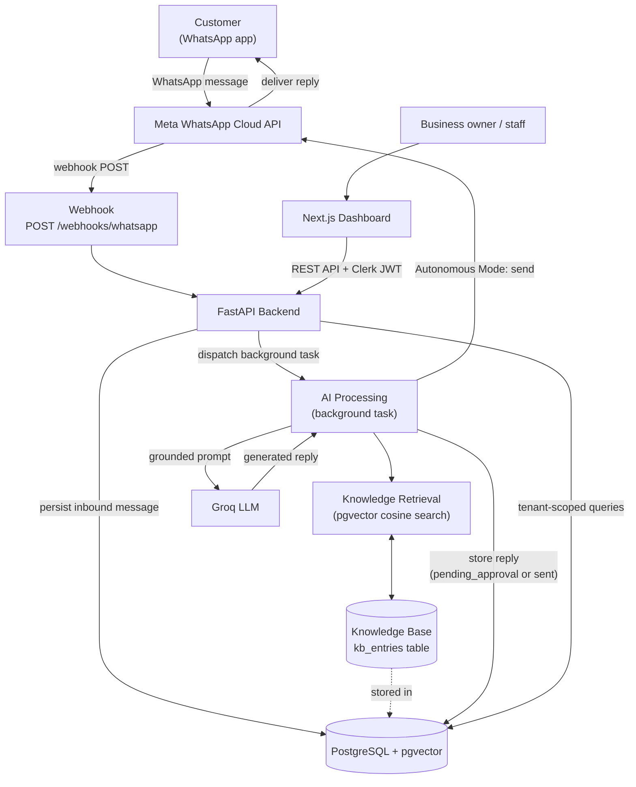
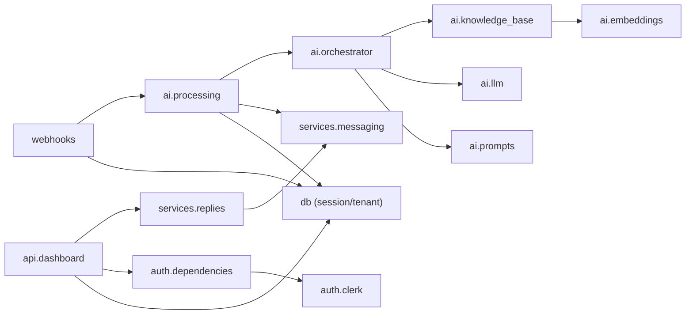
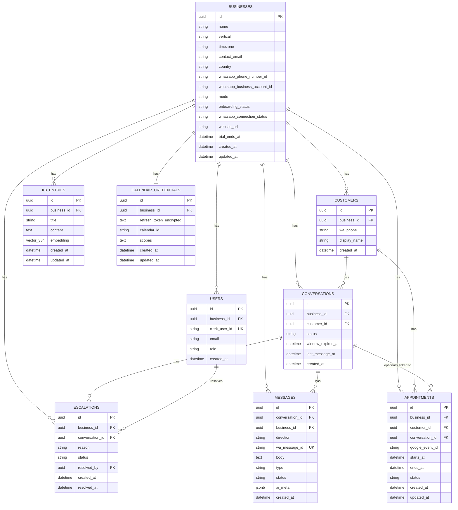
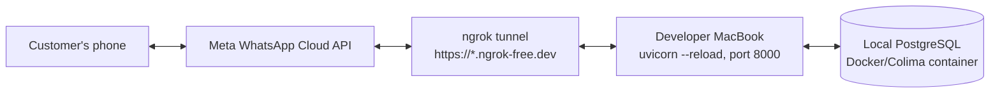
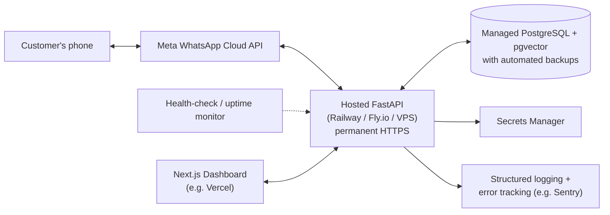

# HIRA — Architecture Documentation

**Status**: Living document, reflects the system as it exists in the codebase on **2026-07-04**.
**Scope**: This documents current implementation only. It supersedes `documentation/ARCHITECTURE.md` (a pre-implementation design doc from 2026-06-29 that describes the *originally planned* MVP — Claude as the LLM, Railway hosting, Google Calendar booking — several of which changed or have not yet been built; that file is kept for historical decision context, not as a description of current state).
**Audience**: A senior backend engineer onboarding to HIRA with no prior context.

Anything not implemented is explicitly marked **Not yet implemented** rather than described as if it exists.

---

# 1. Executive Summary

**HIRA** is an AI receptionist for WhatsApp-first small businesses. A business connects one WhatsApp Business number to HIRA; when a customer messages that number, HIRA answers using the business's own knowledge base (hours, pricing, policies, FAQs) instead of a human having to reply.

**Problem it solves**: small businesses (dental clinics, salons, gyms, consultants, etc.) receive a steady stream of repetitive WhatsApp questions ("are you open today?", "how much does X cost?") and lose leads when nobody replies fast enough. HIRA answers those automatically, grounded in real business data, and only escalates to a human when configured to.

**Current MVP capabilities** (implemented and verified working end-to-end against the real Meta WhatsApp Cloud API, as of 2026-07-04):
- Receive a WhatsApp text message via Meta's Cloud API webhook.
- Verify the webhook (Meta's verification handshake) and every inbound payload (HMAC-SHA256 signature).
- Identify which business the message belongs to (multi-tenant, by WhatsApp phone number id).
- Store the customer, conversation, and message in Postgres.
- Retrieve relevant knowledge-base entries for that business via semantic search (pgvector).
- Generate a grounded reply using an LLM (Groq, live).
- Either send the reply immediately (**Autonomous Mode**) or hold it for human approval via a dashboard (**Assisted Mode**, the default).
- A Next.js dashboard with Clerk authentication, tenant-scoped API, and a live "Pending Replies" copilot screen (Sprint 27, 2026-07-09): an operator can edit an AI draft before sending, approve & send, reject, regenerate (re-runs the same LLM pipeline), or escalate to a human, all against the running conversation's real context.

**Current production maturity**: **pre-production / single-tenant validation stage.** The full loop has been verified live end-to-end against Meta's real Cloud API with one test business and one test WhatsApp number, run from a developer's local machine via `uvicorn --reload`, tunneled through ngrok. There is:
- No deployed backend or frontend (no hosting, no Dockerfile, no CI deploy step).
- No production secrets manager (a local `.env` file, git-ignored).
- No monitoring, alerting, or error tracking.
- No automated database backups.
- No CORS configuration, no rate limiting on the webhook endpoint.
- `appointments` and `calendar_credentials` exist in the schema but have **zero application code** using them yet (`calendar_credentials` — no OAuth built; see DEC-028). `escalations` gained its first application code in Sprint 27 (2026-07-09): `POST /messages/{id}/escalate` creates rows, but there is still no list/resolve endpoint or dashboard surface to view them (see DEC-030). `leads`/`lead_events` (CRM Foundation, Sprint 28, 2026-07-09) are new tables with full CRUD, a service layer, an API, and a live Customers page — see DEC-031.

This is an intentional MVP-first sequencing (see `.claude/DECISIONS.md`): prove the core AI loop works against real infrastructure before investing in production hardening. Section 12 and 13 describe exactly what's left to close that gap.

---

# 2. High-Level Architecture



**Components and how they connect:**
- **Database** (PostgreSQL + pgvector extension): the single system of record. Every business-owned table carries a `business_id`. `kb_entries` also stores 384-dimensional embeddings for semantic search.
- **Knowledge Base**: not a separate service — it's the `kb_entries` table plus the retrieval code in `app/ai/knowledge_base.py`. Ingestion (chunk → embed → store) and retrieval (embed query → cosine search) both live in the same backend process as everything else.
- **Frontend**: a separate Next.js application (`frontend/`) that talks to the backend only over the REST API (`/api/v1/*`), authenticated with a Clerk JWT. It has no direct database access.
- **Admin Dashboard**: this *is* the Next.js frontend — there is no separate admin app. "Dashboard" and "Frontend" are the same codebase.

---

# 3. Backend Architecture

## Folder structure

```
backend/
├── app/
│   ├── main.py                 # FastAPI app instance, router registration, /health
│   ├── models.py                # All SQLAlchemy ORM models (single file)
│   ├── core/
│   │   └── config.py            # Settings (pydantic-settings), loaded from .env
│   ├── db/
│   │   ├── base.py              # SQLAlchemy DeclarativeBase
│   │   ├── session.py           # engine, SessionLocal, get_db() FastAPI dependency
│   │   └── tenant.py            # tenant_query() / get_scoped() — tenant-scoping helpers
│   ├── webhooks/
│   │   └── whatsapp.py          # GET verify handshake, POST inbound handler
│   ├── ai/
│   │   ├── orchestrator.py      # generate_reply(): retrieval + prompt + LLM call
│   │   ├── processing.py        # generate_and_store_reply(): background task entry point
│   │   ├── prompts.py           # System prompt + message assembly
│   │   ├── chunking.py          # Character-based text chunking for KB ingestion
│   │   ├── knowledge_base.py    # index_entry() / search() / retrieve_context()
│   │   ├── llm/                 # LLMProvider interface + Mock/Claude/Groq implementations
│   │   └── embeddings/          # EmbeddingProvider interface + local BGE implementation
│   ├── services/
│   │   ├── messaging.py         # send_text(): outbound WhatsApp Cloud API call
│   │   ├── replies.py           # approve_and_send(), update_draft(), reject_reply(),
│   │   │                        # regenerate_draft(), escalate_reply() — every pending-draft action
│   │   ├── provisioning.py      # provision_business(): signup → Business + owner User
│   │   ├── leads.py             # create_lead()/update_lead()/delete_lead() — CRM pipeline actions + LeadEvent logging
│   │   └── timeline.py          # get_customer_timeline(): merges Message + LeadEvent history
│   ├── auth/
│   │   ├── clerk.py             # Clerk JWT verification against JWKS
│   │   └── dependencies.py      # get_verified_clerk_user_id(), get_current_principal()
│   └── api/
│       ├── dashboard.py         # /api/v1/pending, /api/v1/messages/{id}/{approve,draft,reject,regenerate,escalate}
│       ├── onboarding.py        # /api/v1/onboarding/status, /api/v1/onboarding/business
│       ├── leads.py             # /api/v1/leads (CRUD) — Sprint 28
│       └── customers.py         # /api/v1/customers, /{id}, /{id}/timeline — Sprint 28
├── alembic/                      # DB migrations
├── tests/                        # pytest suite (259 tests, all passing, as of Sprint 28)
└── scripts/                      # One-off operational scripts (seeding, phone-number updates)
```

## Major modules and responsibilities

| Package | Responsibility |
|---|---|
| `app.core` | Configuration only. One `Settings` class, one module-level `settings` instance. |
| `app.db` | Database plumbing: engine/session lifecycle and the multi-tenant scoping helpers. No business logic. |
| `app.webhooks` | The only HTTP surface Meta talks to. Verifies, persists, and dispatches — does no AI work itself. |
| `app.ai` | Everything about generating a reply: retrieval, prompting, provider abstraction, background dispatch. |
| `app.services` | Outbound side-effects — WhatsApp send, the approval workflow, and turning a Clerk signup into a tenant (`provisioning.py`). |
| `app.auth` | Dashboard/onboarding authentication only. Unrelated to the webhook's HMAC verification. `get_verified_clerk_user_id` (token only) underlies `get_current_principal` (token + existing-User lookup) — the former is what onboarding routes use, since a brand-new signup has no `User` row yet. |
| `app.api` | The authenticated REST surface exposed to the frontend: `dashboard.py` (pending/approve) and `onboarding.py` (business provisioning). |

## Dependency flow



Business logic (`ai`, `services`) never imports a vendor SDK directly except inside the provider implementations themselves (`ai/llm/groq.py`, `ai/llm/claude.py`, `ai/embeddings/local_bge.py`), and those imports are lazy (deferred to first call) so the rest of the app has no hard dependency on any one vendor.

## Startup process

`app/main.py` builds one module-level `FastAPI()` instance at import time, registers the `whatsapp` and `dashboard` routers, and defines `/health`. There is **no `lifespan`/startup-event hook** — nothing is warmed up in advance. Two things are eagerly instantiated at import time as a side effect of importing their modules:
- `app.core.config.settings = Settings()` — reads `.env` once, at process start.
- `app.db.session.engine = create_engine(...)` — creates the connection pool object (does not open a connection yet; `pool_pre_ping=True` validates a connection is alive each time one is checked out of the pool).

Run locally with `uvicorn app.main:app --reload` (from `backend/`, with the venv active). `--reload` only watches `*.py` files (confirmed by reading `uvicorn`'s `FileFilter` default: `default_includes = ["*.py"]`) — **editing `.env` does not trigger a restart**, and even if it did, `Settings()` is a singleton read once, so a full process restart is required to pick up new environment values.

## Configuration loading

`pydantic-settings`, via `SettingsConfigDict(env_file=".env", extra="ignore")` in `app/core/config.py`. `.env` is resolved relative to the process's working directory at startup (must be run from `backend/`). Real environment variables (if set) take precedence over `.env` file values — confirmed no such override exists in the current dev environment.

## Environment variables

**Backend** (`backend/.env`, git-ignored; template in `backend/.env.example`):

| Variable | Required | Default | Purpose |
|---|---|---|---|
| `DATABASE_URL` | Yes | — (no default; app fails to start without it) | Postgres connection string |
| `WHATSAPP_VERIFY_TOKEN` | For live WhatsApp | `dev-verify-token` | Meta webhook handshake token |
| `WHATSAPP_APP_SECRET` | For live WhatsApp | `dev-app-secret` | HMAC key for verifying inbound webhook signatures |
| `WHATSAPP_ACCESS_TOKEN` | For live WhatsApp | `dev-access-token` | Bearer token for outbound Cloud API calls |
| `WHATSAPP_API_BASE` | No | `https://graph.facebook.com` | Meta Graph API host |
| `WHATSAPP_GRAPH_VERSION` | No | `v21.0` | Graph API version (currently `v25.0` in local `.env`) |
| `EMBEDDING_PROVIDER` | No | `local_bge` | Embedding backend selector |
| `EMBEDDING_MODEL` | No | `BAAI/bge-small-en-v1.5` | Local embedding model name |
| `LLM_PROVIDER` | No | `mock` | LLM backend selector (currently `groq`) |
| `LLM_MAX_TOKENS` | No | `1024` | Max generation tokens |
| `ANTHROPIC_API_KEY` | Only if `LLM_PROVIDER=claude` | `""` | Claude provider |
| `LLM_MODEL` | No | `claude-sonnet-4-6` | Claude model id |
| `GROQ_API_KEY` | Only if `LLM_PROVIDER=groq` | `""` | Groq provider |
| `GROQ_MODEL` | No | `llama-3.3-70b-versatile` | Groq model id |
| `CLERK_JWKS_URL` | For dashboard auth | `""` | Clerk's public key set, for JWT verification |
| `CLERK_ISSUER` | No | `""` | Optional issuer check |

**Frontend** (`frontend/.env.example`):

| Variable | Purpose |
|---|---|
| `NEXT_PUBLIC_API_BASE_URL` | Backend base URL (default `http://localhost:8000`) |
| `NEXT_PUBLIC_CLERK_PUBLISHABLE_KEY` | Enables real Clerk auth when set; falls back to dev mock when blank (never in production) |
| `CLERK_SECRET_KEY` | Server-side Clerk key (Next.js middleware) |

## Request lifecycle

**Webhook (`POST /webhooks/whatsapp`)** — fully synchronous up to persistence, then backgrounded:
1. Read raw request body.
2. Verify `X-Hub-Signature-256` (HMAC-SHA256 over the raw body, constant-time compare) → `403` if invalid.
3. Parse JSON, walk `entry[].changes[].value`.
4. Skip entries with no `messages` key (status/delivery callbacks).
5. Look up `Business` by `metadata.phone_number_id` → silently skip if no match (unknown number).
6. For each message: dedupe by `wa_message_id` (unique DB constraint + existence check) → get-or-create `Customer` → get-or-create active `Conversation` → insert `Message` (status `received`) → commit.
7. For every newly-persisted inbound message, schedule `generate_and_store_reply` via FastAPI's `BackgroundTasks`.
8. Return `200` immediately — always, once persistence succeeds, so Meta does not retry.

**Dashboard API (`/api/v1/*`)** — synchronous, request/response:
1. `get_current_principal` dependency: extract `Authorization: Bearer <token>`, verify against Clerk's JWKS, resolve the JWT `sub` to a local `User` row → `Principal(business_id, ...)`. Missing/invalid token or unknown user → `401`.
2. Route handler runs a `tenant_query`/`get_scoped` query, always filtered to `principal.business_id`.
3. Cross-tenant access is indistinguishable from non-existent (`404`), never a distinguishing error.

## Background processing

There is **no task queue** (no Celery/RQ/arq). Background work uses FastAPI's built-in `BackgroundTasks`, which runs in-process, in the same Python process, after the HTTP response has been sent. `generate_and_store_reply` opens its **own** database session (`SessionLocal()`, not the request's `get_db()` session) because it executes outside the request lifecycle.

**Implication worth flagging**: if the web process crashes or is restarted (e.g., `--reload` firing on a code change) while a background task is mid-flight, that task is lost silently — there is no persistence, retry, or dead-letter queue for background reply generation.

## Error handling

- `generate_and_store_reply` wraps its entire body in a broad `try/except Exception`, logs via `logger.exception(...)`, and rolls back the DB session. **The customer receives no reply and no error message** in this case — there is no fallback message and no escalation (see Section 7).
- `send_text` distinguishes retryable failures (`httpx.TransportError`, Meta 5xx) — retried up to 3 times with linear backoff — from non-retryable ones (`WhatsAppSendError` on any 4xx), which propagate immediately.
- `LLMProvider` implementations raise `LLMError` after exhausting retries on transient errors (connection, timeout, 429, 5xx); other 4xx errors from the provider are not retried.
- Dashboard API translates domain errors to HTTP: unapprovable/cross-tenant message → `404`; send failure → `502`.

## Logging

Standard library `logging`, one `logger = logging.getLogger(__name__)` per module that needs it. **There is currently no centralized logging configuration** (`main.py` has no `logging.basicConfig(...)` call as of this writing — one was added temporarily during a debugging session and removed afterward, see `.claude/PROGRESS.md` Session 19). In practice this means log visibility depends on whatever default handlers uvicorn installs; there is no structured logging, no log level configuration, and no shipping to an external log sink. This is tracked as `INFRA-005` in `TODOS.md`.

---

# 4. Frontend Architecture

**Framework**: Next.js 15 (App Router), TypeScript, React 19, Tailwind CSS v4. Hand-authored shadcn-style UI primitives on top of Radix (not the shadcn CLI).

**Routing**: file-based via the App Router. Authenticated dashboard pages live under the `(dashboard)` route group, sharing one layout (`app-shell` + sidebar nav + `ErrorBoundary`). Route: `/`, `/dashboard`, `/inbox`, `/pending`, `/knowledge-base`, `/customers`, `/analytics`, `/settings`. `/customers` is now a live two-pane list/detail view (Sprint 28, 2026-07-09) — see the page-status table below. A separate `(onboarding)` route group (its own minimal layout, no sidebar) serves `/onboarding` — the business-provisioning form (Milestone A). `(dashboard)/layout.tsx` is a client component that calls `GET /api/v1/onboarding/status` on load and redirects a business-less user to `/onboarding`; `(onboarding)/layout.tsx` does the inverse (redirects an already-provisioned business to `/dashboard`).

**Authentication**: `AuthContext` (`lib/auth-context.tsx`) is the single abstraction every page/component uses — `useAuthContext()` returns `{ getToken, user, isLoaded, mocked }`. Two implementations select at runtime (`components/providers.tsx`):
- **Real Clerk** (`ClerkProvider` + `ClerkBridge`) when `NEXT_PUBLIC_CLERK_PUBLISHABLE_KEY` is set.
- **Dev mock** (`MockAuthProvider`, hardcoded dev user, fake token) when the key is absent — but **only outside production** (`isProduction` check). In production without a Clerk key, the app renders an "Authentication not configured" screen instead of silently bypassing auth.

`middleware.ts` mirrors the same guard at the edge: real `clerkMiddleware()` when configured, a pass-through otherwise.

**API communication**: one typed client, `lib/api.ts`. Every call takes a `getToken` function, attaches `Authorization: Bearer <token>` if present, and throws a typed `ApiError` (with HTTP status) on failure. As of 2026-07-08 this covers pending/approve, KB CRUD + website import, onboarding, playground, settings (AI Reply Mode), and conversations/messages — this line was last accurate at "exactly two calls" on 2026-07-04 and has not been kept in sync with every endpoint added since; treat the endpoint list in `documentation/API.md` as authoritative over an exhaustive count here.

**Current pages** (this table is known to be stale beyond the rows below — see the note above; not corrected wholesale in this pass):

| Page | Status |
|---|---|
| `/dashboard` | Partially live — pending-reply count via `usePending()`; conversation/customer stat tiles show "Coming soon" |
| `/pending` | **Live** (Sprint 27, 2026-07-09) — editable AI draft (dirty-state tracking, character counter, unsaved-edit confirm dialog), approve & send, reject, regenerate, escalate, against the real API; optimistic updates, 15s polling. See `components/pending-reply-card.tsx`. |
| `/inbox` | **Live** (2026-07-08) — two-pane conversation list + message timeline against `GET /api/v1/conversations`, `GET /api/v1/conversations/{id}`, `GET /api/v1/conversations/{id}/messages`; search (debounced), status filter chips (All/Open/Pending/Closed), pagination, 15s polling, mobile master-detail (list ↔ timeline). See `hooks/use-conversations.ts`. |
| `/knowledge-base` | **Live** — full CRUD + website import |
| `/customers` | **Live** (Sprint 28, 2026-07-09) — two-pane searchable/paginated customer list + detail view: customer profile, an editable Lead card (stage/source/estimated value/notes/next follow-up, create/edit/delete), and a Timeline aggregating message history with Lead activity. See `components/customer-detail.tsx`, `hooks/use-customers.ts`/`use-leads.ts`. |
| `/analytics` | Static UI shell — all stat tiles show "Coming soon" |
| `/settings` | Partially live — AI Reply Mode card is real; business info/WhatsApp config fields remain disabled placeholders |
| `/onboarding` | **Live** — business-provisioning form (name, industry, business email, country, timezone); posts to `/api/v1/onboarding/business`, redirects to `/dashboard` on success. Outside the `(dashboard)` route group. |

**Future pages**: *Not yet implemented* — none of the above placeholders have a target ship date recorded; they become "future pages" once their backing endpoint exists (see Section 15).

**State management**: TanStack Query (`@tanstack/react-query`) for all server state — `usePending`/`useApprove` in `hooks/use-pending.ts`, with optimistic removal on approve and rollback on error. No global client-state library (no Redux/Zustand/Context-based app state) beyond `AuthContext` (auth) and `next-themes` (theme). There is no local persistence beyond React Query's in-memory cache.

---

# 5. Database Architecture

PostgreSQL with the `pgvector` extension. Every business-owned table carries `business_id`, enforced by convention (see Section 8) rather than by row-level security — there is no Postgres RLS policy in use.

## Tables

**`businesses`** — one row per tenant.
- Columns: `id`, `name`, `vertical` (nullable — doubles as "industry" at signup), `timezone` (default `"UTC"`), `contact_email` (nullable), `country` (nullable), `whatsapp_phone_number_id` (nullable — the inbound routing key, see Section 8), `whatsapp_business_account_id` (nullable), `mode` (`assisted` | `autonomous`, default `assisted`), `onboarding_status` (`created` | `live`, default `created` — nothing sets it to `live` yet), `whatsapp_connection_status` (`not_connected` | `pending_verification` | `connected`, default `not_connected` — nothing beyond the default is set yet), `website_url` (nullable), `trial_ends_at` (nullable), `created_at`, `updated_at`.
- No parent. Root of the tenant hierarchy.
- `contact_email`/`country`/`onboarding_status`/`whatsapp_connection_status`/`website_url`/`trial_ends_at` were added by the onboarding-provisioning migration (below); only `contact_email`, `country`, and `onboarding_status="created"` are populated by anything today (`app/services/provisioning.py`) — the rest are reserved for the not-yet-built onboarding milestones (`ONBOARDING_IMPLEMENTATION_PLAN.md` B–F).

**`users`** — dashboard login identities, one per Clerk user.
- FK: `business_id → businesses.id` (`ON DELETE CASCADE`), indexed.
- `clerk_user_id` unique — this is the join key from a verified Clerk JWT to tenant scope.
- `role`: `owner` | `staff`.
- **Note**: no code path currently creates these rows automatically from a Clerk sign-up (no provisioning webhook) — see Section 15.

**`customers`** — a business's end customers, identified by WhatsApp number.
- FK: `business_id → businesses.id` (`ON DELETE CASCADE`), indexed.
- `UNIQUE(business_id, wa_phone)` — the same phone number can exist as separate `Customer` rows under different businesses (correct: a phone number isn't globally unique across tenants), but only once per business.

**`leads`** — CRM Foundation (Sprint 28, 2026-07-09, DEC-031). One row per `(business, customer)`.
- FKs: `business_id → businesses.id` (`ON DELETE CASCADE`, indexed), `customer_id → customers.id` (`ON DELETE CASCADE`), `assigned_to → users.id` (`ON DELETE SET NULL`, nullable — same shape as `escalations.resolved_by`).
- `UNIQUE(business_id, customer_id)` — one lead per customer for the MVP; a repeat inquiry updates the existing lead in place rather than creating a second one.
- `stage`: `new | contacted | qualified | proposal_sent | negotiation | won | lost` — plain string, no CHECK constraint (matches `messages.status`/`conversations.status`); validated instead at the API layer (`app/api/leads.py`'s `LeadStage` Pydantic `Literal`).
- `source` (nullable, free text, not validated against a fixed set — unlike `stage`), `estimated_value` (`NUMERIC(12,2)`, nullable), `notes` (nullable), `next_follow_up_at` (nullable, stored as naive UTC like every other timestamp in this schema).
- Composite index `ix_leads_business_stage (business_id, stage)` for pipeline-board-style "list leads in stage X" queries, mirroring `ix_conversations_business_status_last`.

**`lead_events`** — append-only history for a `Lead`; the "CRM events" half of the Customer timeline (Sprint 28, DEC-031).
- FK: `lead_id → leads.id` (`ON DELETE CASCADE`, indexed). **No `business_id` column** — the first tenant-owned-adjacent table without one; every query reaches it by joining through `Lead.business_id` (`app/services/leads.py`/`app/services/timeline.py`), never `tenant_query`/`get_scoped` directly.
- `type`: `lead_created | stage_change | notes_updated | follow_up_set | assigned`. `from_value`/`to_value` (`Text`, nullable — full note content can be stored here, not just short codes). `note` (`Text`, nullable, reserved — nothing writes it yet).
- Application code only ever inserts rows here; nothing updates or deletes one once written (a row disappears only via `ON DELETE CASCADE` from its parent `Lead`).
- Composite index `ix_lead_events_lead_created (lead_id, created_at)` — supports the timeline's newest-first per-lead history query.

**`conversations`** — one active thread per customer per business (get-or-create by "most recent active" on inbound).
- FKs: `business_id` (indexed), `customer_id → customers.id` (`ON DELETE CASCADE`).
- `status`: `active` | `escalated` | `closed` (`closed` is still never assigned by anything; `escalated` is now set by `POST /messages/{id}/escalate` as of Sprint 27, 2026-07-09 — see `app/services/replies.py::escalate_reply`).
- `window_expires_at` — tracks Meta's 24-hour customer-service window (set on every inbound message; **not currently enforced anywhere** before an outbound send).
- Composite index `ix_conversations_business_status_last (business_id, status, last_message_at)` — supports the get-or-create-most-recent-active query.

**`messages`** — every inbound/outbound message.
- FKs: `conversation_id → conversations.id` (`ON DELETE CASCADE`), `business_id` (indexed, denormalized off the conversation for direct tenant-scoped queries).
- `wa_message_id` unique, nullable — the dedupe key for inbound messages; null for outbound messages that haven't been sent yet.
- `direction`: `inbound` | `outbound`. `status`: `received` | `pending_approval` | `sent` | `failed` | `rejected` | `escalated` (the last two added Sprint 27, 2026-07-09 — plain strings, no CHECK constraint, so no migration was needed).
- `ai_meta` (JSONB, nullable) — records `{model, prompt_version, retrieved_count}` for AI-generated replies, enabling traceability of which prompt/model produced a given reply.
- Composite index `ix_messages_conversation_created (conversation_id, created_at)` — supports the rolling-history query (last 20 messages, oldest-first).

**`kb_entries`** — the knowledge base, one row per chunk.
- FK: `business_id` (indexed).
- `embedding`: `vector(384)` (pgvector), matching `BAAI/bge-small-en-v1.5`. Changing to a different-dimension embedding model requires a migration (this happened once already — see migration history below).
- HNSW index `ix_kb_entries_embedding_hnsw` on `embedding` using `vector_cosine_ops` — fast approximate cosine search.
- No full-text index; retrieval is embedding-similarity only.

**`appointments`** — schema unchanged, but as of 2026-07-08 is read/written by `app.calendar.service.AppointmentService` (`backend/app/calendar/service.py`), exercised only against `MockCalendarProvider` so far — no real vendor writes to it yet. FKs to `businesses`, `customers`, and optionally `conversations` (`ON DELETE SET NULL`). See DEC-028.

**`escalations`** — schema unchanged; gained its first application code Sprint 27 (2026-07-09): `POST /messages/{id}/escalate` (`app/services/replies.py::escalate_reply`) creates a row (`status="open"`, `reason="other"` — no UI collects a specific reason yet) whenever a human escalates a pending draft. There is still no list/resolve endpoint or dashboard surface to view or act on open escalations (see DEC-030) — `resolved_by`/`resolved_at` are set by nothing. FKs to `businesses`, `conversations`, and optionally `users` (`resolved_by`, `ON DELETE SET NULL`).

**`calendar_credentials`** — schema exists, **zero application code references this table**. One row per business (`UNIQUE(business_id)`), intended to hold an encrypted OAuth refresh token. Has no `provider` column yet — flagged in DEC-028 as a required additive migration once a second real calendar vendor is added.

## Tenant isolation

Enforced in application code, not the database: `app/db/tenant.py` provides `tenant_query(model, business_id)` and `get_scoped(db, model, business_id, row_id)`, both of which raise `ValueError` immediately if the given model has no `business_id` column — a guard against accidentally calling them on a model that can't be tenant-scoped. Every dashboard API route and every AI/webhook query that touches business-owned data goes through one of these two helpers or an equivalent explicit `.where(Model.business_id == ...)` filter. There is no Postgres Row-Level Security policy — isolation is entirely an application-layer discipline, tested by `tests/test_tenant_scoping.py`.

## Migration history

Four Alembic migrations, applied in order:
1. `ea5a287d0681` — initial schema (all 9 tables, `CREATE EXTENSION IF NOT EXISTS vector`, `kb_entries.embedding` originally `vector(1536)`).
2. `0f9137e8dd34` — `kb_entries.embedding` changed from `vector(1536)` to `vector(384)` (switch from an assumed 1536-dim provider to the actual local BGE-small model).
3. `31348c56a758` — added the HNSW index on `kb_entries.embedding`.
4. `b4fa9e1f5f6a` — added `contact_email`, `country`, `onboarding_status`, `whatsapp_connection_status`, `website_url`, `trial_ends_at` to `businesses` (onboarding Milestone A; the two new NOT NULL status columns use a `server_default` so the existing seeded business row backfills cleanly).

## ER Diagram



---

# 6. WhatsApp Integration

## Complete flow

1. **Webhook verification** (`GET /webhooks/whatsapp`) — Meta calls this once when the webhook URL is configured. HIRA checks `hub.mode == "subscribe"` and `hub.verify_token` (constant-time compare against `WHATSAPP_VERIFY_TOKEN`); echoes `hub.challenge` back on success, else `403`.
2. **Webhook delivery** — Meta only calls the webhook for events on WABAs where **the app is subscribed** (`POST /{waba-id}/subscribed_apps`). This is a separate concern from step 1: verifying the URL does not subscribe the app to events. (This exact gap was the root cause of a real incident — see `.claude/PROGRESS.md` Session 19 — where webhook verification succeeded but real messages never arrived because only Meta's own placeholder app, not HIRA's app, was subscribed to the WABA.)
3. **Business lookup** — `POST /webhooks/whatsapp` extracts `value.metadata.phone_number_id` from the payload and looks up `Business.whatsapp_phone_number_id`. No match → the entry is silently skipped (not an error response) — see Section 8 for why this is the sole multi-tenant dispatch key.
4. **Customer lookup** — get-or-create `Customer` by `(business_id, wa_phone)`, using the `contacts[].profile.name` from the payload as the display name on first contact.
5. **Conversation creation** — get-or-create the most recent `active` conversation for that customer; if none, create one.
6. **Message persistence** — insert a `Message` row (`direction="inbound"`, `status="received"`), deduped by `wa_message_id` (unique constraint + existence check before insert). `window_expires_at` is bumped to `now + 24h` on every inbound message.
7. **Knowledge retrieval** — `retrieve_context()` embeds the message text (local BGE model) and runs a tenant-scoped pgvector cosine search over `kb_entries`, returning up to 5 nearest entries.
8. **AI generation** — the retrieved entries are injected into the system prompt; the last 20 messages of conversation history plus the new message are sent to Groq.
9. **Outbound send** — in **Autonomous Mode** the reply is sent immediately via `send_text()`; in **Assisted Mode** (default) it's stored as `pending_approval` and a human must approve it via the dashboard, which triggers the same `send_text()` call.
10. **Status callbacks** — Meta also sends webhook events for message delivery/read receipts. These carry a `statuses` key instead of `messages`; HIRA explicitly detects the absence of `messages` and skips the entry (no processing, no error).

## Error cases

| Case | Behavior |
|---|---|
| Invalid/missing HMAC signature | `403`, nothing persisted |
| Unknown `phone_number_id` | Entry silently skipped, `200` returned (Meta must not see an error or it will retry indefinitely) |
| Duplicate `wa_message_id` | Skipped (dedupe), no new message row |
| Status/delivery callback (no `messages`) | Skipped, no processing |
| LLM generation fails | Exception caught in `generate_and_store_reply`, logged, DB rolled back — **no reply is stored, customer receives nothing**, no escalation |
| Outbound send returns 4xx | `WhatsAppSendError` raised immediately (not retried); message marked `failed` |
| Outbound send returns 5xx / network error | Retried up to 3 times with linear backoff (0.2s × attempt) before failing |

---

# 7. AI Pipeline

**Message preprocessing**: minimal. `_extract_text()` returns the message body only if `type == "text"`; any other message type (image, audio, document, location, etc.) yields an empty string. **Non-text inbound messages are not handled — Not yet implemented.**

**Retrieval**: `retrieve_context()` → embeds the query with the local BGE provider (prefixed `"Represent this sentence for searching relevant passages: "` per bge's recommended convention), then `search()` runs `ORDER BY embedding <=> query_vector LIMIT k` (k=5), tenant-scoped by `business_id`.

**Knowledge ranking**: pure nearest-neighbor cosine distance ordering — no score threshold, no reranking, no filtering out low-relevance matches. If the KB has no good match, the 5 nearest (however distant) are still returned and injected. **Relevance thresholding/reranking is not yet implemented.**

**Prompt construction** (`app/ai/prompts.py`, `SYSTEM_PROMPT_VERSION = "v1"`): a fixed system prompt instructing the model to answer only from the injected knowledge base, admit uncertainty rather than guess, stay concise, and never invent prices/hours/policies — followed by the formatted retrieved entries. Conversation history (last 20 messages, oldest-first) is mapped `inbound → user`, `outbound → assistant`, with the new message appended last.

**Groq interaction**: official `groq` SDK, OpenAI-compatible chat completions. Retries up to 3 times (linear backoff) on connection errors, timeouts, rate limits (429), and 5xx; other 4xx errors raise immediately. Model and prompt version are recorded on the stored message (`ai_meta`) for traceability.

**Response validation**: **none.** There is no check that the returned text actually stays grounded in the retrieved knowledge, no profanity/safety filter, no length cap enforcement beyond `LLM_MAX_TOKENS`, no structured-output validation. **Not yet implemented.**

**Autonomous mode**: a per-business flag (`businesses.mode`). `"assisted"` (default) stores the reply as `pending_approval` for dashboard review. `"autonomous"` calls `send_text()` immediately inside the same background task and marks the message `sent`/`failed`.

**Fallback behaviour**: if anything in `generate_and_store_reply` raises, the exception is logged and the DB session rolled back — there is **no user-facing fallback message** ("sorry, I couldn't process that") and **no automatic escalation** to a human on a generation failure. **Automatic fallback-on-failure escalation is still not implemented.** What Sprint 27 (2026-07-09) *did* add is the other half of human handoff: once a draft has successfully generated and reached `pending_approval`, an operator can manually escalate it via `POST /messages/{id}/escalate` — see the Assisted-Mode Approvals section of `documentation/API.md`. The two are independent: a generation failure still produces silence, not an escalation.

**Future improvements** (see also Section 15): intent classification (currently every message goes through the same grounded-FAQ path — no routing to booking/escalation/other flows), tool use for appointment booking, wiring a low-confidence/generation-failure signal into an *automatic* escalation (the manual, human-triggered path exists as of Sprint 27; the automatic one doesn't), reranking or a relevance threshold on retrieval, response validation/guardrails, non-text message handling.

---

# 8. Multi-Tenant Architecture

**Business isolation**: every business-owned table carries a `business_id` foreign key to `businesses.id`. All application queries touching these tables go through `tenant_query()`/`get_scoped()` (which refuse to run against a model lacking `business_id`) or an equivalent explicit filter. There is no database-level Row-Level Security — isolation is an application-code discipline, covered by `tests/test_tenant_scoping.py`.

**Knowledge isolation**: `kb_entries` is scoped like any other business-owned table; `search()`/`retrieve_context()` always filter `WHERE business_id = :business_id` before the vector similarity ordering — a business's KB is never visible to another business's retrieval, structurally (the query itself excludes other tenants' rows, not just a post-filter).

**Customer isolation**: `UNIQUE(business_id, wa_phone)` — the same WhatsApp number can be a distinct `Customer` under each business it messages; there is no cross-business customer identity.

**Conversation isolation**: scoped by both `business_id` and `customer_id`; the get-or-create-active-conversation query is additionally scoped by `status`.

**Phone Number ID lookup — the actual multi-tenancy dispatch mechanism**: `Business.whatsapp_phone_number_id` is how an inbound webhook payload is routed to the correct tenant. Meta's payload carries `value.metadata.phone_number_id` (the *receiving* number, i.e., the business's number), and the webhook looks up the owning `Business` by that single column. **This is the only place tenant identity is derived from an inbound webhook** — there is no other signal (no per-tenant secret, no separate webhook URL per business). All businesses share the same webhook URL, app, and `WHATSAPP_APP_SECRET`; only the `phone_number_id` in the payload distinguishes them.

**How multiple businesses are supported**: each business has its own row in `businesses` with its own `whatsapp_phone_number_id` and `whatsapp_business_account_id`. There is currently **one real business row** in use, seeded via `backend/scripts/seed_business.py` / `update_business_phone.py` — those scripts remain the only way to *connect a WhatsApp number* to a business (Milestone A below does not touch WhatsApp). Business **signup/provisioning** itself is no longer manual: `POST /api/v1/onboarding/business` (`app/services/provisioning.py`) creates a `Business` + owner `User` for any authenticated Clerk identity that doesn't have one yet, idempotently. Multi-business support is structurally in place and has now been exercised by real provisioning code (63 backend tests), but self-service knowledge-base ingestion and WhatsApp connection are still not built (Section 15).

---

# 9. Security

**Authentication**:
- **Dashboard**: Clerk-issued RS256 JWTs, verified against Clerk's public JWKS (`CLERK_JWKS_URL`) — no shared secret needed server-side. `get_current_principal` resolves the JWT `sub` to a local `User` row; missing/invalid token or unrecognized user → `401`.
- **Webhook**: not authenticated via any token — trust is established entirely by HMAC signature verification (below). There is no additional API key or IP allowlisting on the webhook endpoint.

**Webhook signature verification**: every inbound POST's raw body is checked against `X-Hub-Signature-256` using `hmac.new(WHATSAPP_APP_SECRET, raw_body, sha256)` and a constant-time (`hmac.compare_digest`) comparison — resistant to timing attacks. The GET verification handshake token comparison is likewise constant-time.

**Secret handling**: all secrets live in `backend/.env` / `frontend/.env.example`-templated `.env` files, git-ignored. No secrets are hardcoded in application code. `backend/scripts/*.py` contain hardcoded WhatsApp **phone number IDs and WABA IDs** — these are not secrets (they're identifiers, not credentials) but are still specific to one real business and would need parameterizing for reuse.

**Access tokens**: WhatsApp — currently a **permanent Meta System User token** (`SYSTEM_USER` type, confirmed via `/debug_token`: `expires_at: 0`, scopes `whatsapp_business_management` + `whatsapp_business_messaging`), replacing an earlier 24-hour temporary token. Clerk — no server-side secret required for verification (JWKS is public); `CLERK_SECRET_KEY` exists only for the Next.js middleware/server SDK.

**Tenant isolation**: see Section 8 — application-layer only, no DB-level enforcement (no RLS).

**Database safety**: all application queries go through the SQLAlchemy ORM with bound parameters — no string-interpolated SQL found in application code. The only raw SQL (`op.execute(...)`) is in Alembic migrations (`CREATE EXTENSION`, a column type `ALTER`) — static DDL, not driven by user input.

**Environment variables**: see Section 3 for the full list. `DATABASE_URL` contains a plaintext password in `.env` (standard for local dev; not yet moved to a secrets manager — `INFRA-002`).

**Potential risks** (concrete, observed in code — not speculative):
- **No CORS middleware** registered in `app/main.py`. The frontend (different origin in any real deployment) would be blocked from calling the API unless CORS is added or a same-origin reverse proxy is used.
- **No rate limiting** on `POST /webhooks/whatsapp` — any client that guesses/replays a validly-signed-looking request shape could be throttled only by Meta's own signature, not by HIRA.
- **Unknown-business webhook payloads are silently dropped** with no alerting — if a business's `whatsapp_phone_number_id` is ever misconfigured, messages vanish with no visible failure signal.
- **Background task loss on process restart**: an in-flight `BackgroundTasks` reply generation is not persisted or retried if the process restarts mid-task (see Section 3).
- **No production secrets manager**; all credentials currently live on one developer's machine in a git-ignored file.
- **No database backups configured** (local Docker/Colima Postgres).

---

# 10. External Services

| Service | Purpose | Authentication | Failure modes | Recovery strategy |
|---|---|---|---|---|
| **Meta WhatsApp Cloud API** | Inbound message delivery (webhook) and outbound message sending | Webhook: HMAC signature (`WHATSAPP_APP_SECRET`). Outbound: Bearer access token (`WHATSAPP_ACCESS_TOKEN`, now a permanent System User token) | Webhook not delivered if app isn't subscribed to the WABA (`subscribed_apps`); outbound `401` on invalid/expired token; `4xx` on malformed requests or messaging-window violations; `5xx` transient | Outbound: automatic retry (3 attempts, backoff) on 5xx/network errors only; `4xx` fails immediately, message marked `failed`. Inbound delivery/subscription issues have **no automated recovery** — require manual Graph API/dashboard intervention (see `documentation/WHATSAPP_INTEGRATION.md`) |
| **Groq** | LLM generation for AI replies | API key (`GROQ_API_KEY`), official `groq` SDK | Connection errors, timeouts, 429 rate limits, 5xx | Automatic retry (3 attempts, linear backoff) on transient errors; other 4xx raises `LLMError` immediately, aborting reply generation for that message (no fallback reply — Section 7) |
| **PostgreSQL (+ pgvector)** | System of record; vector similarity search for KB retrieval | Connection string (`DATABASE_URL`) | Connection failure, pool exhaustion | `pool_pre_ping=True` validates connections on checkout; no automatic reconnect/retry logic beyond SQLAlchemy's pool defaults; **no automated backups** (`INFRA-004`) |
| **Clerk** | Dashboard authentication | Public JWKS (`CLERK_JWKS_URL`) for verification; `CLERK_SECRET_KEY`/publishable key for the Next.js SDK | JWKS unreachable, expired/malformed token, unknown user | Every failure mode maps to `401`; no retry needed since verification is stateless. **Not yet implemented**: a Clerk webhook to auto-provision `User` rows on sign-up — currently manual |
| **ngrok** | Dev-only public HTTPS tunnel to the local backend, so Meta can reach it | None (tunnel-level; not an app credential) | Tunnel URL changes on every `ngrok` restart (free tier), requiring the Meta webhook URL to be updated manually; local machine going offline takes the whole integration down | None — this is explicitly a temporary development-only mechanism, to be replaced per `INFRA-001`/`INFRA-006` |
| **fastembed (local, BAAI/bge-small-en-v1.5)** | Local embedding generation, no external network call per-request | None (runs on-device; model weights downloaded once on first use) | Model download failure on first load | Retried up to 3 times with backoff on load failure; inference itself is not retried |

---

# 11. Current Deployment

Everything currently runs on a single developer's laptop.



- Backend: `uvicorn app.main:app --reload`, run directly on the developer's machine.
- Database: local Postgres + pgvector, in a Docker container managed via Colima.
- Public exposure: ngrok free-tier tunnel — URL changes on every restart, requiring the Meta App Dashboard webhook URL to be updated manually each time.
- Frontend: run locally via `next dev`, not deployed anywhere.
- No containerization of the app itself (no `Dockerfile` found in the repo), no CI deploy step, no environment beyond local dev.

---

# 12. Production Deployment Plan

Recommended target architecture — **not yet built**; this section describes the plan, not the current state.



Recommended steps, in order (mirrors `TODOS.md` Infrastructure section):
1. **Permanent HTTPS deployment** (Railway, Fly.io, Render, or a VPS) replacing ngrok — `INFRA-001`.
2. **Secrets manager** appropriate to the chosen platform, replacing the local `.env` file for all credentials (`WHATSAPP_ACCESS_TOKEN`, `GROQ_API_KEY`, `DATABASE_URL`, Clerk keys) — `INFRA-002`.
3. **Webhook health monitoring and alerting** — detect signature failures, send failures, and downtime — `INFRA-003`.
4. **Automated backups** for the production Postgres database — `INFRA-004`.
5. **Production logging and error monitoring** (structured logs + something like Sentry), replacing the current ad-hoc per-module logging with no central configuration — `INFRA-005`.
6. **Re-verify the full webhook round-trip against the new deployment** — GET verification, real inbound delivery, real outbound send — before removing ngrok from the path or onboarding a real business — `INFRA-006`.
7. **Health checks**: `/health` already exists and returns `200 {"status": "ok"}` — needs to be wired into whatever the hosting platform / uptime monitor expects.

---

# 13. Current Technical Debt

(Completed work — the WhatsApp access-token replacement — is intentionally excluded; see `.claude/TODOS.md` Completed section for that history.)

All current, open technical debt is infrastructure-shaped, not application-logic debt:

- **INFRA-001** — Replace ngrok with a permanent HTTPS deployment (Railway/Fly.io/Render/VPS).
- **INFRA-002** — Move secrets (WhatsApp token, Groq key, database URL, Clerk keys) from `.env` files to a production secrets manager.
- **INFRA-003** — Add webhook health monitoring and alerting.
- **INFRA-004** — Configure automatic backups for production data.
- **INFRA-005** — Add production logging and error monitoring (structured logging + error tracking), replacing the current uncentralized per-module logging.
- **INFRA-006** — Re-verify the full webhook round-trip end-to-end once deployed to the permanent HTTPS endpoint, before onboarding real businesses.

No open application-logic debt is currently tracked in `TODOS.md` beyond these — the gaps noted in Sections 6, 7, and 9 (CORS, rate limiting, response validation, escalation wiring, non-text messages, etc.) are real and worth tracking, but are not yet formally entered as backlog items; see Section 15 for sequencing recommendations.

---

# 14. Milestone Status

Per `MILESTONES.md`:

- **Milestone 1 — First Working AI Receptionist**: ✅ Complete. Full loop (receive → verify → store → retrieve → generate → reply) implemented and live-verified with Groq.
- **Milestone 2 — Clerk Authentication**: ✅ Complete (built & tested). Live use requires Clerk app credentials in `.env` and a `User` row per Clerk user (provisioning is manual — see Section 15).
- **Milestone 3 — Next.js Dashboard UI**: ✅ Complete. Full app shell, 7 pages; `/pending` (full copilot workflow as of Sprint 27), `/inbox`, `/knowledge-base`, `/onboarding`, `/customers` (full CRM view as of Sprint 28, 2026-07-09), and partially `/dashboard`/`/settings` are wired to live data; `/analytics` remains a placeholder pending backend endpoints.
- **Milestone 4 — WhatsApp Cloud API (autonomous loop)**: ✅ Complete and **live-verified** (2026-07-04) — real customer message → webhook → retrieval → Groq → real outbound send → customer, confirmed end-to-end against Meta's live Cloud API.

**Current project maturity**: all four MVP milestones are functionally complete against a single real test business. The system has not been deployed, has not handled more than one real tenant concurrently, and has no production operational tooling (monitoring, backups, secrets management). This is best characterized as **"MVP proven, pre-production."**

---

# 15. Future Roadmap

Recommended next implementation order, reasoning included:

1. **Deployment** (`INFRA-001`, `INFRA-006`) — do this before anything else below. Every feature built on top of a laptop+ngrok setup will need to be re-verified once deployed anyway; deploying first means new features are verified once, not twice.
2. **Inbox** — **done (2026-07-08)**. `GET /api/v1/conversations` (search, status filter, pagination), `GET /api/v1/conversations/{id}`, `GET /api/v1/conversations/{id}/messages` (`backend/app/api/conversations.py`), and a real two-pane `/inbox` page (`frontend/src/app/(dashboard)/inbox/page.tsx`). No new tables — reads `Conversation`/`Message`/`Customer` as they already existed.
3. **Human handoff / escalation** — **half done (Sprint 27, 2026-07-09).** The manual half is built: `POST /messages/{id}/escalate` lets an operator hand off a pending draft from the dashboard, creating an `Escalation` row and marking the conversation `escalated`. Still open: a list/resolve endpoint or dashboard surface for open escalations (see DEC-030); wiring the *automatic* half — `generate_and_store_reply`'s failure path (Section 7) and a low-confidence signal from the LLM response — into the same `escalate_reply()` mechanism. That automatic half still closes the biggest reliability gap: right now a failed generation means the customer gets silence, with no escalation of any kind.
4. **Google Calendar** — **internal architecture built (2026-07-08, DEC-028)**: a provider-agnostic `CalendarProvider` interface and `AppointmentService` (`backend/app/calendar/`), tested against an in-memory `MockCalendarProvider`. Still not built: OAuth, token encryption, a real `GoogleCalendarProvider`, API routes, frontend, and AI tool-calling to actually trigger a booking from a conversation. Sequenced after handoff because booking failures should be able to escalate to a human using the same mechanism.
5. **Conversation memory** — today "memory" is a rolling window of the last 20 raw messages; there is no summarization or long-term customer memory across conversations. Worth revisiting once conversations regularly exceed that window in practice.
6. **Analytics** — real metrics behind `/analytics` (conversation volume, response time, approval rate). Sequenced after Inbox/handoff since those produce the events analytics would report on.
7. **Multi-tenant onboarding** — **partially done.** Business + owner `User` provisioning is now self-service (`POST /api/v1/onboarding/business`, `/onboarding` page — see `ONBOARDING_IMPLEMENTATION_PLAN.md` Milestone A, done 2026-07-05). Still manual/not built: connecting the business's own WhatsApp number (still only via `scripts/seed_business.py`), knowledge-base ingestion from a website/PDF, and the test-drive playground — tracked as Milestones B–F in the same plan.
8. **Billing** — no billing model, no Stripe/payment integration exists anywhere in the codebase today. Sequenced last: billing only matters once there's more than one paying tenant, which depends on Multi-tenant onboarding above.
9. **CRM Foundation** — **done (Sprint 28, 2026-07-09).** `Lead`/`LeadEvent` tables (DEC-031), full CRUD (`/api/v1/leads`), and a live `/customers` list/detail page (editable Lead card + a Timeline aggregating message history with CRM activity, `GET /customers/{id}/timeline`). Sequenced ahead of Analytics (#6) since pipeline/conversion metrics need lead data to exist first. Still open: a dedicated Leads/pipeline board view (Kanban-style, grouped by stage — only the Customer-centric view was built this sprint), and an assignee picker in the frontend (the backend/API fully support `assigned_to`, but there's no `GET /api/v1/users` staff-list endpoint yet to populate a picker with).

Items 4, 5, 6, and 8 above remain **not yet implemented**; 2, 3, 7, and 9 have completed or partial work, annotated inline above.

---

# Files Inspected

Backend: `app/main.py`, `app/models.py`, `app/core/config.py`, `app/db/{base,session,tenant}.py`, `app/webhooks/whatsapp.py`, `app/ai/{orchestrator,processing,prompts,chunking,knowledge_base}.py`, `app/ai/llm/{__init__,base,groq,claude,mock}.py`, `app/ai/embeddings/{__init__,base,local_bge}.py`, `app/services/{messaging,replies}.py`, `app/auth/{clerk,dependencies}.py`, `app/api/dashboard.py`, `pyproject.toml`, `.env` / `.env.example`, all three `alembic/versions/*.py` migrations, `tests/` directory listing, live `pytest` run (50 passed).

Frontend: full `frontend/src` tree listing, `lib/{api,auth-context,config,nav}.ts`, `hooks/use-pending.ts`, `components/providers.tsx`, `app/(dashboard)/layout.tsx`, all 7 dashboard page files (grepped for live-data vs. placeholder markers), `package.json`, `.env.example`.

Project docs (for cross-reference, not copied uncritically): `.claude/{DECISIONS,PROGRESS,TODOS}.md`, `MILESTONES.md`, `documentation/ARCHITECTURE.md` (confirmed stale/superseded in scope).

Verified directly against running code/config (not assumed): no CORS middleware, no rate limiting, no lifespan/startup hooks, no Dockerfile/Procfile/railway.json/fly.toml, no Clerk user-provisioning code path. As of the original 2026-07-04 audit, `Appointment`/`Escalation`/`CalendarCredential` had zero application references beyond their model definitions; as of 2026-07-08 (DEC-028), `Appointment` is now read/written by `backend/app/calendar/service.py` (against a mock provider only) — `Escalation`/`CalendarCredential` remain unreferenced.
