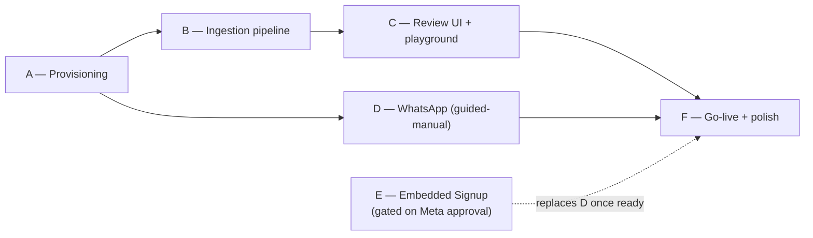

# HIRA Onboarding — Implementation Plan

**Status**: Planning document. No code has been written for any of this yet, per the brief's instruction.
**Companions**: `ONBOARDING_ARCHITECTURE.md` (engineering design), `ONBOARDING_USER_FLOW.md` (UX/journey).
**Scope**: Phases 7 and 8 of the onboarding brief — milestone breakdown, self-critique, and the final sequencing recommendation.

---

## 1. Milestones

Effort scale matches `IMPLEMENTATION_PLAN.md` (the existing pre-pilot-hardening plan): **S** = hours–1 day, **M** = 1–3 days, **L** = 3–10 days, **XL** = multiple weeks.

### Milestone A — Provisioning: signup creates a real tenant ✅ Done (2026-07-05)

**Purpose**: close the gap where the *only* way a `Business` + `User` exists today is a developer manually running `seed_business.py`. This is the precondition for every other milestone — there is no onboarding to build until signup produces a tenant.

**Implementation note (2026-07-05)**: built as specified below, with two refinements made during implementation: (1) the plan's original `POST /api/v1/onboarding/business` needed a way to distinguish "invalid token" from "valid token, no business yet" — `auth/dependencies.py` was refactored to extract `get_verified_clerk_user_id` (token verification only) out of `get_current_principal` (which additionally requires a matching `User` row), so onboarding routes can authenticate a brand-new signup without the existing dashboard routes' stricter "unknown user → 401" behavior. `get_current_principal`'s external behavior is unchanged (all 50 pre-existing tests pass unmodified). (2) Two form fields not anticipated in `ONBOARDING_ARCHITECTURE.md` §2.1 (business email, country) were added as `businesses.contact_email` and `businesses.country`; "industry" reuses the existing `vertical` column rather than duplicating it, per the "don't duplicate business creation logic" instruction. See `PROGRESS.md` Session 21 for the full file list.

| | |
|---|---|
| **Files to modify** | New: `backend/app/services/provisioning.py`. New route in `backend/app/api/onboarding.py` (`POST /api/v1/onboarding/business`). Frontend: new `(onboarding)` route group + `lib/api.ts` extension. |
| **DB migrations** | `businesses`: add `onboarding_status`, `whatsapp_connection_status`, `website_url`, `trial_ends_at` (Section 2.1 of architecture doc). |
| **Backend** | `provision_business()` — create `Business` + owner `User` in one transaction, scoped to the calling Clerk identity. |
| **Frontend** | Welcome + Business Information screens (Section 3, 5.1–5.2 of UX doc). |
| **Testing** | Unit: provisioning creates exactly one `Business`+`User` pair, is idempotent if called twice for the same Clerk user (returns existing, doesn't duplicate). Integration: a fresh Clerk JWT with no matching `User` row successfully provisions via the API. |
| **Estimated effort** | S–M (1–2 days) |
| **Dependencies** | None — can start immediately. |
| **Risk** | Low. Purely additive; doesn't touch any existing table's semantics, only adds columns with safe defaults. |

### Milestone B — Knowledge ingestion pipeline (backend)

**Purpose**: the actual "automatic knowledge creation" the brief centers on — website crawl, PDF extraction, structuring, dedup/validation, staged for review. This is the highest-effort, highest-value milestone.

| | |
|---|---|
| **Files to modify** | New package `backend/app/ingestion/` (`crawler.py`, `pdf.py`, `clean.py`, `structure.py`, `dedup.py`, `jobs.py`). New routes in `api/onboarding.py` for `/kb/website`, `/kb/pdf`, `/kb/manual`, `/kb/jobs/{id}`, `/kb/drafts*`. |
| **DB migrations** | New tables `kb_ingestion_jobs`, `kb_entry_drafts` (Section 2.2–2.3 of architecture doc). No change to `kb_entries`. |
| **Backend** | Crawler with SSRF guard + robots.txt + page/time caps; `pypdf`-based extraction with size/type validation; one LLM structuring call via existing `LLMProvider`; embedding-similarity dedup via existing `EmbeddingProvider`; job orchestration via `BackgroundTasks` (no new queue). |
| **Frontend** | Not required for this milestone in isolation — can be tested via API directly first; Milestone C wires the UI. |
| **Testing** | Unit: crawler rejects private/internal IPs (SSRF test with mocked DNS); PDF validation rejects oversized/non-PDF files; structuring LLM call tested against `MockProvider`, matching the existing test pattern for `orchestrator.py`; dedup correctly merges near-identical drafts. Integration: a full job (mocked HTTP + mocked LLM) goes from `pending` → `ready_for_review` with correct draft rows. |
| **Estimated effort** | L (5–8 days) — this is genuinely the biggest piece of new logic in the whole plan. |
| **Dependencies** | Milestone A (needs a `business_id` to attach jobs to). |
| **Risk** | Medium. New external-network trust boundary (Section 6 of architecture doc) — the SSRF guard and file validation are not optional hardening, they're load-bearing for this milestone to be safe to ship at all. Website crawling reliability also varies by site (JS-heavy sites, aggressive bot-blocking) — mitigated by the manual-entry fallback always being available (never a hard dependency for launch). |

### Milestone C — Knowledge review UI + test-drive playground

**Purpose**: the trust checkpoint (Section 5.3 of UX doc) and the "prove it works before it's live" moment (Section 5.4). Without this, Milestone B's output has no human-reviewable surface, and the product still can't demonstrate value before WhatsApp is connected.

| | |
|---|---|
| **Files to modify** | New: `backend/app/ai/playground.py`. New route `/api/v1/onboarding/playground/message`. Frontend: `onboarding/knowledge`, `onboarding/review`, `onboarding/test` pages; new draft-review card component; new job-progress component. |
| **DB migrations** | None new (reuses Milestone B's tables). |
| **Backend** | `playground_reply()` — thin wrapper around the existing, unmodified `orchestrator.generate_reply()`, using a synthetic per-business test `Customer`/`Conversation` excluded from real inbox/analytics by phone-marker filter. |
| **Frontend** | Draft review list (edit/approve/reject), job progress with staged messaging ("Reading your website... found 6 pages..."), playground chat UI (reuses existing `Card`/`Input` primitives). |
| **Testing** | Unit: playground reply uses the same retrieval+prompt path as production (can literally share test fixtures with `test_orchestrator.py` if that exists). Integration: approve-draft flow correctly calls `index_entry()` and the resulting entry is retrievable in the next playground query (a real end-to-end proof that review → promotion → retrieval works). Manual: exercise the review screen with a real crawled site once Milestone B is live. |
| **Estimated effort** | M (2–4 days) |
| **Dependencies** | Milestone B (needs drafts to review) and the existing `orchestrator.py`/`knowledge_base.py` (unchanged, already built). |
| **Risk** | Low — mostly UI + thin reuse of already-tested backend logic. |

### Milestone D — WhatsApp connection (guided-manual, v1)

**Purpose**: replace "a developer edits `.env` and runs a script" with an in-product, validated, non-technical wizard. This is the pragmatic interim step that ships without waiting on Meta's Tech Provider approval (Milestone E).

| | |
|---|---|
| **Files to modify** | New route `POST /api/v1/onboarding/whatsapp/connect`. Frontend: `onboarding/whatsapp` page (guided wizard with live field validation), extends the existing (currently disabled) WhatsApp fields on `/settings`. |
| **DB migrations** | Uses `businesses.whatsapp_connection_status` from Milestone A's migration. |
| **Backend** | Validate submitted `phone_number_id` + `access_token` against Meta's Graph API (`GET /{phone_number_id}`) before persisting anything; on success, set `whatsapp_phone_number_id`, `whatsapp_connection_status='connected'`. Still requires the owner to manually complete the webhook-subscription step in Meta's dashboard (HIRA shows the exact callback URL + verify token to paste) — auto-subscription requires the Embedded Signup permissions that gate Milestone E. |
| **Frontend** | Step-by-step wizard with inline screenshots/annotated links per field, live green-check validation per the architecture doc. |
| **Testing** | Unit: connect endpoint rejects invalid tokens (mocked Graph API 401) without writing to `businesses`. Manual: full run against a real (test) WhatsApp number, re-verifying the exact webhook-subscription gap that caused the Session 19 incident doesn't recur. |
| **Estimated effort** | M (2–3 days) |
| **Dependencies** | Milestone A. `IMPLEMENTATION_PLAN.md`'s Milestone 0 items `SEC-1` (insecure default secrets) and `SEC-2` (CORS) — connecting real business credentials through a system with default/guessable secrets would be the wrong order — are both **done** as of Sprint 50 (2026-07-15), so this milestone is no longer blocked on them. |
| **Risk** | Medium. This is still "copy an ID and a token from Meta's dashboard" — meaningfully better than editing `.env`, but not yet the one-click magic the brief envisions. Flagged honestly in the UX doc rather than oversold. |

### Milestone E — WhatsApp Embedded Signup (v2, the real "one click" experience)

**Purpose**: the actual zero-technical-knowledge WhatsApp connection — Facebook Login for Business popup, no IDs or tokens shown to the owner, automatic webhook subscription.

| | |
|---|---|
| **Files to modify** | New route `GET /api/v1/onboarding/whatsapp/callback`. Frontend: replace Milestone D's manual-field wizard with a single "Connect WhatsApp" button + popup handling. |
| **DB migrations** | None new beyond Milestone A. |
| **Backend** | Exchange Embedded Signup's returned code for a permanent access token via Graph API; auto-populate `whatsapp_phone_number_id`/`whatsapp_business_account_id`; call `/subscribed_apps` programmatically (closing the exact manual step that caused the Session 19 incident). |
| **Frontend** | One button; popup-based OAuth-style flow (standard Facebook Login for Business SDK integration). |
| **Testing** | Full integration test against Meta's sandbox/test WABA once Tech Provider access is granted. |
| **Estimated effort** | M (2–4 days) **of engineering** — but see the dependency below, which is the real cost of this milestone. |
| **Dependencies** | **A Meta Tech Provider / Embedded Signup approval**, which is a business-verification and app-review process run by Meta, entirely outside HIRA's control. This is not an engineering task and cannot be estimated in engineering-days — it is a **business/legal/compliance action** (per CLAUDE.md's "stop and ask" trigger #6) that should be started in parallel, now, regardless of when the engineering work is scheduled, because it is the longest lead-time item in this entire plan. |
| **Risk** | High on timeline (external, non-negotiable approval latency), low on engineering complexity once approved. Milestone D exists specifically so onboarding doesn't sit blocked on this external dependency. |

### Milestone F — Go-live, resumability, and polish

**Purpose**: the closing moment (Section 5.6 of UX doc) and the connective tissue that makes the whole flow resumable and coherent, not six disconnected screens.

| | |
|---|---|
| **Files to modify** | `POST /api/v1/onboarding/go-live`. Frontend: `(onboarding)/layout.tsx` (resume-from-`onboarding_status` logic), success screen. |
| **DB migrations** | None new. |
| **Backend** | Set `onboarding_status='live'`, `trial_ends_at = now() + N days`. |
| **Frontend** | Progress indicator across all screens (the `● ● ● ○ ○ ○` shown throughout the UX doc); resume-on-load redirect logic; success screen with the owner's real connected number. |
| **Testing** | End-to-end manual walkthrough of the entire flow, welcome → live, using a real test business — this is the "does it actually feel like the brief asked for" check, not something a unit test can confirm. |
| **Estimated effort** | S (1 day) |
| **Dependencies** | All of A–D (E optional at launch). |
| **Risk** | Low. |

---

## 2. Milestone dependency graph

**Total estimated engineering effort, A–D + F (the shippable v1)**: roughly **11–18 days** for one engineer, plus Milestone E's engineering cost (2–4 days, whenever Meta approval lands). This assumes `IMPLEMENTATION_PLAN.md`'s Milestone 0 (pre-pilot hardening) is already done or done in parallel, since several onboarding pieces (Milestone D especially) shouldn't ship before those cheap security fixes are in.

---

## 3. Design critique (Phase 8)

Self-review of the design above, applying the same bar this document would apply to anyone else's proposal.

### 3.1 The "under 10 minutes" claim is conditional, and the design should say so out loud

Confirmed honest in the UX doc (Section 4.2), but worth stating as a standalone critique: **do not** let marketing copy or the welcome screen imply the promise is unconditional. The target is real and achievable *for a business that already has a WhatsApp Business number ready to connect* — that's most of the addressable pilot segment (small businesses already using WhatsApp informally), so it's a fair headline claim, but the product must degrade gracefully and honestly for the minority who need Meta's own verification first (Path B, UX doc Section 4.2), rather than silently blowing the time budget on step 6 with no explanation.

### 3.2 Unnecessary complexity considered and cut

- **Google Business Profile ingestion** — cut from v1 (architecture doc Section 7). It's a distinct OAuth integration with its own approval process, and website + PDF + manual entry already cover the realistic MVP knowledge surface. Revisit only if pilot businesses specifically ask for it.
- **OCR for scanned PDFs** — cut from v1. Real added complexity (a vision-model call or a Tesseract dependency) for a segment (small-business brochures) that's overwhelmingly text-based PDFs. Detect and message clearly instead of silently failing.
- **A dedicated task queue for ingestion jobs** — cut. Reuses `BackgroundTasks`, the same mechanism the core message pipeline already uses, rather than introducing a second, different async pattern before the first one (`REL-1`/`SCALE-2` in the existing plan) has even been built.
- **Object storage for uploaded files** — cut. Files are processed and discarded; only extracted text persists. Revisit only if a future feature genuinely needs the original file (e.g., "re-download your uploaded menu").
- **Periodic re-crawl / KB freshness** — explicitly deferred to a future milestone, not bundled into onboarding, which is a one-time flow.

### 3.3 Friction points still worth naming

- **Review-screen fatigue**: an owner who just wants to be done might click "approve all" without reading. The confidence-flagging design (Section 3.4 of architecture doc, the ⚠ marker in the UX doc) mitigates this by directing attention to what's actually uncertain rather than demanding equal scrutiny of everything, but it does not eliminate the risk. Mitigation if this proves insufficient in practice: require at least one edit-or-explicit-approve action per flagged entry before "continue" is enabled — a cheap addition if data shows it's needed, not built preemptively on a hunch.
- **Website crawl reliability**: JS-heavy sites, aggressive bot/WAF blocking, or a business with no website at all are all real cases where the crawl produces little or nothing. The manual-entry path is always available and always visible (never hidden behind a failure state) — this is the actual mitigation, not a promise that crawling always works.
- **Guided-manual WhatsApp connection (Milestone D) is not actually "zero technical knowledge."** It's a real, honest improvement over today (a developer editing `.env`), but a business owner is still copying an ID and a token. This is named plainly rather than marketed as the finished experience — Milestone E is the finished experience, and it's gated on something outside engineering's control.

### 3.4 Security and scalability re-check

- SSRF and file-upload validation (architecture doc Section 6) are treated as launch-blocking for Milestone B, not hardening to add later — this is the one area where "ship fast" must not win, because the failure mode is a server-side request forgery vector, not a cosmetic bug.
- Multi-tenant isolation adds no new risk: every new table and route reuses `tenant_query`/`get_scoped`, the same mechanism already covering every existing table.
- Cost/scale: the one new recurring cost is the structuring LLM call (one call per crawled page/document per business, once, at onboarding time — not per message). At current small-business content volumes (a handful of pages, a few PDFs) this is negligible against Groq's pricing, but worth a line in whatever cost-monitoring exists once there are dozens of tenants onboarding concurrently. Not a blocker; a line item to watch.

### 3.5 Where this design delights, on purpose

- The test-drive playground (Milestone C) reusing the *exact* production reply path (architecture doc Section 4.4) is both an engineering simplification and a UX win — the owner isn't shown a demo, they're shown the real thing, before it's live.
- Parallelizing the website crawl with the rest of the onboarding conversation (UX doc Section 3, Step 1→2) is the single biggest lever for making "10 minutes" true rather than aspirational — the slowest step runs invisibly in the background instead of gating the front of the flow.
- Ending on the owner's own phone actually receiving a HIRA reply (Section 5.6 of UX doc) is a stronger "it works" proof than any dashboard metric could be — it's the same channel their real customers will use, not a simulation.

---

## 4. Recommendation: should this be the next milestone?

**Yes — build this before Google Calendar, CRM, or Analytics.** Reasoning, in order of weight:

1. **It's the actual precondition for everything else on the roadmap.** `ARCHITECTURE.md` §15 and the existing `IMPLEMENTATION_PLAN.md` Milestone 2 both already identify multi-tenant onboarding as required "before a second real business can be onboarded." Right now HIRA has exactly one business, created by hand. Calendar booking, CRM features, and analytics are all only valuable once there are multiple real, actively-used tenants generating real conversations and bookings to manage — onboarding is what produces those tenants in the first place. Building Calendar or Analytics next would be investing in depth for a customer base of one.
2. **It doesn't conflict with the existing hardening plan — it slots in cleanly after it.** `IMPLEMENTATION_PLAN.md`'s Milestone 0 (pre-pilot hardening: default secrets, CORS, fallback-on-failure, reject endpoint) is cheap (~1–1.5 weeks) and should still go first — bringing self-service signup online on top of insecure defaults would be the wrong order, actively increasing risk at the exact moment HIRA starts exposing itself to unknown signups. Sequence: **Milestone 0 (existing) → this onboarding plan (A–D, F) → Milestone 1 deployment work (existing)** — and note that onboarding needs a real public URL anyway (for webhook subscription, for Embedded Signup's OAuth redirect), so Milestone 1's deployment work and this plan can partly run in parallel rather than strictly sequentially.
3. **The external dependency (Meta Tech Provider approval, Milestone E) has the longest lead time in the entire roadmap and is not on any other feature's critical path.** Starting that approval process today costs nothing and blocks nothing else — but *not* starting it today is the single easiest way to accidentally add months to this plan. This is the strongest concrete argument for prioritizing onboarding's planning *now*, even before every engineering milestone above it is scheduled: the clock on Milestone E should start immediately, in parallel with Milestone 0.
4. **Calendar, CRM, and Analytics all get *more* valuable, not less, once onboarding exists** — because they'll have real multi-tenant data and real usage patterns to be designed against, instead of being built speculatively for a single hand-seeded test business. Sequencing onboarding first makes every subsequent feature better-informed, not just earlier.

**Concretely**: after this session, the next engineering work should be (a) finish `IMPLEMENTATION_PLAN.md` Milestone 0 if not already done, (b) kick off the Meta Tech Provider application in parallel starting now, and (c) begin Milestone A (provisioning) of this plan — it's the smallest, lowest-risk piece and unblocks everything else here.
