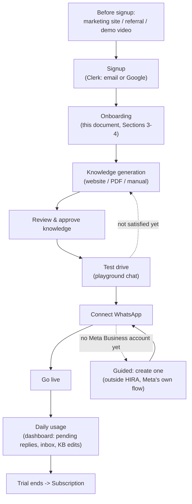
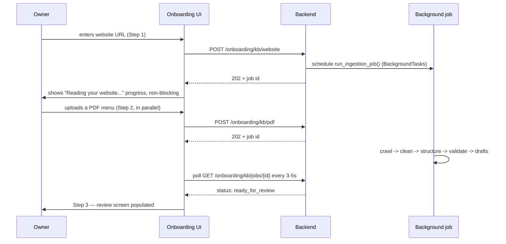
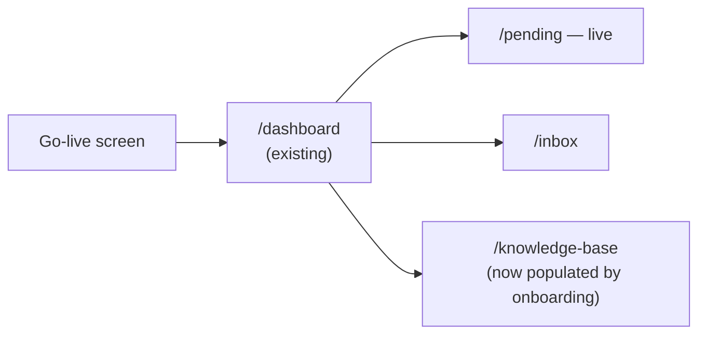

# HIRA Onboarding — User Flow & UX Design

**Status**: Design, not yet built. Companion to `ONBOARDING_ARCHITECTURE.md` (engineering) and `ONBOARDING_IMPLEMENTATION_PLAN.md` (milestones).
**Scope**: Phases 2, 4, 5 of the onboarding brief — the ideal onboarding experience, the full customer journey, and screen-by-screen UX.
**Design target**: a non-technical business owner goes from "never heard of HIRA" to "a real WhatsApp customer just got answered by their AI receptionist" in one sitting, conversationally, with almost no blank forms.

---

## 1. Design principles for this onboarding

1. **Conversational, not form-based.** One question (or one clear action) on screen at a time, like talking to an assistant setting itself up — not a 12-field form. This is explicitly requested in the brief and is also just better UX for a non-technical audience: one decision at a time reduces abandonment.
2. **Show, don't configure.** The owner never sees the words "chunking," "embedding," "vector," or "webhook." They see "teaching HIRA about your business" and "connecting your WhatsApp."
3. **Always a way forward.** No source of knowledge (crawl failed? no website? PDF is scanned?) is a dead end — manual text entry is always available as the fallback, never a hidden escape hatch.
4. **Prove it before it's live.** The owner talks to their own HIRA (the playground) before a single real customer can. Trust is earned before exposure, mirroring the product's own Assisted-Mode-first philosophy.
5. **Progress is resumable.** Nothing is lost if the owner closes the tab. `businesses.onboarding_status` (see architecture doc) means "continue where I left off" is the default, not a special case.
6. **Honest about time.** "Under 10 minutes" is the target for a business that already has a WhatsApp Business number ready to connect. A business starting with *no* Meta Business account at all is honestly a longer path, gated by Meta's own verification — the product says so, rather than overpromising and breaking trust at step 6 of 7.

---

## 2. The complete customer journey



Two loop-backs are deliberate, not omissions: **F→D** (a business owner who test-drives HIRA and finds a gap should be able to add more knowledge immediately, not restart onboarding), and **G→G1** (a business with no existing WhatsApp Business number needs to leave HIRA's flow briefly to create one at Meta — this is the one step genuinely outside our control, and the design should make that boundary honest and clearly signposted rather than pretend it doesn't exist).

---

## 3. The onboarding conversation, step by step

This is the "feel like ChatGPT" sequence the brief asks for — designed as a guided conversation, not a form, even though it's implemented as a sequence of screens (Section 5).

**Step 0 — Welcome**
> 👋 **Hi, I'm HIRA.** I'm going to learn about your business and start answering your customers on WhatsApp — usually in under 10 minutes. Let's start.
> [Get started]

**Step 1 — Business identity** (one screen, three fields, no scrolling)
> What's your business called? → *[Acme Dental Clinic]*
> What kind of business is it? → *[dropdown: the six existing target verticals, or "Other"]*
> Got a website? (optional — you can skip this) → *[https://...]*

This single screen produces `POST /api/v1/onboarding/business` and, if a website was given, immediately queues the website crawl in the background (Section 4) — **the knowledge-building clock starts now**, while the owner is still answering the next questions. This parallelization is what makes "under 10 minutes" realistic: crawling/extraction happens *during* the rest of onboarding, not as a step the owner sits and waits through.

**Step 2 — Add more knowledge (while the website crawl runs)**
> While I read your website, want to add anything else? Menus, price lists, brochures — drag them in.
> [Upload files]  [Type it in myself]  [Skip — website is enough]

**Step 3 — Review** (the trust checkpoint)
> Here's what I learned. Anything wrong or missing, just edit it.
> *(list of extracted title/content cards — see Section 5.3)*
> [Looks good — continue]

**Step 4 — Test drive**
> Try me. Ask a question a real customer might ask.
> *(chat interface, live against the just-approved knowledge)*
> [I'm happy with this — connect WhatsApp]  [Let me add more knowledge]

**Step 5 — Connect WhatsApp**
> Last step. Connect the WhatsApp number your customers already message.
> *(two paths — Section 4, WhatsApp connection)*

**Step 6 — Go live**
> 🎉 You're live. Message your own WhatsApp number now and watch HIRA answer.
> *(a real, satisfying "it actually works" moment, using the owner's own phone — no fake demo)*

---

## 4. Knowledge generation and WhatsApp connection — the two flows that need real design thought

### 4.1 Knowledge generation UX (ties to `ONBOARDING_ARCHITECTURE.md` §3)



**Why polling every 3–5s here, not the dashboard's 15s**: onboarding is a live, watched moment (the owner is looking at the screen waiting), unlike the Pending Replies dashboard which runs in the background of someone's day. A faster poll during an active wait feels responsive; the same interval on a background dashboard tab would just waste requests. Same underlying pattern (`use-pending.ts`), different interval.

**Progress messaging, not a spinner**: "Reading your website... found 6 pages... extracting hours, pricing, and policies..." — a business owner watching a plain spinner for 15 seconds reads as broken; watching it narrate what it's doing reads as intelligent. This is a genuinely cheap thing to build (the job row already tracks `pages_crawled`; adding a one-line "stage" string costs almost nothing) with an outsized trust payoff.

### 4.2 WhatsApp connection UX — the honest two-path design

This is the step where "zero technical knowledge" collides hardest with reality: connecting a WhatsApp Business number is Meta's process, not HIRA's, and Meta's own requirements vary by whether the owner already has things set up. The brief asks for magic; the honest design is to make the magic apply to the common case and be transparent about the uncommon one.

**Path A — Owner already has a Meta Business Manager + WhatsApp Business number** (the common case, and the one "under 10 minutes" targets):

- **Ideal state (v2, gated on Meta Tech Provider approval — see implementation plan)**: one button, **"Connect WhatsApp"**, opens Meta's Embedded Signup popup (a Facebook Login for Business flow). Owner logs into Facebook, picks their WhatsApp Business number, grants permission. HIRA receives a signup code, exchanges it server-side for a permanent token, and auto-subscribes the app to the account. **Zero copy-pasting, zero IDs, zero App Secrets shown to the owner.** This is genuinely under a minute.
- **Interim state (v1, ships without waiting on Meta's approval)**: a guided wizard, not a raw form — HIRA tells the owner exactly where to find each value inside Meta's own dashboard (with a screenshot/annotated link per field), and **validates each value live** as it's entered (a green check the moment the Phone Number ID + Access Token are confirmed against Meta's Graph API — see architecture doc §4.1) rather than only discovering a mistake after "Save." This is slower than Path A's ideal state (realistically 5–10 minutes of copy-pasting) but is dramatically better than today's reality (a developer manually editing `.env` and running a script), ships immediately, and doesn't block onboarding on an external approval timeline.

**Path B — Owner has no WhatsApp Business number / no Meta Business account at all:**
> This is the one part I can't do for you — WhatsApp requires you to verify your business with Meta directly. It usually takes 5–15 minutes if you have your business details handy. I'll walk you through exactly what to click.
> [Start Meta's setup →] *(deep link to Meta's own onboarding, opens in new tab)*
> Once you're done there, come back here and I'll finish connecting.

The design choice here is candor: rather than a progress bar that silently stalls on step 6, the product names the external dependency, gives a realistic time estimate, and hands the owner off with a clear "come back when done" — treating them as a capable adult, not hiding the seam.

---

## 5. Screen-by-screen wireframes

### 5.1 Welcome

```
┌─────────────────────────────────────────────┐
│                                               │
│                  ✦ HIRA                      │
│                                               │
│      👋  Hi, I'm HIRA.                       │
│                                               │
│      I'm going to learn about your           │
│      business and start answering your       │
│      customers on WhatsApp — usually in      │
│      under 10 minutes.                       │
│                                               │
│           [ Get started → ]                  │
│                                               │
└─────────────────────────────────────────────┘
```

### 5.2 Business information

```
┌─────────────────────────────────────────────┐
│  ● ○ ○ ○ ○ ○           Step 1 of 6           │
├─────────────────────────────────────────────┤
│                                               │
│  What's your business called?                │
│  ┌─────────────────────────────────────────┐ │
│  │ Acme Dental Clinic                       │ │
│  └─────────────────────────────────────────┘ │
│                                               │
│  What kind of business is it?                │
│  ┌─────────────────────────────────────────┐ │
│  │ Dental Clinic                    ▾       │ │
│  └─────────────────────────────────────────┘ │
│                                               │
│  Got a website? (optional)                   │
│  ┌─────────────────────────────────────────┐ │
│  │ https://acmedental.com                   │ │
│  └─────────────────────────────────────────┘ │
│                                               │
│                            [ Continue → ]    │
└─────────────────────────────────────────────┘
```

### 5.3 Knowledge review (the trust checkpoint — most important screen in the flow)

```
┌─────────────────────────────────────────────┐
│  ● ● ○ ○ ○ ○           Step 3 of 6           │
├─────────────────────────────────────────────┤
│  Here's what I learned about Acme Dental.    │
│  Anything wrong? Just edit it.               │
│                                               │
│  ┌─────────────────────────────────────────┐ │
│  │ Opening Hours                       ✎ ✕ │ │
│  │ Mon–Fri 9am–6pm, Sat 10am–2pm            │ │
│  │ from acmedental.com/contact              │ │
│  └─────────────────────────────────────────┘ │
│  ┌─────────────────────────────────────────┐ │
│  │ ⚠ Teeth Whitening Price          ✎ ✕    │ │
│  │ "Starting from 199" (no currency found)  │ │
│  │ from menu-2024.pdf, page 2                │ │
│  └─────────────────────────────────────────┘ │
│  ┌─────────────────────────────────────────┐ │
│  │ Cancellation Policy                 ✎ ✕ │ │
│  │ 24-hour notice required for refund       │ │
│  │ from acmedental.com/policies             │ │
│  └─────────────────────────────────────────┘ │
│                                               │
│  [ + Add more knowledge ]                    │
│                                               │
│              [ Looks good — continue → ]     │
└─────────────────────────────────────────────┘
```

The ⚠ marker is the `confidence='low'` flag from the architecture doc's validation pass — it draws the owner's eye to the one entry that actually needs a second look (missing currency), rather than making all 12 entries look equally suspect. This is the single highest-leverage UX detail for keeping review fast *and* meaningful, addressed directly in the critique (Section 6).

### 5.4 Test drive

```
┌─────────────────────────────────────────────┐
│  ● ● ● ● ○ ○           Step 4 of 6           │
├─────────────────────────────────────────────┤
│  Try me. Ask what a real customer might.     │
│                                               │
│  ┌─────────────────────────────────────────┐ │
│  │  You: Are you open on Sunday?            │ │
│  │                                           │ │
│  │  HIRA: We're closed Sundays — open        │ │
│  │  Mon–Fri 9am–6pm and Sat 10am–2pm.        │ │
│  │  Would you like to book for Saturday?     │ │
│  └─────────────────────────────────────────┘ │
│  ┌─────────────────────────────────────────┐ │
│  │ Type a message...                    ➤   │ │
│  └─────────────────────────────────────────┘ │
│                                               │
│  [ Add more knowledge ]  [ Connect WhatsApp →]│
└─────────────────────────────────────────────┘
```

### 5.5 Connect WhatsApp

```
┌─────────────────────────────────────────────┐
│  ● ● ● ● ● ○           Step 5 of 6           │
├─────────────────────────────────────────────┤
│  Connect the WhatsApp number your            │
│  customers already message.                  │
│                                               │
│      ┌───────────────────────────────┐       │
│      │   📱  Connect WhatsApp         │       │
│      │   (via Meta — takes ~1 min)    │       │
│      └───────────────────────────────┘       │
│                                               │
│  Don't have a WhatsApp Business number yet?  │
│  → I'll walk you through Meta's setup        │
│                                               │
└─────────────────────────────────────────────┘
```

### 5.6 Success

```
┌─────────────────────────────────────────────┐
│                                               │
│              🎉  You're live!                │
│                                               │
│   Message your own WhatsApp number right     │
│   now and watch HIRA answer.                 │
│                                               │
│         +1 (555) 019-2934                    │
│                                               │
│           [ Go to my dashboard → ]           │
│                                               │
└─────────────────────────────────────────────┘
```

### 5.7 Dashboard (existing — post-onboarding landing, unchanged from `ARCHITECTURE.md` §4)



The dashboard itself is not redesigned here — onboarding's job is to end with a dashboard that already has real data in it (a live WhatsApp connection, an approved KB, a first conversation) rather than the empty-state placeholders a brand-new business sees today.

---

## 6. Daily usage and subscription (journey tail)

**Daily usage**: unchanged from the existing product — Pending Replies (live today), Inbox, Knowledge Base (now editable post-onboarding, not just viewable), Settings. Onboarding's contribution here is simply that these screens have real content from minute one instead of "coming soon" placeholders.

**Subscription**: HIRA has no billing today (`ARCHITECTURE.md` confirms zero Stripe/payment integration exists). Onboarding should not block on billing being built — consistent with the product's own sequencing principle (prove value before monetizing). The only onboarding-relevant hook is `businesses.trial_ends_at` (Section 2.1 of the architecture doc), set at go-live to today + N days, so a future billing feature has something to key off without onboarding needing to know anything about plans or pricing yet.
