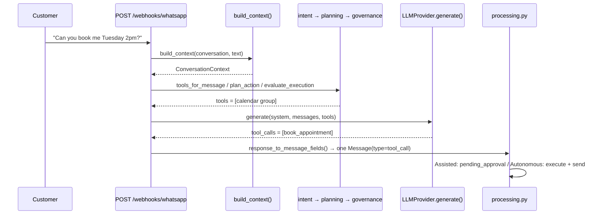
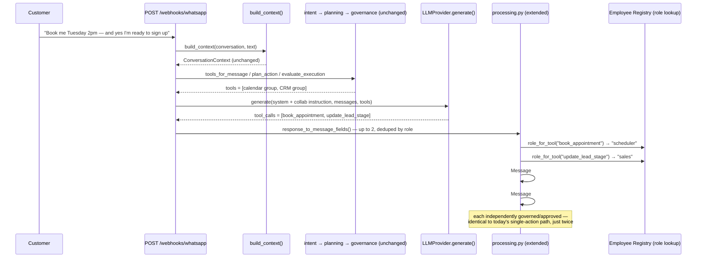
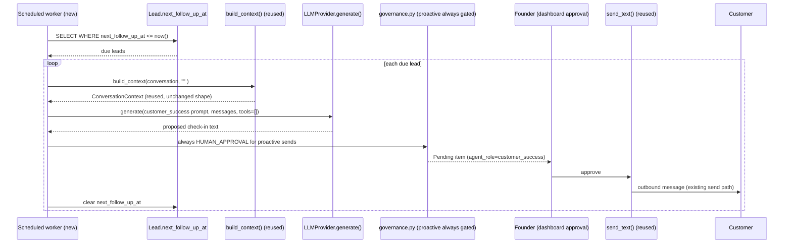

# Multi-Agent Collaboration Architecture (Sprint 74 — Design Only)

Status: **Proposed** — not accepted, not implemented. See `DECISIONS.md` DEC-043.
Scope: Phase 3 ("AI Business Operating System"), Sprint 74. This document is the design-only deliverable for that sprint — no code was written to produce it. Every claim about "today" below is a verified fact from reading `backend/app/ai/` directly (2026-07-26), not an assumption; every claim about "proposed" is explicitly marked as such.

Related: `ARCHITECTURE.md`, `LLM_ORCHESTRATION.md`, `API.md`, `.claude/PROJECT_CONTEXT.md`, `.claude/DECISIONS.md` (DEC-021, DEC-028, DEC-032, DEC-033, DEC-034, DEC-037).

---

## 0. Current-State Audit

### 0.1 Existing AI "agents"

**There is exactly one.** Not five, not two — one undifferentiated persona, referred to in the product's own marketing as "The Receptionist," with zero code-level representation as a distinct role. `app/ai/prompts.py` defines exactly two system prompts:

- `_BASE_SYSTEM_PROMPT` (`SYSTEM_PROMPT_VERSION = "v6"`) — the real, knowledge-grounded reply prompt.
- `_DEMO_SYSTEM_PROMPT` (`DEMO_SYSTEM_PROMPT_VERSION = "demo-v1"`) — used only when a business has uploaded no Knowledge Base yet.

Neither prompt speaks as a named role. Both are assembled by `app/ai/orchestrator.py::generate_reply()`, the single entry point every customer turn — WhatsApp or Demo Chat — passes through.

This is not an oversight; it's a stated, deliberate scope boundary. `.claude/PROJECT_CONTEXT.md`:

> "Long-term vision: an **AI Business Operating System** where businesses can 'hire' AI employees across functions (the Receptionist, sales follow-up, support, and others yet to be validated). The current focus remains narrow and deliberate — becoming the best AI employee first, in the Receptionist role. **Nothing beyond the Receptionist exists in the codebase today; the wider vision is direction, not a committed build plan.**"

Sprint 74 is the sprint that starts turning that direction into a committed plan — this document is that plan.

### 0.2 Responsibilities (what the one existing agent actually does)

The Receptionist prompt + tool set covers, today:
- Grounded Q&A (pgvector KB retrieval, injected into every prompt)
- Calendar actions: `check_availability` (read-only), `book_appointment`, `reschedule_appointment`, `cancel_appointment` (`app/ai/tools.py`)
- CRM actions: `create_lead`, `update_lead_stage`, `set_lead_follow_up` (`app/ai/lead_tools.py`)
- Conversation-summary memory across turns (`app/ai/memory.py`)
- Implicit triage: a deterministic (non-LLM) three-stage pipeline — `intent.py` → `planning.py` → `governance.py` — narrows which tools are even offered to the LLM call before it happens (detailed in §0.5).

### 0.3 Overlap

**Sales vs. CRM is the overlap the requested role list itself creates.** The codebase's own `intent.py` Stage 2 already groups the lead-management tools (`create_lead`/`update_lead_stage`/`set_lead_follow_up`) under one label — informally, "CRM." "Sales" as a distinct persona would operate on **the exact same tool set** — there is no tool-level granularity today that separates "log a lead in the system" (CRM data hygiene) from "qualify and advance a prospect" (Sales conversation). Building both as literal, separate conversational personas today would mean two agents fighting over identical write access to the same `Lead` row with no way to tell them apart in the schema.

**Recommendation** (a judgment call, flagged here rather than made silently): treat **CRM as the shared data/audit substrate** every role reads and writes through (`Lead`, `LeadEvent`, `Customer`, `ConversationContext.lead`) — not a sixth conversational voice. **Sales** is the persona that principally exercises that substrate in conversation (qualifying questions, stage advancement, mentioning packages/pricing from the KB). If a business genuinely wants CRM-hygiene actions to feel distinct from Sales conversation later, that's a tool-schema-splitting exercise (dividing `lead_tools.py` into finer domains) — a real, deferrable future step, not something to force in Sprint 74.

### 0.4 Missing collaboration

- **No role attribution anywhere.** `Message.ai_meta` (JSONB) carries `model`/`prompt_version`/`retrieved_count`/`tool_name` — never *who* (which function/persona) proposed an action. A founder looking at the Pending queue today cannot tell "the AI wants to book an appointment" from "the AI wants to update a lead" without reading the raw tool name.
- **Hard single-action-per-turn ceiling — and it's artificial.** `app/ai/tools.py`, `response_to_message_fields()`:
  ```python
  if response.tool_calls:
      tool_call = response.tool_calls[0]  # MVP: one proposed action per turn
  ```
  This is the *only* chokepoint (all three callers — `processing.py`, `playground.py`, `replies.py::regenerate_draft` — go through it). Critically: `LLMResponse.tool_calls` is **already typed as a list** (`app/ai/llm/base.py`) — the underlying model/provider APIs already support proposing multiple tool calls in one response. The limit is a downstream simplification HIRA imposed, not a capability ceiling the model has. This was already observed live and documented (`documentation/API.md`): a real customer message once produced both `create_lead` and `update_lead_stage` in one model response, and only the first was ever surfaced. `.claude/PROGRESS.md` flags this as worth revisiting.
- **No proactive/scheduled outbound capability at all.** Every outbound message today is a *reply* — triggered by an inbound webhook or a Demo Chat turn. There is no cron/worker/scheduled-send mechanism anywhere in the codebase. This matters specifically for **Customer Success**, which is fundamentally a proactive function (post-appointment check-ins, retention nudges) — it cannot be built as "just another tool" inside the existing reactive turn; it needs a new triggering mechanism entirely (see §1.4, §3.5).
- **`governance.py` already anticipates this gap and has been waiting for it.** Its policy registry (`app/ai/governance.py`) already declares policies for actions with no tool or Planning profile yet — `invoice_send`, `refund`, `payment`, `delete_customer`, `whatsapp_broadcast`, `update_business_data`, `crm_lead_delete` — "declared here so the policy is already in place the moment the capability is built." This is the single strongest piece of existing evidence that extending the current architecture, not replacing it, is the right posture for Sprint 74.

### 0.5 Shared state, shared memory, event flow (as they exist today)

**Shared state — `ConversationContext`** (`app/ai/context.py`), assembled fresh every turn by `build_context()`:
```
ConversationContext:
  business, customer, lead, upcoming_appointments,
  retrieved_kb, has_knowledge, summary, history
```
This is already the one unified object every prompt-builder consumes. It is read-only except that generating a summary may write `Conversation.summary`/`summary_message_count` as a side effect.

**Shared memory — `app/ai/memory.py`**, the only thing the codebase itself calls "memory": a rolling summary of everything older than the last `HISTORY_LIMIT` (20) messages, regenerated only when the raw window has advanced, stored on `Conversation.summary`. Strictly **per-conversation** — there is one `Conversation` row per `(business, customer)` pair, created lazily, so memory is effectively per-customer-per-business in practice, but there is no cross-conversation aggregation and no dedicated "customer profile" memory object separate from the relational rows themselves.

**Event flow — the existing deterministic triage pipeline** (the part of today's system closest, in spirit, to what "orchestration between employees" needs):
```
user_text
  → intent.py    Stage 1: CONVERSATION | CAPABILITY | KNOWLEDGE | ACTION
                 Stage 2 (if ACTION): narrow to a tool-schema group — calendar | CRM
  → planning.py  deterministic readiness check (regex-based) — is there enough
                 information in the message to act, or does it need clarification?
  → governance.py policy lookup by action name — EXECUTE_NOW | CONFIRM | HUMAN_APPROVAL | BLOCKED
  → (single LLM call, tools = whatever survived the above)
  → at most one bounded follow-up call, only for check_availability
  → response_to_message_fields(): tool_calls[0] only → one Message row
  → Assisted Mode: pending_approval : Autonomous Mode: execute + send immediately
```
No loop exists anywhere in this chain — deliberately. `orchestrator.py`'s own docstring: *"bounded by construction, not a loop, so there's no runaway risk."* This is a standing, explicit anti-runaway invariant, reasoned about in three separate places in the codebase (module docstring, inline comment, `.claude/PROGRESS.md`), and it is exactly the kind of constraint CLAUDE.md §11 has in mind: *"Don't add agentic complexity (multi-agent, long chains, autonomous loops) unless a simpler single-call or deterministic approach has been ruled out first."* Every design choice below is made in that light — this document does not propose removing the no-loop invariant; it proposes a small, capped relaxation of one specific downstream restriction (§1.3), justified by the fact noted above that the restriction wasn't load-bearing for runaway-prevention in the first place (the bound was always "one," never "unbounded" — this proposal changes "one" to a small fixed "two," not to "unbounded").

**Documentation gap, noted for honesty**: the intent/planning/governance work (informally "Sprint 55–62.7") has no corresponding `DECISIONS.md` entries — a known, already-flagged gap in `.claude/PROGRESS.md`, not something newly discovered here. This document doesn't attempt to backfill that history; it treats the code's own docstrings (quoted above) as the authoritative record of that layer's reasoning.

---

## 1. Architecture

### 1.1 Design stance

**Reject**: a general multi-agent framework where named agents converse with each other in a loop (classic AutoGen/CrewAI-style orchestration) to decide what to do. This would mean unbounded LLM calls per customer turn, unpredictable latency/cost, and a direct contradiction of the standing no-runaway-loop invariant (§0.5) with no corresponding customer-experience benefit identified in this audit.

**Adopt**: an **Employee Registry over existing infrastructure** — roles are a thin, named layer over what already exists (tool groups, intent categories, governance policies), not a new parallel agent runtime. Two collaboration mechanisms, chosen because each is the *minimal* extension that closes a real, audited gap:

1. **In-turn, same-call collaboration** (no extra LLM call) — for the common case of one customer message implying two structured actions from different domains (e.g., book an appointment *and* advance a lead stage). Closes the gap in §0.4 (single-action ceiling) by relaxing exactly the one artificial chokepoint, capped at 2.
2. **Out-of-turn, scheduled collaboration** (a new, separate triggering path) — for Customer Success's proactive function, which cannot exist inside a reactive turn at all. Closes the gap in §0.4 (no proactive send capability).

No third mechanism (e.g., a real agent-to-agent "handoff" LLM call) is proposed for Phase 1–3, because the audit found no gap that specifically requires it — see §7 for when it might become warranted.

### 1.2 The Employee Registry

A new, small, code-level (not database) registry — analogous in spirit to the existing `LLMProvider`/`CalendarProvider` registries (DEC-021/DEC-028): a plain mapping, not a class hierarchy, since roles here are configuration (which tools, which prompt fragment, which governance action-prefix), not polymorphic behavior.

```
AGENT_ROLES = {
    "receptionist": {
        "owns_intent_categories": ["CONVERSATION", "CAPABILITY", "KNOWLEDGE"],
        "tool_names": [],
        "prompt_fragment": <triage / general Q&A guidance>,
    },
    "scheduler": {
        "owns_intent_categories": ["ACTION"],
        "tool_names": ["check_availability", "book_appointment",
                        "reschedule_appointment", "cancel_appointment"],
        "prompt_fragment": <booking guidance, already exists in _BASE_SYSTEM_PROMPT>,
    },
    "sales": {
        "owns_intent_categories": ["ACTION"],
        "tool_names": ["create_lead", "update_lead_stage", "set_lead_follow_up"],
        "prompt_fragment": <qualifying-question / stage-advancement guidance,
                            already partially exists as CRM tool-usage guidance>,
    },
    "customer_success": {
        "owns_intent_categories": [],   # not turn-triggered — see §1.4
        "tool_names": [],               # reuses Sales' set for now (no new tools)
        "prompt_fragment": <check-in / retention tone, new>,
    },
}
```

`"crm"` is deliberately **not** a key in this registry — per §0.3, it is the substrate (`Lead`/`LeadEvent`/`Customer`), addressed structurally, not as a persona. If real usage later shows a genuine need to separate CRM data-hygiene actions from Sales conversation, that's a registry entry split, not a rewrite.

Every existing extension seam is reused unchanged:
- New tool → still just added to `tools.py`/`lead_tools.py` and now also listed under one role's `tool_names`.
- New LLM provider → `LLMProvider` registry, completely untouched by this proposal.
- New governance policy → `governance.py`'s existing table, now additionally keyed to a role (for the dashboard to show "which employee needs this approved").

### 1.3 In-turn collaboration (no extra LLM call)

1. `intent.py`/`planning.py`/`governance.py` run exactly as they do today, **unchanged** — they still decide *whether* any tools are offered and *which* governance tier applies.
2. The system prompt (built by `build_system_prompt`) gains one new, small instruction: the model **may** propose up to 2 tool calls in a single response, **only** when they come from different domains (never two calendar actions, never two CRM actions) and the message genuinely implies both. Conservative by default — the existing prompt's own restraint-oriented guidance (already present for booking/CRM tool usage) is extended, not replaced.
3. `response_to_message_fields()` changes from `tool_calls[0]` only to: take up to the first 2 `tool_calls`, **deduplicated by owning role** (if the model somehow proposes two from the same role, only the first is kept — preserves the existing single-action-per-domain safety property exactly). Each surviving tool call becomes its **own** `Message` row (not one row with two actions crammed in) — this is the key design choice that makes the rest of the system (Pending queue, approval gate, WhatsApp send, escalation-on-failure) work **completely unchanged**: every existing code path already operates on "one `Message` row is one action."
4. Each `Message.ai_meta` gains one new key: `"agent_role"` (e.g. `"scheduler"`, `"sales"`) — looked up from the static registry by `tool_name`, zero new logic, zero new LLM involvement.
5. Governance/approval-gating applies **per Message, exactly as today** — two proposed actions in one turn means two independently-approvable Pending items (a founder can approve the booking and reject the lead update, or vice versa) — arguably a strict *improvement* in auditability and control over today's silent "only the first ever survives" behavior.
6. **Customer-facing text stays singular.** The customer never sees "Sales Agent: ..." / "Scheduler: ..." as separate WhatsApp messages — only one text reply is ever sent per turn (unchanged); tool-call actions are separate, mostly-silent structured actions exactly as they are today (a tool call's `body` is already a human-readable confirmation string per DEC-032, not additional chat noise).

### 1.4 Out-of-turn collaboration — Customer Success

Not a turn extension. A **new, separate entry point**, `generate_followup_message()` (proposed name), triggered by a new scheduled worker, not a webhook:

- Trigger field: `Lead.next_follow_up_at` — **already exists**, already nullable, already exactly the "when should someone follow up" signal (currently read only by humans via the dashboard). No new column needed to trigger a check.
- Worker: a periodic scan (`WHERE next_follow_up_at <= now()`), one business/lead at a time, reusing `build_context()`/`build_system_prompt()` machinery with a Customer-Success-flavored prompt fragment, then the **existing** `send_text()` pipeline (`app/services/messaging.py`) — no new send mechanism.
- Governance: proactive sends are **always** approval-gated in Phase 1 regardless of `business.mode` (see §5, Risk 4) — a stricter default than the existing Autonomous-Mode auto-send, because this is HIRA *initiating* contact, not replying to one, a materially different trust boundary.
- After a successful send, `next_follow_up_at` is cleared (existing nullable field) — the Message row itself (already a permanent, auditable record) is the history; no new table is strictly required for Phase 1 (see §3.5 for the retry/reliability trade-off this accepts).

---

## 2. Sequence Diagrams

### 2.1 Baseline — today, one action per turn (unchanged by this proposal)



### 2.2 Proposed — in-turn collaboration, two roles, one LLM call



### 2.3 Proposed — out-of-turn collaboration, Customer Success proactive outreach



---

## 3. Required Backend Changes

All items below are described, not implemented, per this sprint's scope.

1. **`app/ai/roles.py` (new)** — the static Employee Registry (§1.2): role name → owned intent categories, owned tool names, prompt fragment, default governance tier. Pure data + one lookup function (`role_for_tool(name) -> str`). No new abstraction layer, no base class.
2. **`app/ai/prompts.py`** — extend `_BASE_SYSTEM_PROMPT` (bump to a new `SYSTEM_PROMPT_VERSION`) with the bounded "you may propose up to 2 actions from different domains" instruction; compose role `prompt_fragment`s from the registry rather than hardcoding the calendar/CRM guidance blocks inline (a refactor of already-conditional sections, not new sections).
3. **`app/ai/tools.py::response_to_message_fields()`** — the one chokepoint (§0.4) changes from `tool_calls[0]` to `tool_calls[:2]`, deduplicated by role via the new registry, each producing its own `(type, body, ai_meta)` tuple instead of one. Callers (`processing.py`, `playground.py`, `replies.py`) adapt to receive a **list** of field-tuples (length 1 today in the common case, up to 2 when collaboration fires) instead of a single tuple — a signature change with exactly three call sites, all internal.
4. **`app/ai/processing.py` / `app/ai/playground.py` / `app/services/replies.py`** — persist one `Message` row per surviving tool call (not per turn) when the list has more than one entry; each stamped with `ai_meta["agent_role"]`. Assisted/Autonomous branching and the 24h-window/credential checks already operate per-Message today — no change to that logic, just more Message rows flowing through it in the collaboration case.
5. **`app/ai/governance.py`** — extend the existing policy table with a `agent_role` column-equivalent per action (already action-name-keyed, so this is additive metadata, not a new table) so the dashboard/approval UI can label *which employee* is asking. Add a new policy tier or reuse `HUMAN_APPROVAL` (recommend reuse — no new tier needed) for proactive Customer Success sends, forced regardless of `business.mode` (§1.4).
6. **New: `app/workers/followups.py` (or `scripts/`, matching existing script conventions)** — the scheduled worker for §1.4. Needs a real scheduling mechanism decision (Railway Cron, a simple polling loop in a long-running process, or an external scheduler) — **explicitly not decided in this document**; flagged as an open question for whoever picks up Phase 4 (§7), since it's an infrastructure choice orthogonal to the AI design itself.
7. **New: `app/ai/followup.py` (or extend `orchestrator.py`)** — `generate_followup_message()`, reusing `build_context()`/`build_system_prompt()` with the `customer_success` role's prompt fragment; no tools in Phase 1 (text-only check-ins), tool access deferred until a real need is observed.
8. **Migration — `Business.enabled_agent_roles`** (new column, `String`, comma-separated, mirroring the just-established `founder_clerk_user_ids` convention) — lets a business opt out of roles that don't fit them (a dental clinic may not want proactive Customer Success outreach; a real estate agency may not want Scheduler at all). Default: all roles except `customer_success` enabled (proactive send is opt-in, not opt-out, given it's the highest-trust-boundary addition — see Risk 4).
9. **No migration needed** for role attribution itself (`ai_meta.agent_role` — existing JSONB) or for the in-turn collaboration mechanism (existing `Message` table, existing columns, just more rows).
10. **Documentation debt to close alongside implementation** (not this document, but flagged so it isn't silently repeated): back-fill or at minimum cross-reference the missing `DECISIONS.md` entries for `intent.py`/`planning.py`/`governance.py` (§0.5) when Phase 1 lands, so the next design effort doesn't hit the same gap.

---

## 4. Required Frontend Changes

1. **Inbox / Pending queue** — a small role badge per message/pending item (e.g., "Scheduler," "Sales," "Customer Success"), sourced directly from `ai_meta.agent_role`. Additive to existing message rendering — no redesign of the Inbox or Pending pages themselves.
2. **Settings page** — a new card, styled like the existing "AI Reply Mode" card (`app/(dashboard)/settings/page.tsx`), listing the 4 conversational roles (Receptionist is not toggleable — it's the base persona) with on/off switches backed by `Business.enabled_agent_roles`. Customer Success defaults off with an explanatory line about proactive outreach.
3. **Demo Chat** — since it shares the exact same `generate_reply()` pipeline (§0.5, DEC-037), it gets multi-role behavior for free once the backend ships; the frontend needs only to render role badges on tool-outcome bubbles the same way the Inbox does (already returns a `tool_outcome` object per DEC-037 — extend it with `agent_role`). This is genuinely useful as the founder's own way to *see* collaboration happen safely before any customer does.
4. **Founder Operations Dashboard (Sprint 73)** — extend the existing `ai_activity` aggregate (`app/services/founder_ops.py`) with a `by_role` breakdown once role attribution exists — a natural, low-risk follow-on to infrastructure that already exists, not a new page.
5. **No changes required** to the core chat/message UI shape, the approval/reject/regenerate actions, or WhatsApp-facing behavior — the customer-visible experience is unchanged by design (§1.3, point 6).

---

## 5. Risks

1. **Cost/latency** — negligible for in-turn collaboration (no extra LLM call, §1.3); real for proactive Customer Success (one full LLM call per due follow-up, on a schedule, independent of customer-initiated volume). Mitigate: rate/volume caps on the worker, monitored via existing Sentry integration (Sprint 70).
2. **Misattributed or overreaching collaboration** — the model proposes an unwarranted second action (e.g., inventing a lead-stage change from a booking-only message). Mitigate: conservative prompt wording (extend, don't loosen, the existing restraint guidance already present for both tool groups), Assisted-Mode approval gate as the existing safety net, and the dedup-by-role rule preventing any runaway even in the worst case (hard cap stays 2, not N).
3. **Reintroducing the loop risk the codebase deliberately avoided** — the explicit reason this document caps in-turn collaboration at exactly 2 and adds no second LLM call: the existing no-loop invariant (§0.5) is preserved exactly, not weakened. Any future proposal to raise the cap or add a real multi-call handoff must re-justify against CLAUDE.md §11 on its own merits, not inherit this document's approval by default.
4. **Proactive messaging is a new trust boundary** — HIRA initiating contact (Customer Success) is categorically different from HIRA replying (everything else). A wrong proactive message reaches a customer who didn't ask anything. Mitigate: always-gated (§1.4), opt-in per business (§3, item 8), Phase 4 only (§7) — not shipped alongside the lower-risk in-turn work.
5. **Customer confusion from a disjointed voice** — mitigated structurally, not just by prompt wording: the customer-facing text channel stays singular by construction (§1.3, point 6); multiple "employees" are a backend/dashboard concept only.
6. **CRM/Sales overlap causing confusing dashboard semantics** — addressed by the design decision in §0.3/§1.2 (CRM is substrate, not a persona) rather than left as an open risk; flagged here so the decision doesn't go unnoticed.
7. **Vertical-agnostic principle** (`ARCHITECTURE.md`: *"no vertical-specific logic hard-coded"*) — role prompt fragments must describe **function** (advance a pipeline stage, ask a qualifying question) not **industry-specific scripts**. Mitigate: same KB-grounding discipline already used for the base prompt — verticals differ in *content* (via the Knowledge Base), not in *role logic*.
8. **Test combinatorics** — more role/tool-call permutations to cover. Mitigate: `MockProvider`'s existing `fixed_tool_calls` injection point extends naturally to a list of 2 without new test infrastructure.
9. **Worker scheduling mechanism is an open infrastructure question** (§3, item 6) — explicitly not resolved here; a real risk if left unresolved when Phase 4 begins, not a risk to Phase 1–3.

---

## 6. Migration Strategy

- **Reversibility by construction**: Phase 1 (attribution) touches no schema. Phase 2 (in-turn collaboration) touches no schema and is gated by the prompt instruction alone — removing that one instruction line reverts to today's exact single-action behavior with zero data migration, because every persisted `Message` shape is unchanged (just more rows, each individually valid on its own under the current schema). Phase 4 (Customer Success) is additive-only (`Business.enabled_agent_roles`, default-off).
- **Per-business rollout**, mirroring the existing `business.mode` and (once built) `enabled_agent_roles` pattern — no global cutover. A business can be on in-turn collaboration while another isn't, simultaneously, with no code branching beyond a config read.
- **No backfill required** — `ai_meta.agent_role` is only ever read for new Messages going forward; historical Messages simply have no `agent_role` key, which every consumer (Inbox badge, Founder Ops breakdown) must already treat as "unattributed" rather than erroring — a normal optional-field pattern, not a migration.
- **Rollback trigger criteria** (to decide *before* shipping, not after): if Assisted-Mode approval-rejection rate on collaboration-produced Messages meaningfully exceeds the rejection rate on single-action Messages, that's the signal to pause collaboration for a business (or globally) and revisit prompt guidance — a concrete, measurable criterion using data the Pending-queue already produces today.

---

## 7. Phased Implementation Plan

| Phase | Scope | Depends on | Effort | Risk |
|---|---|---|---|---|
| **0** | This document | — | — | — |
| **1** | Role attribution only: Employee Registry (`roles.py`), `ai_meta.agent_role` tagging on existing single-action Messages (Scheduler/Sales labels on what already happens today) — **zero behavior change** | Phase 0 | S | Very low — pure observability |
| **2** | In-turn collaboration: prompt instruction + `response_to_message_fields()` → up to 2 actions, dashboard role badges (Inbox/Pending) | Phase 1 | M | Low–Medium (Risks 1–3, 5) |
| **3** | Demo Chat + Founder Ops surfacing of role data (frontend-only, both pipelines already produce the data once Phase 2 ships) | Phase 2 | S | Low |
| **4** | Customer Success: worker + scheduling-mechanism decision + `generate_followup_message()` + `enabled_agent_roles` migration, opt-in, always-approval-gated | Phase 1 (registry) — independent of Phases 2–3 | L | Medium–High (Risk 4, 9) |
| **5** | Reassessment: real usage data on collaboration-rejection rate (§6) and on whether 2 is ever an observed binding constraint; only then consider raising the cap, adding true agent-to-agent handoff calls, or expanding Customer Success beyond text-only | Phases 2 & 4 | — | Gate, not a build |

Phase 4 does not block on Phases 2–3 and could ship first if Customer Success is judged higher-value — the only hard dependency is Phase 1's registry existing, since both branches read from it.

---

## Open Questions for the Founder

1. Does the 5-role list (Receptionist/Sales/Scheduler/CRM/Customer Success) stand as-is, or is the CRM-as-substrate recommendation (§0.3/§1.2) accepted — should "CRM" not appear as a toggle in Settings at all?
2. Scheduling mechanism for Phase 4's worker (§3, item 6) — Railway Cron, a long-running poller, or something else — is a real infrastructure decision, not an AI-design one, and needs a founder call before Phase 4 starts.
3. Is a cap of 2 in-turn actions the right starting number, or should Phase 2 start even more conservatively at "still 1, but now labeled by role" (i.e., ship Phase 1's attribution and *stop*, deferring the multi-action relaxation to its own later decision)?
